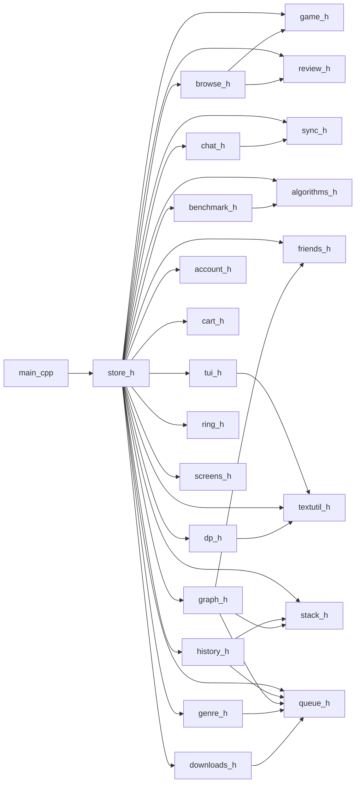

# Documentation

Generated by `tools/docgen.py`. **Do not edit this file by hand**: change the comment block above the function in the source and run the tool again.

- Functions and methods documented: **333** in **23** files
- Every function has a comment block in the source (`What`, `Returns`, `Used by`) and every file starts with its own function index.
- Class methods listed as `Class::method`. Constructors, destructors and operators are included.

## Contents

1. [Master index](#master-index)
2. [Modules and lessons](#modules-and-lessons)
3. [How the files include each other](#how-the-files-include-each-other)
4. [Menu map: what calls what](#menu-map-what-calls-what)
5. [Reference by file](#reference-by-file)

## Master index

All functions and methods in alphabetical order. The link opens the file at the line of the function.

| Function | Kind | Where | One line |
| :--- | :--- | :--- | :--- |
| [`accBstFind`](#account-h-accbstfind-178) | function | [account.h:178](../account.h#L178) | Looks for a lowercase username in the account tree |
| [`accBstFree`](#account-h-accbstfree-192) | function | [account.h:192](../account.h#L192) | Deletes the nodes of the account tree (post-order: children first) |
| [`accBstInsert`](#account-h-accbstinsert-160) | function | [account.h:160](../account.h#L160) | Adds an account to the binary search tree that is keyed by the lowercase username, so a login can find it quickly |
| [`acceptRequest`](#friends-h-acceptrequest-109) | function | [friends.h:109](../friends.h#L109) | Accepts a request that another user sent to me |
| [`accToLower`](#account-h-acctolower-114) | function | [account.h:114](../account.h#L114) | Makes a copy of the text in lowercase so usernames are compared without caring about capital letters |
| [`addFunds`](#account-h-addfunds-329) | function | [account.h:329](../account.h#L329) | Adds money (in cents) to the wallet |
| [`addOwnedGame`](#account-h-addownedgame-304) | function | [account.h:304](../account.h#L304) | Appends a game id to the owned list of an account (the checkout calls this for every bought game) |
| [`addToCart`](#cart-h-addtocart-48) | function | [cart.h:48](../cart.h#L48) | Appends a game id at the end of the cart list |
| [`addWish`](#account-h-addwish-368) | function | [account.h:368](../account.h#L368) | Adds a game id to the wishlist (linked list) |
| [`areFriends`](#friends-h-arefriends-71) | function | [friends.h:71](../friends.h#L71) | Tells if two users are friends (an accepted record exists) |
| [`ArrayStack::ArrayStack`](#stack-h-arraystack-arraystack-75) | constructor | [stack.h:75](../stack.h#L75) | Creates an empty ArrayStack with the given capacity or size (a value that is not positive falls back to 8) |
| [`ArrayStack::ArrayStack`](#stack-h-arraystack-arraystack-91) | constructor | [stack.h:91](../stack.h#L91) | Copy constructor: makes a separate copy of all items (part of the rule of three) |
| [`ArrayStack::at`](#stack-h-arraystack-at-153) | method | [stack.h:153](../stack.h#L153) | The item at a position counted from the bottom or the front, without removing it |
| [`ArrayStack::clear`](#stack-h-arraystack-clear-176) | method | [stack.h:176](../stack.h#L176) | Removes all items |
| [`ArrayStack::empty`](#stack-h-arraystack-empty-165) | method | [stack.h:165](../stack.h#L165) | Tells if there are no items |
| [`ArrayStack::grow`](#stack-h-arraystack-grow-60) | method | [stack.h:60](../stack.h#L60) | Doubles the array: copies the items into a bigger array and frees the old one |
| [`ArrayStack::operator=`](#stack-h-arraystack-operator-101) | operator | [stack.h:101](../stack.h#L101) | Copy assignment: replaces the items with a copy of another ArrayStack |
| [`ArrayStack::peek`](#stack-h-arraystack-peek-141) | method | [stack.h:141](../stack.h#L141) | Looks at the front or top item without removing it |
| [`ArrayStack::pop`](#stack-h-arraystack-pop-130) | method | [stack.h:130](../stack.h#L130) | Removes the top item and gives it back through the parameter |
| [`ArrayStack::push`](#stack-h-arraystack-push-119) | method | [stack.h:119](../stack.h#L119) | Puts an item on top of the stack (the array grows first when it is full) |
| [`ArrayStack::size`](#stack-h-arraystack-size-171) | method | [stack.h:171](../stack.h#L171) | Number of items |
| [`ArrayStack::~ArrayStack`](#stack-h-arraystack-arraystack-84) | destructor | [stack.h:84](../stack.h#L84) | Frees all memory of the ArrayStack (rule of three) |
| [`askForGame`](#store-h-askforgame-564) | function | [store.h:564](../store.h#L564) | Asks for a game id or a title and finds it |
| [`benchmarkAll`](#benchmark-h-benchmarkall-111) | function | [benchmark.h:111](../benchmark.h#L111) | Runs all six sorts on the same generated data |
| [`benchmarkSearch`](#benchmark-h-benchmarksearch-131) | function | [benchmark.h:131](../benchmark.h#L131) | Looks for the last item of a sorted array with linear and binary search, which is the worst case of linear search, and counts the comparisons |
| [`benchmarkSort`](#benchmark-h-benchmarksort-88) | function | [benchmark.h:88](../benchmark.h#L88) | Sorts a copy of the data with one algorithm and records the time, the comparisons, the moves and whether the result is sorted |
| [`bestBundle`](#dp-h-bestbundle-92) | function | [dp.h:92](../dp.h#L92) | 0/1 knapsack with a bottom up table: picks the wishlist games with the highest total value that fit the budget |
| [`binarySearch`](#algorithms-h-binarysearch-458) | function | [algorithms.h:458](../algorithms.h#L458) | Binary search on a SORTED array: look in the middle, then keep the half that can still hold the key |
| [`BrowseHistory::backList`](#history-h-browsehistory-backlist-122) | method | [history.h:122](../history.h#L122) | The pages behind the current one, oldest first |
| [`BrowseHistory::BrowseHistory`](#history-h-browsehistory-browsehistory-54) | constructor | [history.h:54](../history.h#L54) | Creates a history with no page opened yet |
| [`BrowseHistory::canGoBack`](#history-h-browsehistory-cangoback-67) | method | [history.h:67](../history.h#L67) | Tells if the back stack holds a page |
| [`BrowseHistory::canGoForward`](#history-h-browsehistory-cangoforward-73) | method | [history.h:73](../history.h#L73) | Tells if the forward stack holds a page |
| [`BrowseHistory::current`](#history-h-browsehistory-current-61) | method | [history.h:61](../history.h#L61) | The game page that is open now |
| [`BrowseHistory::goBack`](#history-h-browsehistory-goback-94) | method | [history.h:94](../history.h#L94) | Pops the back stack and pushes the current page on the forward stack |
| [`BrowseHistory::goForward`](#history-h-browsehistory-goforward-108) | method | [history.h:108](../history.h#L108) | Pops the forward stack and pushes the current page on the back stack |
| [`BrowseHistory::visit`](#history-h-browsehistory-visit-81) | method | [history.h:81](../history.h#L81) | A page was opened by the user: the current page goes on the back stack and the forward stack is cleared |
| [`bubbleSort`](#algorithms-h-bubblesort-238) | function | [algorithms.h:238](../algorithms.h#L238) | Bubble sort: compare neighbours and swap them so the biggest item bubbles to the end |
| [`buildFriendGraph`](#graph-h-buildfriendgraph-60) | function | [graph.h:60](../graph.h#L60) | Builds the friend graph from the accepted friendships, as an adjacency list and an adjacency matrix |
| [`buildTagIndex`](#browse-h-buildtagindex-91) | function | [browse.h:91](../browse.h#L91) | Counts how many games use each tag |
| [`CartUndo::clear`](#history-h-cartundo-clear-219) | method | [history.h:219](../history.h#L219) | Forgets all recorded actions (logout, empty cart) |
| [`CartUndo::empty`](#history-h-cartundo-empty-208) | method | [history.h:208](../history.h#L208) | Tells if there is nothing to undo |
| [`CartUndo::pop`](#history-h-cartundo-pop-202) | method | [history.h:202](../history.h#L202) | Takes the last action back off the stack |
| [`CartUndo::record`](#history-h-cartundo-record-196) | method | [history.h:196](../history.h#L196) | Remembers one cart action (add or remove) on the undo stack |
| [`CartUndo::size`](#history-h-cartundo-size-214) | method | [history.h:214](../history.h#L214) | How many actions can be undone |
| [`centerText`](#tui-h-centertext-146) | function | [tui.h:146](../tui.h#L146) | Centers a text inside a width (used by the banner) |
| [`chatClean`](#chat-h-chatclean-78) | function | [chat.h:78](../chat.h#L78) | Makes a chat text safe for the file: the \| separator and line breaks become / |
| [`ChatListener::ChatListener`](#chat-h-chatlistener-chatlistener-302) | constructor | [chat.h:302](../chat.h#L302) | Creates the listener without starting the thread |
| [`ChatListener::clearAllUnread`](#chat-h-chatlistener-clearallunread-397) | method | [chat.h:397](../chat.h#L397) | Marks everything as read |
| [`ChatListener::clearUnread`](#chat-h-chatlistener-clearunread-388) | method | [chat.h:388](../chat.h#L388) | Marks the messages from one friend as read |
| [`ChatListener::latestMessageId`](#chat-h-chatlistener-latestmessageid-359) | method | [chat.h:359](../chat.h#L359) | The newest message id the thread has seen (an atomic read, no lock needed) |
| [`ChatListener::pollOnce`](#chat-h-chatlistener-pollonce-233) | method | [chat.h:233](../chat.h#L233) | One check of the chat file |
| [`ChatListener::setOpenPartner`](#chat-h-chatlistener-setopenpartner-353) | method | [chat.h:353](../chat.h#L353) | Sets which friend's chat is open (0 = none) |
| [`ChatListener::start`](#chat-h-chatlistener-start-319) | method | [chat.h:319](../chat.h#L319) | Resets the counters, counts the messages that arrived while the user was offline, then starts the background thread for the logged in user |
| [`ChatListener::stop`](#chat-h-chatlistener-stop-343) | method | [chat.h:343](../chat.h#L343) | Clears the running flag and joins the thread (waits until it has finished) |
| [`ChatListener::totalUnread`](#chat-h-chatlistener-totalunread-377) | method | [chat.h:377](../chat.h#L377) | Total unread messages from all friends, shown on the store page |
| [`ChatListener::unreadFrom`](#chat-h-chatlistener-unreadfrom-366) | method | [chat.h:366](../chat.h#L366) | How many unread messages came from one friend |
| [`ChatListener::workerLoop`](#chat-h-chatlistener-workerloop-289) | method | [chat.h:289](../chat.h#L289) | The loop of the background thread: wait 300 ms, call pollOnce, repeat until stop() clears the running flag |
| [`ChatListener::~ChatListener`](#chat-h-chatlistener-chatlistener-308) | destructor | [chat.h:308](../chat.h#L308) | Stops the thread when the listener is destroyed, so the program never ends with a running thread |
| [`chatTimeText`](#chat-h-chattimetext-93) | function | [chat.h:93](../chat.h#L93) | Turns a time stamp (seconds) into HH:MM text for the message list |
| [`CircularQueue::at`](#queue-h-circularqueue-at-331) | method | [queue.h:331](../queue.h#L331) | The item at a position counted from the bottom or the front, without removing it |
| [`CircularQueue::CircularQueue`](#queue-h-circularqueue-circularqueue-207) | constructor | [queue.h:207](../queue.h#L207) | Creates an empty CircularQueue with the given capacity or size (a value that is not positive falls back to 8) |
| [`CircularQueue::CircularQueue`](#queue-h-circularqueue-circularqueue-222) | constructor | [queue.h:222](../queue.h#L222) | Copy constructor: makes a separate copy of all items (part of the rule of three) |
| [`CircularQueue::clear`](#queue-h-circularqueue-clear-343) | method | [queue.h:343](../queue.h#L343) | Removes all items |
| [`CircularQueue::copyFrom`](#queue-h-circularqueue-copyfrom-192) | method | [queue.h:192](../queue.h#L192) | Copies all items of another object, keeping the same order |
| [`CircularQueue::dequeue`](#queue-h-circularqueue-dequeue-305) | method | [queue.h:305](../queue.h#L305) | Removes the front item and gives it back through the parameter |
| [`CircularQueue::empty`](#queue-h-circularqueue-empty-258) | method | [queue.h:258](../queue.h#L258) | Tells if there are no items |
| [`CircularQueue::enqueue`](#queue-h-circularqueue-enqueue-278) | method | [queue.h:278](../queue.h#L278) | Adds an item at the rear of the queue |
| [`CircularQueue::enqueueOverwrite`](#queue-h-circularqueue-enqueueoverwrite-292) | method | [queue.h:292](../queue.h#L292) | Adds an item at the rear |
| [`CircularQueue::full`](#queue-h-circularqueue-full-252) | method | [queue.h:252](../queue.h#L252) | Tells if the ring array has no free place |
| [`CircularQueue::maxSize`](#queue-h-circularqueue-maxsize-270) | method | [queue.h:270](../queue.h#L270) | The capacity of the ring array |
| [`CircularQueue::operator=`](#queue-h-circularqueue-operator-233) | operator | [queue.h:233](../queue.h#L233) | Copy assignment: replaces the items with a copy of another CircularQueue |
| [`CircularQueue::peek`](#queue-h-circularqueue-peek-318) | method | [queue.h:318](../queue.h#L318) | Looks at the front or top item without removing it |
| [`CircularQueue::size`](#queue-h-circularqueue-size-264) | method | [queue.h:264](../queue.h#L264) | Number of items |
| [`CircularQueue::~CircularQueue`](#queue-h-circularqueue-circularqueue-216) | destructor | [queue.h:216](../queue.h#L216) | Frees all memory of the CircularQueue (rule of three) |
| [`clearCart`](#cart-h-clearcart-86) | function | [cart.h:86](../cart.h#L86) | Frees every node of the cart |
| [`closestTitle`](#store-h-closesttitle-542) | function | [store.h:542](../store.h#L542) | Finds the game title with the smallest edit distance (dynamic programming) to what the user typed, for the "Did you mean" hint |
| [`collectGames`](#browse-h-collectgames-77) | function | [browse.h:77](../browse.h#L77) | Walks the catalog and collects pointers to the games that pass the tag filter |
| [`consoleMutex`](#sync-h-consolemutex-39) | function | [sync.h:39](../sync.h#L39) | The one mutex that protects std::cout, shared by the main thread and the chat listener thread |
| [`countedLess`](#algorithms-h-countedless-197) | function | [algorithms.h:197](../algorithms.h#L197) | Calls the comparison function and counts the call in the statistics |
| [`countGenreGames`](#screens-h-countgenregames-83) | function | [screens.h:83](../screens.h#L83) | Fills the game count of every genre node from the tag index of the catalog |
| [`countIncoming`](#friends-h-countincoming-147) | function | [friends.h:147](../friends.h#L147) | Counts the friend requests waiting for my answer (shown on the store page) |
| [`createAccount`](#account-h-createaccount-234) | function | [account.h:234](../account.h#L234) | Creates an account (player or developer) with a hashed password, adds it to the list and to the tree, and gives it the next user id |
| [`createGame`](#game-h-creategame-265) | function | [game.h:265](../game.h#L265) | Cleans the texts, creates a game, appends it to the list, adds it to the title tree and gives it the next game id |
| [`dataShapeName`](#benchmark-h-datashapename-42) | function | [benchmark.h:42](../benchmark.h#L42) | The display name of a data shape (random, sorted, reversed, few unique) |
| [`displayGameDetails`](#game-h-displaygamedetails-354) | function | [game.h:354](../game.h#L354) | Prints one game with id, title, price, tags and description |
| [`displayReviewsForGame`](#review-h-displayreviewsforgame-158) | function | [review.h:158](../review.h#L158) | Prints every review of one game as [+ Recommended] or [- Not Recommended] with the user name and the comment, or a line saying there are none |
| [`doAddToCart`](#store-h-doaddtocart-802) | function | [store.h:802](../store.h#L802) | Asks for a game and puts it in the cart (not when it is owned or already in the cart) |
| [`doBundle`](#screens-h-dobundle-264) | function | [screens.h:264](../screens.h#L264) | The Bundle optimizer: chooses the wishlist games with the best total rating for a budget (knapsack) and offers to put them in the cart |
| [`doCart`](#store-h-docart-875) | function | [store.h:875](../store.h#L875) | The Cart screen: checkout, remove an item, empty the cart, and undo the last cart change (stack) |
| [`doCheckout`](#store-h-docheckout-836) | function | [store.h:836](../store.h#L836) | Buys everything in the cart in one Transaction: all or nothing |
| [`doDiscover`](#screens-h-dodiscover-596) | function | [screens.h:596](../screens.h#L596) | The Discover menu: featured games, genres, recently viewed, page history and the Algorithm lab |
| [`doDownloads`](#screens-h-dodownloads-208) | function | [screens.h:208](../screens.h#L208) | The Downloads screen: install a game from the library (queue + worker thread), watch the progress bar, uninstall |
| [`doEditGame`](#store-h-doeditgame-1073) | function | [store.h:1073](../store.h#L1073) | Developer Studio: changes description, tags and price of one of my own games |
| [`doFeatured`](#screens-h-dofeatured-46) | function | [screens.h:46](../screens.h#L46) | The Featured carousel: the best rated games in a circular doubly linked list |
| [`doFriends`](#store-h-dofriends-1173) | function | [store.h:1173](../store.h#L1173) | The Friends screen: send, accept, decline, cancel a request, or remove a friend |
| [`doGenres`](#screens-h-dogenres-99) | function | [screens.h:99](../screens.h#L99) | Browse by genre: prints the genre tree with counts, shows the games of a branch, and prints the preorder, postorder and level order traversals |
| [`doHistory`](#screens-h-dohistory-182) | function | [screens.h:182](../screens.h#L182) | Back / Forward between the game pages that were opened, like a web browser (two stacks) |
| [`doLab`](#screens-h-dolab-345) | function | [screens.h:345](../screens.h#L345) | The Algorithm lab: compares the six sorts, linear and binary search, and plain and memoized Fibonacci, with time and operation counts |
| [`doLibrary`](#store-h-dolibrary-757) | function | [store.h:757](../store.h#L757) | Lists the games the logged in user owns |
| [`doLogin`](#store-h-dologin-632) | function | [store.h:632](../store.h#L632) | The Log in screen |
| [`doLogout`](#store-h-dologout-653) | function | [store.h:653](../store.h#L653) | Stops the chat thread, empties the cart, the undo list and the installed list, and logs out |
| [`doMessages`](#store-h-domessages-1274) | function | [store.h:1274](../store.h#L1274) | The Messages screen: open a chat with a friend, or mark everything as read |
| [`doNetwork`](#screens-h-donetwork-306) | function | [screens.h:306](../screens.h#L306) | The Friend network screen: size of the friend group (DFS), friends at 1, 2 and 3 steps (BFS), people you may know, and the shortest chain to another user |
| [`doPublish`](#store-h-dopublish-1017) | function | [store.h:1017](../store.h#L1017) | Developer Studio: publishes a new game (title, description, tags, price) owned by the logged in developer |
| [`doRecent`](#screens-h-dorecent-167) | function | [screens.h:167](../screens.h#L167) | Prints the recently viewed games, newest first |
| [`doRegister`](#store-h-doregister-592) | function | [store.h:592](../store.h#L592) | The Create account screen: username, password twice, account type, and the developer access code for a developer |
| [`doReview`](#store-h-doreview-965) | function | [store.h:965](../store.h#L965) | Posts or updates a review for a game |
| [`doSearch`](#store-h-dosearch-683) | function | [store.h:683](../store.h#L683) | Searches titles and tags for a keyword, sorts the results with the chosen sort order, and shows them |
| [`doShowcase`](#screens-h-doshowcase-425) | function | [screens.h:425](../screens.h#L425) | The lesson showcase: a short live demo of every lesson (functions, lists, stacks, queues, searching, sorting, trees, graphs, benchmarks, dynamic programming, threads) using the real code of the project |
| [`doSortFilter`](#store-h-dosortfilter-710) | function | [store.h:710](../store.h#L710) | The Sort / filter screen: choose the sort order, filter by tags, or clear the filter |
| [`doStudio`](#store-h-dostudio-1108) | function | [store.h:1108](../store.h#L1108) | The Developer Studio menu |
| [`doViewGame`](#store-h-doviewgame-670) | function | [store.h:670](../store.h#L670) | Asks for a game and shows its page |
| [`doWallet`](#store-h-dowallet-775) | function | [store.h:775](../store.h#L775) | Adds funds to the wallet (simulated) |
| [`doWishlist`](#store-h-dowishlist-926) | function | [store.h:926](../store.h#L926) | The Wishlist screen: add, remove, or move everything to the cart |
| [`DownloadManager::activeId`](#downloads-h-downloadmanager-activeid-136) | method | [downloads.h:136](../downloads.h#L136) | The game that is being installed (atomic read) |
| [`DownloadManager::activeProgress`](#downloads-h-downloadmanager-activeprogress-142) | method | [downloads.h:142](../downloads.h#L142) | Progress of the active download, 0 to 100 (atomic read) |
| [`DownloadManager::DownloadManager`](#downloads-h-downloadmanager-downloadmanager-96) | constructor | [downloads.h:96](../downloads.h#L96) | Creates the manager and starts the worker thread |
| [`DownloadManager::enqueue`](#downloads-h-downloadmanager-enqueue-121) | method | [downloads.h:121](../downloads.h#L121) | Puts a game at the end of the download queue and wakes the worker |
| [`DownloadManager::idle`](#downloads-h-downloadmanager-idle-174) | method | [downloads.h:174](../downloads.h#L174) | Tells if nothing is running and nothing is waiting |
| [`DownloadManager::run`](#downloads-h-downloadmanager-run-63) | method | [downloads.h:63](../downloads.h#L63) | The worker thread: waits on the condition variable for a job, takes the oldest one from the queue, and counts its progress from 1 to 100% |
| [`DownloadManager::takeFinished`](#downloads-h-downloadmanager-takefinished-162) | method | [downloads.h:162](../downloads.h#L162) | Hands over the games that finished since the last call, so the screen can mark them installed |
| [`DownloadManager::waitingList`](#downloads-h-downloadmanager-waitinglist-150) | method | [downloads.h:150](../downloads.h#L150) | The games waiting behind the active one, in install order |
| [`DownloadManager::~DownloadManager`](#downloads-h-downloadmanager-downloadmanager-106) | destructor | [downloads.h:106](../downloads.h#L106) | Sets the stop flag, wakes the worker and joins it, so the program never ends with a running thread |
| [`editDistance`](#dp-h-editdistance-133) | function | [dp.h:133](../dp.h#L133) | Levenshtein distance by dynamic programming: the fewest insertions, deletions and replacements that turn one text into the other |
| [`fibonacciMemo`](#dp-h-fibonaccimemo-62) | function | [dp.h:62](../dp.h#L62) | Memoized Fibonacci (top down dynamic programming), O(n) calls |
| [`fibonacciMemoStep`](#dp-h-fibonaccimemostep-49) | function | [dp.h:49](../dp.h#L49) | The recursive part of the memoized Fibonacci: a value already in the memo table is not computed again |
| [`fibonacciNaive`](#dp-h-fibonaccinaive-36) | function | [dp.h:36](../dp.h#L36) | Plain recursive Fibonacci, about 1.6^n calls |
| [`FileLock::FileLock`](#sync-h-filelock-filelock-63) | constructor | [sync.h:63](../sync.h#L63) | Takes the shared lock by creating the folder <name>.lock (only one terminal can create it) |
| [`FileLock::locked`](#sync-h-filelock-locked-110) | method | [sync.h:110](../sync.h#L110) | Tells if the lock was really obtained |
| [`FileLock::~FileLock`](#sync-h-filelock-filelock-98) | destructor | [sync.h:98](../sync.h#L98) | Releases the lock by removing the lock folder (RAII: it runs when the object goes out of scope) |
| [`findAccountById`](#account-h-findaccountbyid-217) | function | [account.h:217](../account.h#L217) | Finds an account from its numeric id by walking the account linked list |
| [`findAccountByName`](#account-h-findaccountbyname-208) | function | [account.h:208](../account.h#L208) | Finds an account from the name the user typed |
| [`findGameById`](#game-h-findgamebyid-317) | function | [game.h:317](../game.h#L317) | Finds a game by its numeric id (linked list walk) |
| [`findGameByTitle`](#game-h-findgamebytitle-330) | function | [game.h:330](../game.h#L330) | Finds a game by title using the tree, so capital letters do not matter |
| [`findLink`](#friends-h-findlink-59) | function | [friends.h:59](../friends.h#L59) | Finds the friendship record between two users, whichever of them sent the request |
| [`findReview`](#review-h-findreview-72) | function | [review.h:72](../review.h#L72) | Finds the review of one user for one game (a user has at most one per game) |
| [`fit`](#tui-h-fit-118) | function | [tui.h:118](../tui.h#L118) | Cuts a text with "..." or pads it with spaces to exactly the width |
| [`fitRight`](#tui-h-fitright-135) | function | [tui.h:135](../tui.h#L135) | Right aligned version of fit (used for numbers) |
| [`freeAccounts`](#account-h-freeaccounts-492) | function | [account.h:492](../account.h#L492) | Frees all accounts with their owned and wishlist lists and the username tree, and resets the counters |
| [`freeCatalog`](#game-h-freecatalog-427) | function | [game.h:427](../game.h#L427) | Frees the games and the tree |
| [`freeFriends`](#friends-h-freefriends-203) | function | [friends.h:203](../friends.h#L203) | Frees the friend list |
| [`freeReviews`](#review-h-freereviews-229) | function | [review.h:229](../review.h#L229) | Frees the review list |
| [`freeStoreData`](#store-h-freestoredata-213) | function | [store.h:213](../store.h#L213) | Frees accounts, games, reviews and friends in memory and forgets the logged in pointer |
| [`gameBstFind`](#game-h-gamebstfind-235) | function | [game.h:235](../game.h#L235) | Looks for a lowercase title in the game tree |
| [`gameBstFree`](#game-h-gamebstfree-248) | function | [game.h:248](../game.h#L248) | Deletes the nodes of the game tree (the games stay in the list) |
| [`gameBstInsert`](#game-h-gamebstinsert-218) | function | [game.h:218](../game.h#L218) | Adds a game to the binary search tree keyed by the lowercase title |
| [`gameClean`](#game-h-gameclean-101) | function | [game.h:101](../game.h#L101) | Makes a text safe for the games file: the \| separator and line breaks become / |
| [`gameHasAllTags`](#browse-h-gamehasalltags-60) | function | [browse.h:60](../browse.h#L60) | Checks that a game carries EVERY wanted tag (an AND filter) |
| [`gameHasTag`](#game-h-gamehastag-204) | function | [game.h:204](../game.h#L204) | Checks one tag on one game |
| [`gameMatches`](#game-h-gamematches-341) | function | [game.h:341](../game.h#L341) | The search test: true when the keyword is inside the title or inside the tags, ignoring capital letters |
| [`gameToLower`](#game-h-gametolower-88) | function | [game.h:88](../game.h#L88) | Lowercase copy of a text, used for case-insensitive title and tag matching |
| [`gameTrim`](#game-h-gametrim-144) | function | [game.h:144](../game.h#L144) | Removes spaces at both ends of a text |
| [`genreAddChild`](#genre-h-genreaddchild-64) | function | [genre.h:64](../genre.h#L64) | Adds a child genre at the end of the parent's children, so the order of insertion is kept |
| [`genreBuildDefault`](#genre-h-genrebuilddefault-97) | function | [genre.h:97](../genre.h#L97) | Builds the standard genre tree of the store (action, adventure, rpg, strategy, simulation, co-op, indie and their subgenres) |
| [`genreCount`](#genre-h-genrecount-126) | function | [genre.h:126](../genre.h#L126) | Counts the nodes of a tree |
| [`genreCreate`](#genre-h-genrecreate-51) | function | [genre.h:51](../genre.h#L51) | Creates one genre node without children |
| [`genreFind`](#genre-h-genrefind-82) | function | [genre.h:82](../genre.h#L82) | Depth first search for a genre by name in a tree |
| [`genreFree`](#genre-h-genrefree-244) | function | [genre.h:244](../genre.h#L244) | Frees the whole tree, children first |
| [`genreHeight`](#genre-h-genreheight-137) | function | [genre.h:137](../genre.h#L137) | Height of the tree |
| [`genreLevelOrder`](#genre-h-genrelevelorder-182) | function | [genre.h:182](../genre.h#L182) | Level order traversal with a queue: all nodes of depth 0, then depth 1, and so on |
| [`genreNamesUnder`](#genre-h-genrenamesunder-233) | function | [genre.h:233](../genre.h#L233) | Collects the names of a genre and all genres below it, to filter games by a whole branch |
| [`genrePath`](#genre-h-genrepath-216) | function | [genre.h:216](../genre.h#L216) | Finds the path of names from the root down to a genre |
| [`genrePostorder`](#genre-h-genrepostorder-171) | function | [genre.h:171](../genre.h#L171) | Postorder traversal: every child's subtree first, then the parent |
| [`genrePreorder`](#genre-h-genrepreorder-159) | function | [genre.h:159](../genre.h#L159) | Preorder traversal: the parent first, then each child's subtree |
| [`genreTotal`](#genre-h-genretotal-203) | function | [genre.h:203](../genre.h#L203) | Games of a genre plus the games of all its subgenres |
| [`goesBefore`](#browse-h-goesbefore-107) | function | [browse.h:107](../browse.h#L107) | The comparison used by the sorts: true when game a must be shown before game b for the chosen key |
| [`graphAreFriends`](#graph-h-grapharefriends-99) | function | [graph.h:99](../graph.h#L99) | Looks in the adjacency matrix, O(1) |
| [`graphBfsDistances`](#graph-h-graphbfsdistances-114) | function | [graph.h:114](../graph.h#L114) | Breadth first search with a queue from one vertex |
| [`graphDfsOrder`](#graph-h-graphdfsorder-179) | function | [graph.h:179](../graph.h#L179) | Depth first search with an explicit stack |
| [`graphShortestPath`](#graph-h-graphshortestpath-140) | function | [graph.h:140](../graph.h#L140) | Shortest chain of friends between two vertices (BFS that remembers each vertex's parent) |
| [`graphSuggestFriends`](#graph-h-graphsuggestfriends-213) | function | [graph.h:213](../graph.h#L213) | Friends of friends (distance exactly 2) with the number of mutual friends, most mutual friends first (insertion sort keeps equal users in order) |
| [`graphVertexOf`](#graph-h-graphvertexof-45) | function | [graph.h:45](../graph.h#L45) | The vertex number of a user id |
| [`guestMenu`](#store-h-guestmenu-1371) | function | [store.h:1371](../store.h#L1371) | The menu of a user who is not logged in: create account, log in, view, search, sort and Discover |
| [`handleMenu`](#store-h-handlemenu-1353) | function | [store.h:1353](../store.h#L1353) | Prints a numbered menu from a list of entries, reads the choice and runs it |
| [`hashPassword`](#account-h-hashpassword-128) | function | [account.h:128](../account.h#L128) | Turns a password into a number (djb2 hash) so the file never holds the plain password |
| [`inCart`](#cart-h-incart-35) | function | [cart.h:35](../cart.h#L35) | Searches the cart list for a game id |
| [`initStore`](#store-h-initstore-335) | function | [store.h:335](../store.h#L335) | Starts the download worker, loads the files, and seeds the starter games when there are none (inside a Transaction, so only one terminal seeds) |
| [`insertionSort`](#algorithms-h-insertionsort-281) | function | [algorithms.h:281](../algorithms.h#L281) | Insertion sort: take the next item and slide it left until it is in place |
| [`insertionSortGames`](#browse-h-insertionsortgames-123) | function | [browse.h:123](../browse.h#L123) | Sorts a list of game pointers with insertion sort (stable) |
| [`isDeveloper`](#account-h-isdeveloper-276) | function | [account.h:276](../account.h#L276) | Tells if an account has the developer role, which unlocks the Developer Studio |
| [`isRealTerminal`](#main-cpp-isrealterminal-250) | function | [main.cpp:250](../main.cpp#L250) | Tells if the output is a real terminal (not a pipe or a file) |
| [`isScreenChangingPrompt`](#main-cpp-isscreenchangingprompt-75) | function | [main.cpp:75](../main.cpp#L75) | Tells if a prompt belongs to a screen that should be cleared when the user answers it ("Choice: ", "Search (", ...) |
| [`isSorted`](#algorithms-h-issorted-221) | function | [algorithms.h:221](../algorithms.h#L221) | Checks that an array is in order under the given comparison |
| [`lessonStep`](#screens-h-lessonstep-410) | function | [screens.h:410](../screens.h#L410) | Shows the title of one lesson of the showcase after the user presses Enter, so the demos can be read one at a time |
| [`linearSearch`](#algorithms-h-linearsearch-441) | function | [algorithms.h:441](../algorithms.h#L441) | Linear search: looks at every item from the start |
| [`LineBuf::LineBuf`](#main-cpp-linebuf-linebuf-219) | constructor | [main.cpp:219](../main.cpp#L219) | Wraps the input stream buffer and the ScreenBuf |
| [`LineBuf::underflow`](#main-cpp-linebuf-underflow-228) | method | [main.cpp:228](../main.cpp#L228) | std::streambuf hook for input: reads one whole line from the real input, tells the ScreenBuf that Enter was pressed, and hands the line over |
| [`LinkedQueue::clear`](#queue-h-linkedqueue-clear-163) | method | [queue.h:163](../queue.h#L163) | Removes all items |
| [`LinkedQueue::copyFrom`](#queue-h-linkedqueue-copyfrom-66) | method | [queue.h:66](../queue.h#L66) | Copies all items of another object, keeping the same order |
| [`LinkedQueue::dequeue`](#queue-h-linkedqueue-dequeue-123) | method | [queue.h:123](../queue.h#L123) | Removes the front item and gives it back through the parameter |
| [`LinkedQueue::empty`](#queue-h-linkedqueue-empty-151) | method | [queue.h:151](../queue.h#L151) | Tells if there are no items |
| [`LinkedQueue::enqueue`](#queue-h-linkedqueue-enqueue-109) | method | [queue.h:109](../queue.h#L109) | Adds an item at the rear of the queue |
| [`LinkedQueue::LinkedQueue`](#queue-h-linkedqueue-linkedqueue-76) | constructor | [queue.h:76](../queue.h#L76) | Creates an empty LinkedQueue |
| [`LinkedQueue::LinkedQueue`](#queue-h-linkedqueue-linkedqueue-88) | constructor | [queue.h:88](../queue.h#L88) | Copy constructor: makes a separate copy of all items (part of the rule of three) |
| [`LinkedQueue::operator=`](#queue-h-linkedqueue-operator-95) | operator | [queue.h:95](../queue.h#L95) | Copy assignment: replaces the items with a copy of another LinkedQueue |
| [`LinkedQueue::peek`](#queue-h-linkedqueue-peek-139) | method | [queue.h:139](../queue.h#L139) | Looks at the front or top item without removing it |
| [`LinkedQueue::size`](#queue-h-linkedqueue-size-157) | method | [queue.h:157](../queue.h#L157) | Number of items |
| [`LinkedQueue::~LinkedQueue`](#queue-h-linkedqueue-linkedqueue-82) | destructor | [queue.h:82](../queue.h#L82) | Frees all memory of the LinkedQueue (rule of three) |
| [`LinkedStack::clear`](#stack-h-linkedstack-clear-292) | method | [stack.h:292](../stack.h#L292) | Removes all items |
| [`LinkedStack::copyFrom`](#stack-h-linkedstack-copyfrom-197) | method | [stack.h:197](../stack.h#L197) | Copies all items of another object, keeping the same order |
| [`LinkedStack::empty`](#stack-h-linkedstack-empty-280) | method | [stack.h:280](../stack.h#L280) | Tells if there are no items |
| [`LinkedStack::LinkedStack`](#stack-h-linkedstack-linkedstack-213) | constructor | [stack.h:213](../stack.h#L213) | Creates an empty LinkedStack |
| [`LinkedStack::LinkedStack`](#stack-h-linkedstack-linkedstack-225) | constructor | [stack.h:225](../stack.h#L225) | Copy constructor: makes a separate copy of all items (part of the rule of three) |
| [`LinkedStack::operator=`](#stack-h-linkedstack-operator-232) | operator | [stack.h:232](../stack.h#L232) | Copy assignment: replaces the items with a copy of another LinkedStack |
| [`LinkedStack::peek`](#stack-h-linkedstack-peek-269) | method | [stack.h:269](../stack.h#L269) | Looks at the front or top item without removing it |
| [`LinkedStack::pop`](#stack-h-linkedstack-pop-254) | method | [stack.h:254](../stack.h#L254) | Removes the top item and gives it back through the parameter |
| [`LinkedStack::push`](#stack-h-linkedstack-push-244) | method | [stack.h:244](../stack.h#L244) | Puts an item on top of the stack (the array grows first when it is full) |
| [`LinkedStack::size`](#stack-h-linkedstack-size-286) | method | [stack.h:286](../stack.h#L286) | Number of items |
| [`LinkedStack::~LinkedStack`](#stack-h-linkedstack-linkedstack-219) | destructor | [stack.h:219](../stack.h#L219) | Frees all memory of the LinkedStack (rule of three) |
| [`loadAccounts`](#account-h-loadaccounts-435) | function | [account.h:435](../account.h#L435) | Reads the accounts file and rebuilds the list and the tree |
| [`loadConversation`](#chat-h-loadconversation-179) | function | [chat.h:179](../chat.h#L179) | Reads the chat file and keeps the last N messages between two users |
| [`loadFriends`](#friends-h-loadfriends-174) | function | [friends.h:174](../friends.h#L174) | Reads the friend records from the file and rebuilds the list |
| [`loadGames`](#game-h-loadgames-385) | function | [game.h:385](../game.h#L385) | Reads the games file and rebuilds the list and the tree |
| [`loadReviews`](#review-h-loadreviews-192) | function | [review.h:192](../review.h#L192) | Reads the reviews file and rebuilds the list |
| [`loginAccount`](#account-h-loginaccount-263) | function | [account.h:263](../account.h#L263) | Checks a username and password pair |
| [`main`](#main-cpp-main-265) | function | [main.cpp:265](../main.cpp#L265) | Program entry |
| [`makeBenchmarkData`](#benchmark-h-makebenchmarkdata-58) | function | [benchmark.h:58](../benchmark.h#L58) | Generates test numbers of the chosen shape |
| [`markChatRead`](#store-h-markchatread-1222) | function | [store.h:1222](../store.h#L1222) | Saves the newest read message id in the account once nothing is unread any more, so unread counts survive a restart |
| [`mergeSort`](#algorithms-h-mergesort-358) | function | [algorithms.h:358](../algorithms.h#L358) | Merge sort: always O(n log n), stable, needs O(n) extra memory for the temporary array |
| [`mergeSortRange`](#algorithms-h-mergesortrange-335) | function | [algorithms.h:335](../algorithms.h#L335) | The recursive part of merge sort: sort both halves, then merge them through a temporary array |
| [`moneyText`](#game-h-moneytext-115) | function | [game.h:115](../game.h#L115) | Formats cents as dollars, for example 1499 becomes $14.99 |
| [`nameOf`](#store-h-nameof-353) | function | [store.h:353](../store.h#L353) | Name of a user id for screens and chat |
| [`normalizeTags`](#game-h-normalizetags-188) | function | [game.h:188](../game.h#L188) | Cleans the tag text typed by a developer (through splitTags) and joins it again as "a, b, c" |
| [`onWishlist`](#account-h-onwishlist-355) | function | [account.h:355](../account.h#L355) | Searches the wishlist of an account for a game id |
| [`otherUser`](#store-h-otheruser-1132) | function | [store.h:1132](../store.h#L1132) | The user on the other side of a friendship record |
| [`ownersCount`](#store-h-ownerscount-364) | function | [store.h:364](../store.h#L364) | How many accounts own a game, the developer's copies sold |
| [`ownsGame`](#account-h-ownsgame-290) | function | [account.h:290](../account.h#L290) | Searches the owned-games list of an account for a game id |
| [`paint`](#tui-h-paint-94) | function | [tui.h:94](../tui.h#L94) | Wraps a text in a color code |
| [`parseChatLine`](#chat-h-parsechatline-110) | function | [chat.h:110](../chat.h#L110) | Splits one line of the chat file into a ChatMessage (id, time, from, to, text) |
| [`parseMoney`](#store-h-parsemoney-185) | function | [store.h:185](../store.h#L185) | Reads an amount such as 12, 12.5 or $12.50 and converts it to cents |
| [`partitionPoint`](#algorithms-h-partitionpoint-485) | function | [algorithms.h:485](../algorithms.h#L485) | Binary search for a boundary: the first index whose item is not "before" the wanted spot |
| [`postReview`](#review-h-postreview-90) | function | [review.h:90](../review.h#L90) | Adds a review (recommend yes/no plus a comment) |
| [`priceText`](#game-h-pricetext-130) | function | [game.h:130](../game.h#L130) | Like moneyText, but shows "Free" for a price of 0 |
| [`printChatMessage`](#chat-h-printchatmessage-198) | function | [chat.h:198](../chat.h#L198) | Prints one chat message with its time and sender |
| [`printGameRow`](#store-h-printgamerow-407) | function | [store.h:407](../store.h#L407) | Prints one row of the game table with the status mark (O owned, C in cart, W wishlist), price, rating and the first tags |
| [`printGameTable`](#store-h-printgametable-441) | function | [store.h:441](../store.h#L441) | Prints a whole table for a list of game pointers |
| [`printTableHeader`](#store-h-printtableheader-394) | function | [store.h:394](../store.h#L394) | Prints the header of the game table: ST, ID, TITLE, PRICE, RATING, TAGS |
| [`progressBar`](#tui-h-progressbar-242) | function | [tui.h:242](../tui.h#L242) | Draws a progress bar like [#####-----] for the download screen |
| [`quickSort`](#algorithms-h-quicksort-405) | function | [algorithms.h:405](../algorithms.h#L405) | Quick sort: O(n log n) on average, not stable |
| [`quickSortRange`](#algorithms-h-quicksortrange-375) | function | [algorithms.h:375](../algorithms.h#L375) | The partition loop of quick sort with the middle item as pivot |
| [`readInt`](#store-h-readint-167) | function | [store.h:167](../store.h#L167) | Prints a prompt and reads a whole number from one line, so letters can never put the program in an endless loop |
| [`readLine`](#store-h-readline-152) | function | [store.h:152](../store.h#L152) | Prints a prompt and reads one whole line (getline), so spaces are allowed |
| [`RecentlyViewed::add`](#history-h-recentlyviewed-add-147) | method | [history.h:147](../history.h#L147) | Puts a game at the newest place |
| [`RecentlyViewed::newestFirst`](#history-h-recentlyviewed-newestfirst-163) | method | [history.h:163](../history.h#L163) | The remembered games, newest first |
| [`RecentlyViewed::RecentlyViewed`](#history-h-recentlyviewed-recentlyviewed-139) | constructor | [history.h:139](../history.h#L139) | Creates the list with room for the given number of games |
| [`RecentlyViewed::size`](#history-h-recentlyviewed-size-177) | method | [history.h:177](../history.h#L177) | How many games are remembered |
| [`recommendPercent`](#review-h-recommendpercent-143) | function | [review.h:143](../review.h#L143) | Share of reviews that recommend the game as a whole percent (integer division) |
| [`reloadStore`](#store-h-reloadstore-259) | function | [store.h:259](../store.h#L259) | Frees everything and reads all the files again so this terminal sees what other terminals changed |
| [`removeFromCart`](#cart-h-removefromcart-68) | function | [cart.h:68](../cart.h#L68) | Unlinks one game from the cart and frees the node |
| [`removeLink`](#friends-h-removelink-126) | function | [friends.h:126](../friends.h#L126) | Deletes the record between two users: declines a request, cancels one, or removes a friend |
| [`removeWish`](#account-h-removewish-388) | function | [account.h:388](../account.h#L388) | Removes a game id from the wishlist and frees its node |
| [`repeatChar`](#tui-h-repeatchar-107) | function | [tui.h:107](../tui.h#L107) | A text made of one character repeated n times (used for borders) |
| [`replaceFile`](#sync-h-replacefile-127) | function | [sync.h:127](../sync.h#L127) | Moves a finished temporary file over the real file, so another terminal never reads a half written file |
| [`requireDeveloper`](#store-h-requiredeveloper-1004) | function | [store.h:1004](../store.h#L1004) | Guard for the Studio screens: prints a message when the logged in user is not a developer |
| [`reviewClean`](#review-h-reviewclean-57) | function | [review.h:57](../review.h#L57) | Makes a review text safe for the file: the \| separator and line breaks become / |
| [`reviewStats`](#review-h-reviewstats-125) | function | [review.h:125](../review.h#L125) | Counts the reviews of a game and how many of them recommend it |
| [`RingList::clear`](#ring-h-ringlist-clear-231) | method | [ring.h:231](../ring.h#L231) | Removes all items |
| [`RingList::copyFrom`](#ring-h-ringlist-copyfrom-53) | method | [ring.h:53](../ring.h#L53) | Copies all items of another object, keeping the same order |
| [`RingList::current`](#ring-h-ringlist-current-172) | method | [ring.h:172](../ring.h#L172) | The item under the cursor |
| [`RingList::empty`](#ring-h-ringlist-empty-102) | method | [ring.h:102](../ring.h#L102) | Tells if there are no items |
| [`RingList::moveNext`](#ring-h-ringlist-movenext-149) | method | [ring.h:149](../ring.h#L149) | Moves the cursor one place forward |
| [`RingList::movePrev`](#ring-h-ringlist-moveprev-160) | method | [ring.h:160](../ring.h#L160) | Moves the cursor one place back |
| [`RingList::operator=`](#ring-h-ringlist-operator-89) | operator | [ring.h:89](../ring.h#L89) | Copy assignment: replaces the items with a copy of another RingList |
| [`RingList::position`](#ring-h-ringlist-position-184) | method | [ring.h:184](../ring.h#L184) | Place of the cursor counted from the head, starting at 1 |
| [`RingList::pushBack`](#ring-h-ringlist-pushback-116) | method | [ring.h:116](../ring.h#L116) | Adds an item at the end of the ring (just before the head) |
| [`RingList::pushFront`](#ring-h-ringlist-pushfront-138) | method | [ring.h:138](../ring.h#L138) | Adds an item as the new head of the ring |
| [`RingList::removeCurrent`](#ring-h-ringlist-removecurrent-197) | method | [ring.h:197](../ring.h#L197) | Removes the item under the cursor |
| [`RingList::RingList`](#ring-h-ringlist-ringlist-70) | constructor | [ring.h:70](../ring.h#L70) | Creates an empty RingList |
| [`RingList::RingList`](#ring-h-ringlist-ringlist-82) | constructor | [ring.h:82](../ring.h#L82) | Copy constructor: makes a separate copy of all items (part of the rule of three) |
| [`RingList::size`](#ring-h-ringlist-size-108) | method | [ring.h:108](../ring.h#L108) | Number of items |
| [`RingList::toVector`](#ring-h-ringlist-tovector-220) | method | [ring.h:220](../ring.h#L220) | Copies all items from the head forward into a vector |
| [`RingList::~RingList`](#ring-h-ringlist-ringlist-76) | destructor | [ring.h:76](../ring.h#L76) | Frees all memory of the RingList (rule of three) |
| [`runAction`](#store-h-runaction-1323) | function | [store.h:1323](../store.h#L1323) | Runs the screen that belongs to a menu entry (switch on the MenuAction) |
| [`runChat`](#store-h-runchat-1238) | function | [store.h:1238](../store.h#L1238) | The live chat with one friend |
| [`runStore`](#store-h-runstore-1423) | function | [store.h:1423](../store.h#L1423) | Entry point of the platform: starts the data, loops over the guest or user menu until Exit, then stops the threads and frees the memory |
| [`saveAccounts`](#account-h-saveaccounts-410) | function | [account.h:410](../account.h#L410) | Writes every account as one line: id\|name\|hash\|owned ids\|wallet\|wishlist ids\|last seen message\|role |
| [`saveAtomic`](#store-h-saveatomic-229) | function | [store.h:229](../store.h#L229) | Writes one data file the safe way: first into <file>.tmp, then replaces the real file (replaceFile) |
| [`saveFriends`](#friends-h-savefriends-160) | function | [friends.h:160](../friends.h#L160) | Writes the friend records to a text file (from\|to\|accepted) |
| [`saveGames`](#game-h-savegames-369) | function | [game.h:369](../game.h#L369) | Writes all games to the games file (id\|title\|description\|tags\|price\|developer) |
| [`saveReviews`](#review-h-savereviews-177) | function | [review.h:177](../review.h#L177) | Writes all reviews to the reviews file |
| [`saveStore`](#store-h-savestore-240) | function | [store.h:240](../store.h#L240) | Saves accounts, games, reviews and friends, each with saveAtomic |
| [`ScreenBuf::clearNow`](#main-cpp-screenbuf-clearnow-146) | method | [main.cpp:146](../main.cpp#L146) | Clears the console right away (done once at the start) |
| [`ScreenBuf::finish`](#main-cpp-screenbuf-finish-155) | method | [main.cpp:155](../main.cpp#L155) | Cancels a pending clear and prints whatever is still held, at the end of the program |
| [`ScreenBuf::overflow`](#main-cpp-screenbuf-overflow-168) | method | [main.cpp:168](../main.cpp#L168) | std::streambuf hook for one character |
| [`ScreenBuf::releaseHeld`](#main-cpp-screenbuf-releaseheld-97) | method | [main.cpp:97](../main.cpp#L97) | Sends the output that was held back to the real console |
| [`ScreenBuf::ScreenBuf`](#main-cpp-screenbuf-screenbuf-127) | constructor | [main.cpp:127](../main.cpp#L127) | Wraps the output stream buffer that receives the text |
| [`ScreenBuf::sync`](#main-cpp-screenbuf-sync-194) | method | [main.cpp:194](../main.cpp#L194) | Flush hook |
| [`ScreenBuf::userPressedEnter`](#main-cpp-screenbuf-userpressedenter-134) | method | [main.cpp:134](../main.cpp#L134) | Called by LineBuf when the user pressed Enter |
| [`ScreenBuf::write`](#main-cpp-screenbuf-write-108) | method | [main.cpp:108](../main.cpp#L108) | Common writer of overflow and xsputn |
| [`ScreenBuf::xsputn`](#main-cpp-screenbuf-xsputn-181) | method | [main.cpp:181](../main.cpp#L181) | std::streambuf hook for a block of characters |
| [`seedGames`](#store-h-seedgames-323) | function | [store.h:323](../store.h#L323) | Creates the four starter games when the store is empty (first run) |
| [`selectionSort`](#algorithms-h-selectionsort-261) | function | [algorithms.h:261](../algorithms.h#L261) | Selection sort: find the smallest item of the unsorted part and put it first |
| [`sendChatMessage`](#chat-h-sendchatmessage-144) | function | [chat.h:144](../chat.h#L144) | Appends one message to the chat file |
| [`sendFriendRequest`](#friends-h-sendfriendrequest-82) | function | [friends.h:82](../friends.h#L82) | Sends a friend request |
| [`shellSort`](#algorithms-h-shellsort-307) | function | [algorithms.h:307](../algorithms.h#L307) | Shell sort: insertion sort on items that are "gap" places apart, with the gap halved until it is 1 |
| [`showCart`](#store-h-showcart-816) | function | [store.h:816](../store.h#L816) | Prints the cart with the total next to the wallet balance |
| [`showFriends`](#store-h-showfriends-1140) | function | [store.h:1140](../store.h#L1140) | Prints friends (with unread counts), requests I received and requests I sent |
| [`showGamePage`](#store-h-showgamepage-519) | function | [store.h:519](../store.h#L519) | One game: price, developer, description, tags, rating and all its reviews |
| [`showMyGames`](#store-h-showmygames-1051) | function | [store.h:1051](../store.h#L1051) | Lists the games of the logged in developer with price and copies sold |
| [`showStorePage`](#store-h-showstorepage-481) | function | [store.h:481](../store.h#L481) | The main screen: banner, user line (wallet, cart, wishlist, unread, requests), the sort and filter in use, and the table of games |
| [`showTagIndex`](#store-h-showtagindex-453) | function | [store.h:453](../store.h#L453) | Prints every tag in the store with the number of games that use it, wrapped to the screen width |
| [`showWishlist`](#store-h-showwishlist-913) | function | [store.h:913](../store.h#L913) | Prints the wishlist with prices |
| [`sortAlgoAverage`](#algorithms-h-sortalgoaverage-93) | function | [algorithms.h:93](../algorithms.h#L93) | The average running time of an algorithm in Big-O, for the benchmark table |
| [`sortAlgoBest`](#algorithms-h-sortalgobest-124) | function | [algorithms.h:124](../algorithms.h#L124) | The best case running time of an algorithm in Big-O |
| [`sortAlgoIsQuadratic`](#algorithms-h-sortalgoisquadratic-153) | function | [algorithms.h:153](../algorithms.h#L153) | Tells if the algorithm takes O(n^2) time on average, so the benchmark can skip it for huge inputs |
| [`sortAlgoIsStable`](#algorithms-h-sortalgoisstable-140) | function | [algorithms.h:140](../algorithms.h#L140) | Tells if equal items keep their original order with this algorithm (bubble, insertion and merge do) |
| [`sortAlgoName`](#algorithms-h-sortalgoname-76) | function | [algorithms.h:76](../algorithms.h#L76) | The display name of a sorting algorithm |
| [`sortAlgoWorst`](#algorithms-h-sortalgoworst-108) | function | [algorithms.h:108](../algorithms.h#L108) | The worst case running time of an algorithm in Big-O |
| [`sortName`](#browse-h-sortname-44) | function | [browse.h:44](../browse.h#L44) | The text shown for a sort order, for example "Price (low to high)" |
| [`sortWith`](#algorithms-h-sortwith-418) | function | [algorithms.h:418](../algorithms.h#L418) | Runs the algorithm that the user picked from a menu (switch on SortAlgo) |
| [`spendFunds`](#account-h-spendfunds-341) | function | [account.h:341](../account.h#L341) | Takes money (in cents) out of the wallet during checkout |
| [`splitTags`](#game-h-splittags-165) | function | [game.h:165](../game.h#L165) | Splits "Action, Co-op" into the lowercase tags {action, co-op}: trimmed, no empty or repeated tags, each tag and the tag count limited |
| [`Stopwatch::elapsedMs`](#algorithms-h-stopwatch-elapsedms-183) | method | [algorithms.h:183](../algorithms.h#L183) | Time since the start or the last restart |
| [`Stopwatch::restart`](#algorithms-h-stopwatch-restart-175) | method | [algorithms.h:175](../algorithms.h#L175) | Starts counting again from zero |
| [`Stopwatch::Stopwatch`](#algorithms-h-stopwatch-stopwatch-169) | constructor | [algorithms.h:169](../algorithms.h#L169) | Starts the stopwatch (std::chrono::steady_clock) |
| [`swapItems`](#algorithms-h-swapitems-207) | function | [algorithms.h:207](../algorithms.h#L207) | Swaps two items and counts one move in the statistics |
| [`tableRule`](#store-h-tablerule-383) | function | [store.h:383](../store.h#L383) | The +----+ line that closes and separates the rows of the game table |
| [`tagChips`](#tui-h-tagchips-196) | function | [tui.h:196](../tui.h#L196) | Shows tags as [action] [co-op], colored when colors are on |
| [`Transaction::commit`](#store-h-transaction-commit-310) | method | [store.h:310](../store.h#L310) | Saves all files while the lock is still held |
| [`Transaction::ok`](#store-h-transaction-ok-301) | method | [store.h:301](../store.h#L301) | Tells if the lock is held and the change may go on |
| [`Transaction::Transaction`](#store-h-transaction-transaction-290) | constructor | [store.h:290](../store.h#L290) | Takes the shared lock and reloads the data |
| [`tuiBanner`](#tui-h-tuibanner-160) | function | [tui.h:160](../tui.h#L160) | Prints the big boxed title of the store page |
| [`tuiInit`](#tui-h-tuiinit-70) | function | [tui.h:70](../tui.h#L70) | Decides once at the start whether ANSI colors are used: off for --plain, off when NO_COLOR is set, on only for a real terminal unless forced |
| [`tuiMenu`](#tui-h-tuimenu-213) | function | [tui.h:213](../tui.h#L213) | Prints a numbered menu in two columns (entries 1..n, then 0 for the exit or back entry) |
| [`tuiRule`](#tui-h-tuirule-185) | function | [tui.h:185](../tui.h#L185) | Prints a plain horizontal line |
| [`tuiSection`](#tui-h-tuisection-175) | function | [tui.h:175](../tui.h#L175) | Prints a section title line such as == CART ===== that fills the screen width |
| [`updateGame`](#game-h-updategame-298) | function | [game.h:298](../game.h#L298) | Changes the description, tags and price of a game (the Developer Studio edit) |
| [`userMenu`](#store-h-usermenu-1390) | function | [store.h:1390](../store.h#L1390) | The menu of a logged in user |
| [`utf8IsContinuation`](#textutil-h-utf8iscontinuation-29) | function | [textutil.h:29](../textutil.h#L29) | True for the 2nd, 3rd and 4th byte of a UTF-8 character (bit pattern 10xxxxxx) |
| [`utf8Length`](#textutil-h-utf8length-40) | function | [textutil.h:40](../textutil.h#L40) | Number of characters in a UTF-8 text |
| [`utf8Prefix`](#textutil-h-utf8prefix-54) | function | [textutil.h:54](../textutil.h#L54) | The first N characters of a text, never cutting a character in the middle |
| [`validUsername`](#account-h-validusername-142) | function | [account.h:142](../account.h#L142) | Checks the username rules: 3 to 20 characters, only letters, digits or underscore |
| [`wipeConsole`](#main-cpp-wipeconsole-45) | function | [main.cpp:45](../main.cpp#L45) | Clears the screen and the scrollback (ANSI codes, or the Windows console API) |

## Modules and lessons

| File | What it contains | HOA | Functions |
| :--- | :--- | :---: | :---: |
| `account.h` | Accounts, roles, wallet, wishlist, owned games, BST by username | 3, 6, 9 | 21 |
| `algorithms.h` | Six sorts, linear/binary search, partition point, stopwatch | 6, 7, 8, 11 | 24 |
| `benchmark.h` | Benchmark of sorts and searches on generated data | 11, 14 | 5 |
| `browse.h` | Filter by tags, sort keys, insertion sort of the store page | 7 | 6 |
| `cart.h` | Shopping cart (linked list) | 3 | 4 |
| `chat.h` | Chat file, live listener thread, unread counters | 13 | 18 |
| `downloads.h` | Download queue worked by a thread | 5, 13 | 9 |
| `dp.h` | Dynamic programming: fibonacci, knapsack bundle, edit distance | 12 | 5 |
| `friends.h` | Friend requests and friendships (linked list) | 3 | 9 |
| `game.h` | Games and tags, linked list + BST by title, file save/load | 3, 6, 9 | 20 |
| `genre.h` | Genre tree (general tree) with preorder, postorder and level order | 9 | 13 |
| `graph.h` | Friend graph: adjacency list and matrix, BFS, DFS, suggestions | 10 | 7 |
| `history.h` | Back/Forward (stacks), recently viewed (circular queue), cart undo (stack) | 4, 5 | 17 |
| `queue.h` | LinkedQueue and CircularQueue | 5 | 26 |
| `review.h` | Reviews and recommendation percent | 3 | 9 |
| `ring.h` | RingList, circular doubly linked list with a cursor | 3 | 16 |
| `screens.h` | Discover, Downloads, Bundle optimizer, Friend network and Algorithm lab screens | 3, 4, 5, 9, 10, 12, 13, 14 | 12 |
| `stack.h` | ArrayStack and LinkedStack | 4 | 23 |
| `store.h` | Main page: login, store table, cart, wallet, wishlist, reviews, friends, chat, Developer Studio, menus | 1, 3, 6, 13 | 54 |
| `sync.h` | Shared console mutex, file lock between terminals, atomic file replace | 13 | 5 |
| `textutil.h` | UTF-8 aware length and cut | 1 | 3 |
| `tui.h` | Colors, tables, banners, menus, progress bar | 1 | 12 |
| `main.cpp` | Program entry, screen clearing between menus (--plain / --color) | 1 | 15 |

### Lesson map

| HOA | Lesson | Files |
| :---: | :--- | :--- |
| 1 | Functions | `store.h`, `textutil.h`, `tui.h`, `main.cpp` |
| 2.1 | Arrays and pointers | (shown across the program) |
| 3 | Linked lists (single, double, circular) | `account.h`, `cart.h`, `friends.h`, `game.h`, `review.h`, `ring.h`, `screens.h`, `store.h` |
| 4 | Stacks | `history.h`, `screens.h`, `stack.h` |
| 5 | Queues | `downloads.h`, `history.h`, `queue.h`, `screens.h` |
| 6 | Searching | `account.h`, `algorithms.h`, `game.h`, `store.h` |
| 7, 8 | Sorting | `algorithms.h`, `browse.h` |
| 9 | Trees | `account.h`, `game.h`, `genre.h`, `screens.h` |
| 10 | Graphs | `graph.h`, `screens.h` |
| 11 | Binary search timing | `algorithms.h`, `benchmark.h` |
| 12 | Dynamic programming | `dp.h`, `screens.h` |
| 13 | Multithreading | `chat.h`, `downloads.h`, `screens.h`, `store.h`, `sync.h` |
| 14 | Sort and search benchmarks | `benchmark.h`, `screens.h` |

## How the files include each other

## Menu map: what calls what

Starting at `main`, three levels deep. A name in `code` is a function documented below.

- `main` ([main.cpp:265](../main.cpp#L265))
  - `isRealTerminal` ([main.cpp:250](../main.cpp#L250))
  - `runStore` ([store.h:1423](../store.h#L1423))
    - `clearCart` ([cart.h:86](../cart.h#L86))
    - `doShowcase` ([screens.h:425](../screens.h#L425))
      - `benchmarkAll` ([benchmark.h:111](../benchmark.h#L111))
      - `benchmarkSearch` ([benchmark.h:131](../benchmark.h#L131))
      - `bestBundle` ([dp.h:92](../dp.h#L92))
      - `binarySearch` ([algorithms.h:458](../algorithms.h#L458))
      - `buildFriendGraph` ([graph.h:60](../graph.h#L60))
      - `collectGames` ([browse.h:77](../browse.h#L77))
      - `editDistance` ([dp.h:133](../dp.h#L133))
      - `fibonacciMemo` ([dp.h:62](../dp.h#L62))
      - `fibonacciNaive` ([dp.h:36](../dp.h#L36))
      - `findGameByTitle` ([game.h:330](../game.h#L330))
      - `genreBuildDefault` ([genre.h:97](../genre.h#L97))
      - `genreCount` ([genre.h:126](../genre.h#L126))
      - `genreFree` ([genre.h:244](../genre.h#L244))
      - `genreHeight` ([genre.h:137](../genre.h#L137))
      - `genreLevelOrder` ([genre.h:182](../genre.h#L182))
      - `genrePostorder` ([genre.h:171](../genre.h#L171))
      - `genrePreorder` ([genre.h:159](../genre.h#L159))
      - `graphDfsOrder` ([graph.h:179](../graph.h#L179))
      - `insertionSort` ([algorithms.h:281](../algorithms.h#L281))
      - `lessonStep` ([screens.h:410](../screens.h#L410))
      - `linearSearch` ([algorithms.h:441](../algorithms.h#L441))
      - `makeBenchmarkData` ([benchmark.h:58](../benchmark.h#L58))
      - `progressBar` ([tui.h:242](../tui.h#L242))
      - `sortAlgoIsStable` ([algorithms.h:140](../algorithms.h#L140))
      - `sortAlgoName` ([algorithms.h:76](../algorithms.h#L76))
      - `sortWith` ([algorithms.h:418](../algorithms.h#L418))
    - `freeStoreData` ([store.h:213](../store.h#L213))
      - `freeAccounts` ([account.h:492](../account.h#L492))
      - `freeCatalog` ([game.h:427](../game.h#L427))
      - `freeFriends` ([friends.h:203](../friends.h#L203))
      - `freeReviews` ([review.h:229](../review.h#L229))
    - `guestMenu` ([store.h:1371](../store.h#L1371))
      - `handleMenu` ([store.h:1353](../store.h#L1353))
      - `reloadStore` ([store.h:259](../store.h#L259))
      - `showStorePage` ([store.h:481](../store.h#L481))
    - `initStore` ([store.h:335](../store.h#L335))
      - `reloadStore` ([store.h:259](../store.h#L259))
      - `seedGames` ([store.h:323](../store.h#L323))
    - `userMenu` ([store.h:1390](../store.h#L1390))
      - `doLogout` ([store.h:653](../store.h#L653))
      - `handleMenu` ([store.h:1353](../store.h#L1353))
      - `isDeveloper` ([account.h:276](../account.h#L276))
      - `reloadStore` ([store.h:259](../store.h#L259))
      - `showStorePage` ([store.h:481](../store.h#L481))
  - `tuiInit` ([tui.h:70](../tui.h#L70))

## Reference by file

### `account.h`

Accounts, roles, wallet, wishlist, owned games, BST by username. Lessons: HOA 3, 6, 9.

| Line | Function | Kind |
| ---: | :--- | :--- |
| 114 | [`accToLower`](#account-h-acctolower-114) | function |
| 128 | [`hashPassword`](#account-h-hashpassword-128) | function |
| 142 | [`validUsername`](#account-h-validusername-142) | function |
| 160 | [`accBstInsert`](#account-h-accbstinsert-160) | function |
| 178 | [`accBstFind`](#account-h-accbstfind-178) | function |
| 192 | [`accBstFree`](#account-h-accbstfree-192) | function |
| 208 | [`findAccountByName`](#account-h-findaccountbyname-208) | function |
| 217 | [`findAccountById`](#account-h-findaccountbyid-217) | function |
| 234 | [`createAccount`](#account-h-createaccount-234) | function |
| 263 | [`loginAccount`](#account-h-loginaccount-263) | function |
| 276 | [`isDeveloper`](#account-h-isdeveloper-276) | function |
| 290 | [`ownsGame`](#account-h-ownsgame-290) | function |
| 304 | [`addOwnedGame`](#account-h-addownedgame-304) | function |
| 329 | [`addFunds`](#account-h-addfunds-329) | function |
| 341 | [`spendFunds`](#account-h-spendfunds-341) | function |
| 355 | [`onWishlist`](#account-h-onwishlist-355) | function |
| 368 | [`addWish`](#account-h-addwish-368) | function |
| 388 | [`removeWish`](#account-h-removewish-388) | function |
| 410 | [`saveAccounts`](#account-h-saveaccounts-410) | function |
| 435 | [`loadAccounts`](#account-h-loadaccounts-435) | function |
| 492 | [`freeAccounts`](#account-h-freeaccounts-492) | function |

#### `accToLower`

`std::string accToLower(std::string s)`  
function, [account.h:114](../account.h#L114)

- **What:** Makes a copy of the text in lowercase so usernames are compared without caring about capital letters.
- **Returns:** the lowercase text
- **Used by:** accBstFind, accBstInsert, findAccountByName

#### `hashPassword`

`unsigned long long hashPassword(const std::string& pw)`  
function, [account.h:128](../account.h#L128)

- **What:** Turns a password into a number (djb2 hash) so the file never holds the plain password. Simple coursework hash, not real security.
- **Returns:** the hash value
- **Used by:** createAccount, loginAccount

#### `validUsername`

`bool validUsername(const std::string& u)`  
function, [account.h:142](../account.h#L142)

- **What:** Checks the username rules: 3 to 20 characters, only letters, digits or underscore.
- **Returns:** true when the name is allowed
- **Used by:** createAccount, doRegister (store.h)

#### `accBstInsert`

`void accBstInsert(AccountBSTNode*& root, AccountNode* acc)`  
function, [account.h:160](../account.h#L160)

- **What:** Adds an account to the binary search tree that is keyed by the lowercase username, so a login can find it quickly.
- **Used by:** createAccount, loadAccounts
- **Calls:** `accToLower`

#### `accBstFind`

`AccountNode* accBstFind(AccountBSTNode* root, const std::string& lowerName)`  
function, [account.h:178](../account.h#L178)

- **What:** Looks for a lowercase username in the account tree. Each step goes left or right, so it is O(log n) for a balanced tree.
- **Returns:** the account, or nullptr when the name is not in the tree
- **Used by:** findAccountByName
- **Calls:** `accToLower`

#### `accBstFree`

`void accBstFree(AccountBSTNode* root)`  
function, [account.h:192](../account.h#L192)

- **What:** Deletes the nodes of the account tree (post-order: children first). The accounts themselves are freed by freeAccounts.
- **Used by:** freeAccounts

#### `findAccountByName`

`AccountNode* findAccountByName(const AccountRegistry& reg, const std::string& username)`  
function, [account.h:208](../account.h#L208)

- **What:** Finds an account from the name the user typed. Capital letters do not matter.
- **Returns:** the account, or nullptr
- **Used by:** createAccount, doFriends (store.h), doMessages (store.h), doNetwork (screens.h), loginAccount
- **Calls:** `accBstFind`, `accToLower`

#### `findAccountById`

`AccountNode* findAccountById(const AccountRegistry& reg, int id)`  
function, [account.h:217](../account.h#L217)

- **What:** Finds an account from its numeric id by walking the account linked list.
- **Returns:** the account, or nullptr
- **Used by:** nameOf (store.h), reloadStore (store.h)

#### `createAccount`

`AccountNode* createAccount(AccountRegistry& reg, const std::string& username, const std::string& password, int role = ROLE_PLAYER)`  
function, [account.h:234](../account.h#L234)

- **What:** Creates an account (player or developer) with a hashed password, adds it to the list and to the tree, and gives it the next user id.
- **Returns:** the new account, or nullptr when the name is invalid or already taken
- **Used by:** doRegister (store.h)
- **Calls:** `accBstInsert`, `findAccountByName`, `hashPassword`, `validUsername`

#### `loginAccount`

`AccountNode* loginAccount(const AccountRegistry& reg, const std::string& username, const std::string& password)`  
function, [account.h:263](../account.h#L263)

- **What:** Checks a username and password pair.
- **Returns:** the account when both match, otherwise nullptr
- **Used by:** doLogin (store.h)
- **Calls:** `findAccountByName`, `hashPassword`

#### `isDeveloper`

`bool isDeveloper(const AccountNode* acc)`  
function, [account.h:276](../account.h#L276)

- **What:** Tells if an account has the developer role, which unlocks the Developer Studio.
- **Returns:** true for a developer account
- **Used by:** doEditGame (store.h), doLogin (store.h), requireDeveloper (store.h), showStorePage (store.h), userMenu (store.h)

#### `ownsGame`

`bool ownsGame(const AccountNode* acc, int gameId)`  
function, [account.h:290](../account.h#L290)

- **What:** Searches the owned-games list of an account for a game id.
- **Returns:** true when the account owns the game
- **Used by:** addOwnedGame, doAddToCart (store.h), doBundle (screens.h), doCart (store.h), doCheckout (store.h), doDownloads (screens.h), doReview (store.h), doWishlist (store.h), ownersCount (store.h), printGameRow (store.h)

#### `addOwnedGame`

`bool addOwnedGame(AccountNode* acc, int gameId)`  
function, [account.h:304](../account.h#L304)

- **What:** Appends a game id to the owned list of an account (the checkout calls this for every bought game).
- **Returns:** false when the game was already owned
- **Used by:** doCheckout (store.h), doPublish (store.h), loadAccounts
- **Calls:** `ownsGame`

#### `addFunds`

`bool addFunds(AccountNode* acc, int cents)`  
function, [account.h:329](../account.h#L329)

- **What:** Adds money (in cents) to the wallet. The wallet can not pass the maximum balance.
- **Returns:** false when the amount is not positive or the wallet would overflow
- **Used by:** doWallet (store.h)

#### `spendFunds`

`bool spendFunds(AccountNode* acc, int cents)`  
function, [account.h:341](../account.h#L341)

- **What:** Takes money (in cents) out of the wallet during checkout.
- **Returns:** false when the amount is not positive or the balance is too low
- **Used by:** doCheckout (store.h)

#### `onWishlist`

`bool onWishlist(const AccountNode* acc, int gameId)`  
function, [account.h:355](../account.h#L355)

- **What:** Searches the wishlist of an account for a game id.
- **Returns:** true when the game is on the wishlist
- **Used by:** addWish, printGameRow (store.h)

#### `addWish`

`bool addWish(AccountNode* acc, int gameId)`  
function, [account.h:368](../account.h#L368)

- **What:** Adds a game id to the wishlist (linked list).
- **Returns:** false when it was already there
- **Used by:** doWishlist (store.h), loadAccounts
- **Calls:** `onWishlist`

#### `removeWish`

`bool removeWish(AccountNode* acc, int gameId)`  
function, [account.h:388](../account.h#L388)

- **What:** Removes a game id from the wishlist and frees its node.
- **Returns:** false when the game was not on the wishlist
- **Used by:** doCheckout (store.h), doWishlist (store.h)

#### `saveAccounts`

`bool saveAccounts(const AccountRegistry& reg, const std::string& file)`  
function, [account.h:410](../account.h#L410)

- **What:** Writes every account as one line: id|name|hash|owned ids|wallet|wishlist ids|last seen message|role.
- **Returns:** true when the file was written
- **Used by:** saveStore (store.h)

#### `loadAccounts`

`bool loadAccounts(AccountRegistry& reg, const std::string& file)`  
function, [account.h:435](../account.h#L435)

- **What:** Reads the accounts file and rebuilds the list and the tree. Lines from older versions with fewer fields are accepted, the missing fields stay empty or 0.
- **Returns:** true when the file could be opened
- **Used by:** reloadStore (store.h)
- **Calls:** `accBstInsert`, `addOwnedGame`, `addWish`

#### `freeAccounts`

`void freeAccounts(AccountRegistry& reg)`  
function, [account.h:492](../account.h#L492)

- **What:** Frees all accounts with their owned and wishlist lists and the username tree, and resets the counters. Called before every reload and when the program ends.
- **Used by:** freeStoreData (store.h)
- **Calls:** `accBstFree`

### `algorithms.h`

Six sorts, linear/binary search, partition point, stopwatch. Lessons: HOA 6, 7, 8, 11.

| Line | Function | Kind |
| ---: | :--- | :--- |
| 76 | [`sortAlgoName`](#algorithms-h-sortalgoname-76) | function |
| 93 | [`sortAlgoAverage`](#algorithms-h-sortalgoaverage-93) | function |
| 108 | [`sortAlgoWorst`](#algorithms-h-sortalgoworst-108) | function |
| 124 | [`sortAlgoBest`](#algorithms-h-sortalgobest-124) | function |
| 140 | [`sortAlgoIsStable`](#algorithms-h-sortalgoisstable-140) | function |
| 153 | [`sortAlgoIsQuadratic`](#algorithms-h-sortalgoisquadratic-153) | function |
| 169 | [`Stopwatch::Stopwatch`](#algorithms-h-stopwatch-stopwatch-169) | constructor |
| 175 | [`Stopwatch::restart`](#algorithms-h-stopwatch-restart-175) | method |
| 183 | [`Stopwatch::elapsedMs`](#algorithms-h-stopwatch-elapsedms-183) | method |
| 197 | [`countedLess`](#algorithms-h-countedless-197) | function |
| 207 | [`swapItems`](#algorithms-h-swapitems-207) | function |
| 221 | [`isSorted`](#algorithms-h-issorted-221) | function |
| 238 | [`bubbleSort`](#algorithms-h-bubblesort-238) | function |
| 261 | [`selectionSort`](#algorithms-h-selectionsort-261) | function |
| 281 | [`insertionSort`](#algorithms-h-insertionsort-281) | function |
| 307 | [`shellSort`](#algorithms-h-shellsort-307) | function |
| 335 | [`mergeSortRange`](#algorithms-h-mergesortrange-335) | function |
| 358 | [`mergeSort`](#algorithms-h-mergesort-358) | function |
| 375 | [`quickSortRange`](#algorithms-h-quicksortrange-375) | function |
| 405 | [`quickSort`](#algorithms-h-quicksort-405) | function |
| 418 | [`sortWith`](#algorithms-h-sortwith-418) | function |
| 441 | [`linearSearch`](#algorithms-h-linearsearch-441) | function |
| 458 | [`binarySearch`](#algorithms-h-binarysearch-458) | function |
| 485 | [`partitionPoint`](#algorithms-h-partitionpoint-485) | function |

#### `sortAlgoName`

`const char* sortAlgoName(SortAlgo algo)`  
function, [algorithms.h:76](../algorithms.h#L76)

- **What:** The display name of a sorting algorithm.
- **Returns:** the name
- **Used by:** doLab (screens.h), doShowcase (screens.h)

#### `sortAlgoAverage`

`const char* sortAlgoAverage(SortAlgo algo)`  
function, [algorithms.h:93](../algorithms.h#L93)

- **What:** The average running time of an algorithm in Big-O, for the benchmark table.
- **Returns:** text such as O(n log n)
- **Used by:** doLab (screens.h)

#### `sortAlgoWorst`

`const char* sortAlgoWorst(SortAlgo algo)`  
function, [algorithms.h:108](../algorithms.h#L108)

- **What:** The worst case running time of an algorithm in Big-O.
- **Returns:** text such as O(n^2)
- **Used by:** doLab (screens.h)

#### `sortAlgoBest`

`const char* sortAlgoBest(SortAlgo algo)`  
function, [algorithms.h:124](../algorithms.h#L124)

- **What:** The best case running time of an algorithm in Big-O.
- **Returns:** text such as O(n)
- **Used by:** (nothing yet: not called from the program)

#### `sortAlgoIsStable`

`bool sortAlgoIsStable(SortAlgo algo)`  
function, [algorithms.h:140](../algorithms.h#L140)

- **What:** Tells if equal items keep their original order with this algorithm (bubble, insertion and merge do).
- **Returns:** true when stable
- **Used by:** doLab (screens.h), doShowcase (screens.h)

#### `sortAlgoIsQuadratic`

`bool sortAlgoIsQuadratic(SortAlgo algo)`  
function, [algorithms.h:153](../algorithms.h#L153)

- **What:** Tells if the algorithm takes O(n^2) time on average, so the benchmark can skip it for huge inputs.
- **Returns:** true for bubble, selection and insertion
- **Used by:** benchmarkSort (benchmark.h)

#### `Stopwatch::Stopwatch`

`Stopwatch() : startTime(std::chrono::steady_clock::now())`  
constructor, [algorithms.h:169](../algorithms.h#L169)

- **What:** Starts the stopwatch (std::chrono::steady_clock).
- **Used by:** benchmarkSort (benchmark.h), doLab (screens.h)

#### `Stopwatch::restart`

`void restart()`  
method, [algorithms.h:175](../algorithms.h#L175)

- **What:** Starts counting again from zero.
- **Used by:** (nothing yet: not called from the program)

#### `Stopwatch::elapsedMs`

`double elapsedMs() const`  
method, [algorithms.h:183](../algorithms.h#L183)

- **What:** Time since the start or the last restart.
- **Returns:** milliseconds as a double
- **Used by:** benchmarkSort (benchmark.h), doLab (screens.h)

#### `countedLess`

`template <typename T, typename Less> bool countedLess(const T& a, const T& b, Less less, SortStats* st)`  
function, [algorithms.h:197](../algorithms.h#L197)

- **What:** Calls the comparison function and counts the call in the statistics.
- **Returns:** the result of less(a, b)
- **Used by:** bubbleSort, insertionSort, mergeSortRange, quickSortRange, selectionSort, shellSort

#### `swapItems`

`template <typename T> void swapItems(T& a, T& b, SortStats* st)`  
function, [algorithms.h:207](../algorithms.h#L207)

- **What:** Swaps two items and counts one move in the statistics.
- **Used by:** bubbleSort, quickSortRange, selectionSort

#### `isSorted`

`template <typename T, typename Less> bool isSorted(const T* a, int n, Less less)`  
function, [algorithms.h:221](../algorithms.h#L221)

- **What:** Checks that an array is in order under the given comparison. Used to verify every benchmark result.
- **Returns:** true when sorted
- **Used by:** benchmarkSort (benchmark.h)

#### `bubbleSort`

`template <typename T, typename Less> void bubbleSort(T* a, int n, Less less, SortStats* st = nullptr)`  
function, [algorithms.h:238](../algorithms.h#L238)

- **What:** Bubble sort: compare neighbours and swap them so the biggest item bubbles to the end. Stops early after a pass without swaps, so sorted input costs only O(n).
- **Used by:** sortWith
- **Calls:** `countedLess`, `swapItems`

#### `selectionSort`

`template <typename T, typename Less> void selectionSort(T* a, int n, Less less, SortStats* st = nullptr)`  
function, [algorithms.h:261](../algorithms.h#L261)

- **What:** Selection sort: find the smallest item of the unsorted part and put it first. Always O(n^2) comparisons but at most n-1 swaps.
- **Used by:** sortWith
- **Calls:** `countedLess`, `swapItems`

#### `insertionSort`

`template <typename T, typename Less> void insertionSort(T* a, int n, Less less, SortStats* st = nullptr)`  
function, [algorithms.h:281](../algorithms.h#L281)

- **What:** Insertion sort: take the next item and slide it left until it is in place. Fast on nearly sorted data.
- **Used by:** doShowcase (screens.h), sortWith
- **Calls:** `countedLess`

#### `shellSort`

`template <typename T, typename Less> void shellSort(T* a, int n, Less less, SortStats* st = nullptr)`  
function, [algorithms.h:307](../algorithms.h#L307)

- **What:** Shell sort: insertion sort on items that are "gap" places apart, with the gap halved until it is 1.
- **Used by:** sortWith
- **Calls:** `countedLess`

#### `mergeSortRange`

`template <typename T, typename Less> void mergeSortRange(T* a, T* temp, int lo, int hi, Less less, SortStats* st)`  
function, [algorithms.h:335](../algorithms.h#L335)

- **What:** The recursive part of merge sort: sort both halves, then merge them through a temporary array. Takes from the right half only when strictly smaller, so it is stable.
- **Used by:** mergeSort
- **Calls:** `countedLess`

#### `mergeSort`

`template <typename T, typename Less> void mergeSort(T* a, int n, Less less, SortStats* st = nullptr)`  
function, [algorithms.h:358](../algorithms.h#L358)

- **What:** Merge sort: always O(n log n), stable, needs O(n) extra memory for the temporary array.
- **Used by:** doFeatured (screens.h), sortWith
- **Calls:** `mergeSortRange`

#### `quickSortRange`

`template <typename T, typename Less> void quickSortRange(T* a, int lo, int hi, Less less, SortStats* st)`  
function, [algorithms.h:375](../algorithms.h#L375)

- **What:** The partition loop of quick sort with the middle item as pivot. It recurses on the smaller side and loops on the bigger side, so the recursion depth stays O(log n).
- **Used by:** quickSort
- **Calls:** `countedLess`, `swapItems`

#### `quickSort`

`template <typename T, typename Less> void quickSort(T* a, int n, Less less, SortStats* st = nullptr)`  
function, [algorithms.h:405](../algorithms.h#L405)

- **What:** Quick sort: O(n log n) on average, not stable. The middle pivot makes sorted and reversed input a normal case.
- **Used by:** sortWith
- **Calls:** `quickSortRange`

#### `sortWith`

`template <typename T, typename Less> void sortWith(SortAlgo algo, T* a, int n, Less less, SortStats* st = nullptr)`  
function, [algorithms.h:418](../algorithms.h#L418)

- **What:** Runs the algorithm that the user picked from a menu (switch on SortAlgo).
- **Used by:** benchmarkSort (benchmark.h), doShowcase (screens.h)
- **Calls:** `bubbleSort`, `insertionSort`, `mergeSort`, `quickSort`, `selectionSort`, `shellSort`

#### `linearSearch`

`template <typename T> int linearSearch(const T* a, int n, const T& key, long long* comparisons = nullptr)`  
function, [algorithms.h:441](../algorithms.h#L441)

- **What:** Linear search: looks at every item from the start. Works on any array, O(n).
- **Returns:** the index of the first match, or -1
- **Used by:** benchmarkSearch (benchmark.h), doShowcase (screens.h)

#### `binarySearch`

`template <typename T, typename Less> int binarySearch(const T* a, int n, const T& key, Less less, long long* comparisons = nullptr)`  
function, [algorithms.h:458](../algorithms.h#L458)

- **What:** Binary search on a SORTED array: look in the middle, then keep the half that can still hold the key. O(log n).
- **Returns:** the index of a match, or -1
- **Used by:** benchmarkSearch (benchmark.h), doShowcase (screens.h)

#### `partitionPoint`

`template <typename T, typename Pred> int partitionPoint(const T* a, int n, Pred stillBefore, long long* comparisons = nullptr)`  
function, [algorithms.h:485](../algorithms.h#L485)

- **What:** Binary search for a boundary: the first index whose item is not "before" the wanted spot. Gives lower and upper bounds, for example all games in a price range.
- **Returns:** the boundary index
- **Used by:** (nothing yet: not called from the program)

### `benchmark.h`

Benchmark of sorts and searches on generated data. Lessons: HOA 11, 14.

| Line | Function | Kind |
| ---: | :--- | :--- |
| 42 | [`dataShapeName`](#benchmark-h-datashapename-42) | function |
| 58 | [`makeBenchmarkData`](#benchmark-h-makebenchmarkdata-58) | function |
| 88 | [`benchmarkSort`](#benchmark-h-benchmarksort-88) | function |
| 111 | [`benchmarkAll`](#benchmark-h-benchmarkall-111) | function |
| 131 | [`benchmarkSearch`](#benchmark-h-benchmarksearch-131) | function |

#### `dataShapeName`

`inline const char* dataShapeName(DataShape shape)`  
function, [benchmark.h:42](../benchmark.h#L42)

- **What:** The display name of a data shape (random, sorted, reversed, few unique).
- **Returns:** the name
- **Used by:** doLab (screens.h)

#### `makeBenchmarkData`

`inline std::vector<int> makeBenchmarkData(int n, DataShape shape, unsigned seed = 2026)`  
function, [benchmark.h:58](../benchmark.h#L58)

- **What:** Generates test numbers of the chosen shape. The seed is fixed, so a run can be repeated.
- **Returns:** the numbers
- **Used by:** benchmarkAll, doShowcase (screens.h)

#### `benchmarkSort`

`inline BenchmarkRow benchmarkSort(SortAlgo algo, const std::vector<int>& original)`  
function, [benchmark.h:88](../benchmark.h#L88)

- **What:** Sorts a copy of the data with one algorithm and records the time, the comparisons, the moves and whether the result is sorted. Quadratic sorts are skipped above the size limit.
- **Returns:** one benchmark row
- **Used by:** benchmarkAll
- **Calls:** `isSorted`, `sortAlgoIsQuadratic`, `sortWith`

#### `benchmarkAll`

`inline std::vector<BenchmarkRow> benchmarkAll(int n, DataShape shape)`  
function, [benchmark.h:111](../benchmark.h#L111)

- **What:** Runs all six sorts on the same generated data.
- **Returns:** six benchmark rows
- **Used by:** doLab (screens.h), doShowcase (screens.h)
- **Calls:** `benchmarkSort`, `makeBenchmarkData`

#### `benchmarkSearch`

`inline SearchBenchmark benchmarkSearch(int n)`  
function, [benchmark.h:131](../benchmark.h#L131)

- **What:** Looks for the last item of a sorted array with linear and binary search, which is the worst case of linear search, and counts the comparisons.
- **Returns:** both comparison counts
- **Used by:** doLab (screens.h), doShowcase (screens.h)
- **Calls:** `binarySearch`, `linearSearch`

### `browse.h`

Filter by tags, sort keys, insertion sort of the store page. Lessons: HOA 7.

| Line | Function | Kind |
| ---: | :--- | :--- |
| 44 | [`sortName`](#browse-h-sortname-44) | function |
| 60 | [`gameHasAllTags`](#browse-h-gamehasalltags-60) | function |
| 77 | [`collectGames`](#browse-h-collectgames-77) | function |
| 91 | [`buildTagIndex`](#browse-h-buildtagindex-91) | function |
| 107 | [`goesBefore`](#browse-h-goesbefore-107) | function |
| 123 | [`insertionSortGames`](#browse-h-insertionsortgames-123) | function |

#### `sortName`

`std::string sortName(SortKey key)`  
function, [browse.h:44](../browse.h#L44)

- **What:** The text shown for a sort order, for example "Price (low to high)".
- **Returns:** the name of the sort key
- **Used by:** doSortFilter (store.h), showStorePage (store.h)

#### `gameHasAllTags`

`bool gameHasAllTags(const GameNode* g, const std::vector<std::string>& wanted)`  
function, [browse.h:60](../browse.h#L60)

- **What:** Checks that a game carries EVERY wanted tag (an AND filter).
- **Returns:** true when all wanted tags are on the game
- **Used by:** collectGames
- **Calls:** `splitTags`

#### `collectGames`

`std::vector<const GameNode*> collectGames(const GameCatalog& cat, const std::vector<std::string>& wantedTags)`  
function, [browse.h:77](../browse.h#L77)

- **What:** Walks the catalog and collects pointers to the games that pass the tag filter. The catalog itself is not changed.
- **Returns:** a vector of game pointers; all games when the filter is empty
- **Used by:** doFeatured (screens.h), doShowcase (screens.h), showStorePage (store.h)
- **Calls:** `gameHasAllTags`

#### `buildTagIndex`

`std::map<std::string, int> buildTagIndex(const GameCatalog& cat)`  
function, [browse.h:91](../browse.h#L91)

- **What:** Counts how many games use each tag. std::map keeps the tags in alphabetical order.
- **Returns:** a map from tag to number of games
- **Used by:** countGenreGames (screens.h), doSortFilter (store.h), showTagIndex (store.h)
- **Calls:** `splitTags`

#### `goesBefore`

`bool goesBefore(const GameNode* a, const GameNode* b, SortKey key, const ReviewList& reviews)`  
function, [browse.h:107](../browse.h#L107)

- **What:** The comparison used by the sorts: true when game a must be shown before game b for the chosen key. It is strict, so equal games keep their order.
- **Returns:** true when a goes strictly before b
- **Used by:** doFeatured (screens.h), insertionSortGames
- **Calls:** `gameToLower`, `recommendPercent`

#### `insertionSortGames`

`void insertionSortGames(std::vector<const GameNode*>& list, SortKey key, const ReviewList& reviews)`  
function, [browse.h:123](../browse.h#L123)

- **What:** Sorts a list of game pointers with insertion sort (stable). Used for the store page, search results and genre lists.
- **Used by:** doGenres (screens.h), doSearch (store.h), showStorePage (store.h)
- **Calls:** `goesBefore`

### `cart.h`

Shopping cart (linked list). Lessons: HOA 3.

| Line | Function | Kind |
| ---: | :--- | :--- |
| 35 | [`inCart`](#cart-h-incart-35) | function |
| 48 | [`addToCart`](#cart-h-addtocart-48) | function |
| 68 | [`removeFromCart`](#cart-h-removefromcart-68) | function |
| 86 | [`clearCart`](#cart-h-clearcart-86) | function |

#### `inCart`

`bool inCart(const Cart& cart, int gameId)`  
function, [cart.h:35](../cart.h#L35)

- **What:** Searches the cart list for a game id.
- **Returns:** true when the game is in the cart
- **Used by:** addToCart, printGameRow (store.h)

#### `addToCart`

`bool addToCart(Cart& cart, int gameId)`  
function, [cart.h:48](../cart.h#L48)

- **What:** Appends a game id at the end of the cart list.
- **Returns:** false when the game is already in the cart
- **Used by:** doAddToCart (store.h), doBundle (screens.h), doCart (store.h), doWishlist (store.h)
- **Calls:** `inCart`

#### `removeFromCart`

`bool removeFromCart(Cart& cart, int gameId)`  
function, [cart.h:68](../cart.h#L68)

- **What:** Unlinks one game from the cart and frees the node.
- **Returns:** false when the game was not in the cart
- **Used by:** doCart (store.h)

#### `clearCart`

`void clearCart(Cart& cart)`  
function, [cart.h:86](../cart.h#L86)

- **What:** Frees every node of the cart. Done at logout and at the end of the program.
- **Used by:** doCart (store.h), doCheckout (store.h), doLogin (store.h), doLogout (store.h), runStore (store.h)

### `chat.h`

Chat file, live listener thread, unread counters. Lessons: HOA 13.

| Line | Function | Kind |
| ---: | :--- | :--- |
| 78 | [`chatClean`](#chat-h-chatclean-78) | function |
| 93 | [`chatTimeText`](#chat-h-chattimetext-93) | function |
| 110 | [`parseChatLine`](#chat-h-parsechatline-110) | function |
| 144 | [`sendChatMessage`](#chat-h-sendchatmessage-144) | function |
| 179 | [`loadConversation`](#chat-h-loadconversation-179) | function |
| 198 | [`printChatMessage`](#chat-h-printchatmessage-198) | function |
| 233 | [`ChatListener::pollOnce`](#chat-h-chatlistener-pollonce-233) | method |
| 289 | [`ChatListener::workerLoop`](#chat-h-chatlistener-workerloop-289) | method |
| 302 | [`ChatListener::ChatListener`](#chat-h-chatlistener-chatlistener-302) | constructor |
| 308 | [`ChatListener::~ChatListener`](#chat-h-chatlistener-chatlistener-308) | destructor |
| 319 | [`ChatListener::start`](#chat-h-chatlistener-start-319) | method |
| 343 | [`ChatListener::stop`](#chat-h-chatlistener-stop-343) | method |
| 353 | [`ChatListener::setOpenPartner`](#chat-h-chatlistener-setopenpartner-353) | method |
| 359 | [`ChatListener::latestMessageId`](#chat-h-chatlistener-latestmessageid-359) | method |
| 366 | [`ChatListener::unreadFrom`](#chat-h-chatlistener-unreadfrom-366) | method |
| 377 | [`ChatListener::totalUnread`](#chat-h-chatlistener-totalunread-377) | method |
| 388 | [`ChatListener::clearUnread`](#chat-h-chatlistener-clearunread-388) | method |
| 397 | [`ChatListener::clearAllUnread`](#chat-h-chatlistener-clearallunread-397) | method |

#### `chatClean`

`std::string chatClean(std::string s)`  
function, [chat.h:78](../chat.h#L78)

- **What:** Makes a chat text safe for the file: the | separator and line breaks become /.
- **Returns:** the cleaned text
- **Used by:** sendChatMessage

#### `chatTimeText`

`std::string chatTimeText(long long ts)`  
function, [chat.h:93](../chat.h#L93)

- **What:** Turns a time stamp (seconds) into HH:MM text for the message list. A mutex guards localtime because it is not thread safe.
- **Returns:** the time as text, or --:-- when it can not be converted
- **Used by:** printChatMessage

#### `parseChatLine`

`bool parseChatLine(std::string line, ChatMessage& m)`  
function, [chat.h:110](../chat.h#L110)

- **What:** Splits one line of the chat file into a ChatMessage (id, time, from, to, text). Bad lines are rejected.
- **Returns:** true when the line was valid
- **Used by:** ChatListener::pollOnce, loadConversation, sendChatMessage

#### `sendChatMessage`

`int sendChatMessage(const std::string& file, int fromId, const std::string& fromName, int toId, std::string text)`  
function, [chat.h:144](../chat.h#L144)

- **What:** Appends one message to the chat file. The text is cleaned and cut to the maximum length. The next message id is found while the file lock is held, so two terminals never get the same id.
- **Returns:** the id of the new message, or 0 when nothing was sent
- **Used by:** runChat (store.h)
- **Calls:** `chatClean`, `parseChatLine`

#### `loadConversation`

`std::vector<ChatMessage> loadConversation(const std::string& file, int a, int b, size_t lastN)`  
function, [chat.h:179](../chat.h#L179)

- **What:** Reads the chat file and keeps the last N messages between two users.
- **Returns:** the messages, oldest first
- **Used by:** runChat (store.h)
- **Calls:** `parseChatLine`

#### `printChatMessage`

`void printChatMessage(const ChatMessage& m)`  
function, [chat.h:198](../chat.h#L198)

- **What:** Prints one chat message with its time and sender. It locks the console mutex so the listener thread and the typing thread do not mix their lines.
- **Used by:** ChatListener::pollOnce, runChat (store.h)
- **Calls:** `chatTimeText`

#### `ChatListener::pollOnce`

`void pollOnce(bool initial, int sinceId)`  
method, [chat.h:233](../chat.h#L233)

- **What:** One check of the chat file. Only the bytes added since the last check are read, and only complete lines are used. A message to the logged in user is printed at once when that friend's chat is open, otherwise counted as unread. With initial = true (at login) only messages newer than sinceId are counted and nothing is printed.
- **Used by:** ChatListener::start, ChatListener::workerLoop
- **Calls:** `consoleMutex`, `parseChatLine`, `printChatMessage`

#### `ChatListener::workerLoop`

`void workerLoop()`  
method, [chat.h:289](../chat.h#L289)

- **What:** The loop of the background thread: wait 300 ms, call pollOnce, repeat until stop() clears the running flag.
- **Used by:** ChatListener::start

#### `ChatListener::ChatListener`

`ChatListener()`  
constructor, [chat.h:302](../chat.h#L302)

- **What:** Creates the listener without starting the thread.
- **Used by:** (nothing yet: not called from the program)

#### `ChatListener::~ChatListener`

`~ChatListener()`  
destructor, [chat.h:308](../chat.h#L308)

- **What:** Stops the thread when the listener is destroyed, so the program never ends with a running thread.
- **Used by:** runs by itself when the object goes out of scope or is deleted

#### `ChatListener::start`

`void start(int userId, const std::string& chatFile, int lastSeenId)`  
method, [chat.h:319](../chat.h#L319)

- **What:** Resets the counters, counts the messages that arrived while the user was offline, then starts the background thread for the logged in user.
- **Used by:** doLogin (store.h)

#### `ChatListener::stop`

`void stop()`  
method, [chat.h:343](../chat.h#L343)

- **What:** Clears the running flag and joins the thread (waits until it has finished). Safe to call when no thread is running.
- **Used by:** ChatListener::start, ChatListener::~ChatListener, doLogout (store.h), runStore (store.h)

#### `ChatListener::setOpenPartner`

`void setOpenPartner(int friendId)`  
method, [chat.h:353](../chat.h#L353)

- **What:** Sets which friend's chat is open (0 = none). The thread prints that friend's messages live instead of counting them as unread.
- **Used by:** runChat (store.h)

#### `ChatListener::latestMessageId`

`int latestMessageId() const`  
method, [chat.h:359](../chat.h#L359)

- **What:** The newest message id the thread has seen (an atomic read, no lock needed).
- **Returns:** the message id
- **Used by:** markChatRead (store.h)

#### `ChatListener::unreadFrom`

`int unreadFrom(int friendId) const`  
method, [chat.h:366](../chat.h#L366)

- **What:** How many unread messages came from one friend.
- **Returns:** the unread count
- **Used by:** showFriends (store.h)

#### `ChatListener::totalUnread`

`int totalUnread() const`  
method, [chat.h:377](../chat.h#L377)

- **What:** Total unread messages from all friends, shown on the store page.
- **Returns:** the unread count
- **Used by:** doLogin (store.h), markChatRead (store.h), showStorePage (store.h)

#### `ChatListener::clearUnread`

`void clearUnread(int friendId)`  
method, [chat.h:388](../chat.h#L388)

- **What:** Marks the messages from one friend as read.
- **Used by:** runChat (store.h)

#### `ChatListener::clearAllUnread`

`void clearAllUnread()`  
method, [chat.h:397](../chat.h#L397)

- **What:** Marks everything as read.
- **Used by:** doMessages (store.h)

### `downloads.h`

Download queue worked by a thread. Lessons: HOA 5, 13.

| Line | Function | Kind |
| ---: | :--- | :--- |
| 63 | [`DownloadManager::run`](#downloads-h-downloadmanager-run-63) | method |
| 96 | [`DownloadManager::DownloadManager`](#downloads-h-downloadmanager-downloadmanager-96) | constructor |
| 106 | [`DownloadManager::~DownloadManager`](#downloads-h-downloadmanager-downloadmanager-106) | destructor |
| 121 | [`DownloadManager::enqueue`](#downloads-h-downloadmanager-enqueue-121) | method |
| 136 | [`DownloadManager::activeId`](#downloads-h-downloadmanager-activeid-136) | method |
| 142 | [`DownloadManager::activeProgress`](#downloads-h-downloadmanager-activeprogress-142) | method |
| 150 | [`DownloadManager::waitingList`](#downloads-h-downloadmanager-waitinglist-150) | method |
| 162 | [`DownloadManager::takeFinished`](#downloads-h-downloadmanager-takefinished-162) | method |
| 174 | [`DownloadManager::idle`](#downloads-h-downloadmanager-idle-174) | method |

#### `DownloadManager::run`

`void run()`  
method, [downloads.h:63](../downloads.h#L63)

- **What:** The worker thread: waits on the condition variable for a job, takes the oldest one from the queue, and counts its progress from 1 to 100%. Bigger games take longer.
- **Used by:** DownloadManager::DownloadManager

#### `DownloadManager::DownloadManager`

`explicit DownloadManager(int msPerPercent = 30) : stopping(false), activeGameId(0), progress(0), stepMs(msPerPercent)`  
constructor, [downloads.h:96](../downloads.h#L96)

- **What:** Creates the manager and starts the worker thread. msPerPercent sets the speed (small values make tests fast).
- **Used by:** doShowcase (screens.h), initStore (store.h), tests (tests/test_dl.cpp)

#### `DownloadManager::~DownloadManager`

`~DownloadManager()`  
destructor, [downloads.h:106](../downloads.h#L106)

- **What:** Sets the stop flag, wakes the worker and joins it, so the program never ends with a running thread.
- **Used by:** runs by itself when the object goes out of scope or is deleted

#### `DownloadManager::enqueue`

`bool enqueue(int gameId, int sizeMb)`  
method, [downloads.h:121](../downloads.h#L121)

- **What:** Puts a game at the end of the download queue and wakes the worker.
- **Returns:** false when the game is already downloading or waiting
- **Used by:** doDownloads (screens.h), doShowcase (screens.h), tests (tests/test_dl.cpp)

#### `DownloadManager::activeId`

`int activeId() const`  
method, [downloads.h:136](../downloads.h#L136)

- **What:** The game that is being installed (atomic read).
- **Returns:** the game id, 0 when idle
- **Used by:** doDownloads (screens.h), doShowcase (screens.h)

#### `DownloadManager::activeProgress`

`int activeProgress() const`  
method, [downloads.h:142](../downloads.h#L142)

- **What:** Progress of the active download, 0 to 100 (atomic read).
- **Returns:** the percent
- **Used by:** doDownloads (screens.h), doShowcase (screens.h)

#### `DownloadManager::waitingList`

`std::vector<int> waitingList()`  
method, [downloads.h:150](../downloads.h#L150)

- **What:** The games waiting behind the active one, in install order.
- **Returns:** the game ids
- **Used by:** doDownloads (screens.h)

#### `DownloadManager::takeFinished`

`std::vector<int> takeFinished()`  
method, [downloads.h:162](../downloads.h#L162)

- **What:** Hands over the games that finished since the last call, so the screen can mark them installed.
- **Returns:** the game ids
- **Used by:** doDownloads (screens.h), doShowcase (screens.h), tests (tests/test_dl.cpp)

#### `DownloadManager::idle`

`bool idle()`  
method, [downloads.h:174](../downloads.h#L174)

- **What:** Tells if nothing is running and nothing is waiting.
- **Returns:** true when idle
- **Used by:** tests (tests/test_dl.cpp)

### `dp.h`

Dynamic programming: fibonacci, knapsack bundle, edit distance. Lessons: HOA 12.

| Line | Function | Kind |
| ---: | :--- | :--- |
| 36 | [`fibonacciNaive`](#dp-h-fibonaccinaive-36) | function |
| 49 | [`fibonacciMemoStep`](#dp-h-fibonaccimemostep-49) | function |
| 62 | [`fibonacciMemo`](#dp-h-fibonaccimemo-62) | function |
| 92 | [`bestBundle`](#dp-h-bestbundle-92) | function |
| 133 | [`editDistance`](#dp-h-editdistance-133) | function |

#### `fibonacciNaive`

`inline long long fibonacciNaive(int n, long long* calls = nullptr)`  
function, [dp.h:36](../dp.h#L36)

- **What:** Plain recursive Fibonacci, about 1.6^n calls. Only for the demonstration in the Algorithm lab.
- **Returns:** the Fibonacci number
- **Used by:** doLab (screens.h), doShowcase (screens.h)

#### `fibonacciMemoStep`

`inline long long fibonacciMemoStep(int n, std::vector<long long>& memo, long long* calls)`  
function, [dp.h:49](../dp.h#L49)

- **What:** The recursive part of the memoized Fibonacci: a value already in the memo table is not computed again.
- **Returns:** the Fibonacci number
- **Used by:** fibonacciMemo

#### `fibonacciMemo`

`inline long long fibonacciMemo(int n, long long* calls = nullptr)`  
function, [dp.h:62](../dp.h#L62)

- **What:** Memoized Fibonacci (top down dynamic programming), O(n) calls.
- **Returns:** the Fibonacci number
- **Used by:** doLab (screens.h), doShowcase (screens.h)
- **Calls:** `fibonacciMemoStep`

#### `bestBundle`

`inline BundleResult bestBundle(const std::vector<BundleItem>& items, int budgetCents, int step = 100)`  
function, [dp.h:92](../dp.h#L92)

- **What:** 0/1 knapsack with a bottom up table: picks the wishlist games with the highest total value that fit the budget. Costs are counted in whole dollars to keep the table small, rounded up so the budget is never exceeded.
- **Returns:** the chosen game ids with total cost and value
- **Used by:** doBundle (screens.h), doShowcase (screens.h)

#### `editDistance`

`inline int editDistance(const std::string& a, const std::string& b)`  
function, [dp.h:133](../dp.h#L133)

- **What:** Levenshtein distance by dynamic programming: the fewest insertions, deletions and replacements that turn one text into the other. Counts UTF-8 characters.
- **Returns:** the number of edits
- **Used by:** closestTitle (store.h), doShowcase (screens.h)
- **Calls:** `utf8IsContinuation`

### `friends.h`

Friend requests and friendships (linked list). Lessons: HOA 3.

| Line | Function | Kind |
| ---: | :--- | :--- |
| 59 | [`findLink`](#friends-h-findlink-59) | function |
| 71 | [`areFriends`](#friends-h-arefriends-71) | function |
| 82 | [`sendFriendRequest`](#friends-h-sendfriendrequest-82) | function |
| 109 | [`acceptRequest`](#friends-h-acceptrequest-109) | function |
| 126 | [`removeLink`](#friends-h-removelink-126) | function |
| 147 | [`countIncoming`](#friends-h-countincoming-147) | function |
| 160 | [`saveFriends`](#friends-h-savefriends-160) | function |
| 174 | [`loadFriends`](#friends-h-loadfriends-174) | function |
| 203 | [`freeFriends`](#friends-h-freefriends-203) | function |

#### `findLink`

`FriendNode* findLink(const FriendList& list, int a, int b)`  
function, [friends.h:59](../friends.h#L59)

- **What:** Finds the friendship record between two users, whichever of them sent the request.
- **Returns:** the record, or nullptr
- **Used by:** areFriends, sendFriendRequest

#### `areFriends`

`bool areFriends(const FriendList& list, int a, int b)`  
function, [friends.h:71](../friends.h#L71)

- **What:** Tells if two users are friends (an accepted record exists).
- **Returns:** true when they are friends
- **Used by:** doMessages (store.h)
- **Calls:** `findLink`

#### `sendFriendRequest`

`int sendFriendRequest(FriendList& list, int me, int other)`  
function, [friends.h:82](../friends.h#L82)

- **What:** Sends a friend request. When the other user had already asked us, both become friends at once.
- **Returns:** FR_SENT, FR_NOW_FRIENDS, FR_SELF, FR_ALREADY or FR_PENDING
- **Used by:** doFriends (store.h)
- **Calls:** `findLink`

#### `acceptRequest`

`bool acceptRequest(FriendList& list, int me, int from)`  
function, [friends.h:109](../friends.h#L109)

- **What:** Accepts a request that another user sent to me.
- **Returns:** false when there was no such request
- **Used by:** doFriends (store.h)

#### `removeLink`

`bool removeLink(FriendList& list, int a, int b)`  
function, [friends.h:126](../friends.h#L126)

- **What:** Deletes the record between two users: declines a request, cancels one, or removes a friend.
- **Returns:** false when there was no record
- **Used by:** doFriends (store.h)

#### `countIncoming`

`int countIncoming(const FriendList& list, int me)`  
function, [friends.h:147](../friends.h#L147)

- **What:** Counts the friend requests waiting for my answer (shown on the store page).
- **Returns:** the number of requests
- **Used by:** showStorePage (store.h)

#### `saveFriends`

`bool saveFriends(const FriendList& list, const std::string& file)`  
function, [friends.h:160](../friends.h#L160)

- **What:** Writes the friend records to a text file (from|to|accepted).
- **Returns:** true when written
- **Used by:** saveStore (store.h)

#### `loadFriends`

`bool loadFriends(FriendList& list, const std::string& file)`  
function, [friends.h:174](../friends.h#L174)

- **What:** Reads the friend records from the file and rebuilds the list.
- **Returns:** true when the file could be read
- **Used by:** reloadStore (store.h)

#### `freeFriends`

`void freeFriends(FriendList& list)`  
function, [friends.h:203](../friends.h#L203)

- **What:** Frees the friend list.
- **Used by:** freeStoreData (store.h)

### `game.h`

Games and tags, linked list + BST by title, file save/load. Lessons: HOA 3, 6, 9.

| Line | Function | Kind |
| ---: | :--- | :--- |
| 88 | [`gameToLower`](#game-h-gametolower-88) | function |
| 101 | [`gameClean`](#game-h-gameclean-101) | function |
| 115 | [`moneyText`](#game-h-moneytext-115) | function |
| 130 | [`priceText`](#game-h-pricetext-130) | function |
| 144 | [`gameTrim`](#game-h-gametrim-144) | function |
| 165 | [`splitTags`](#game-h-splittags-165) | function |
| 188 | [`normalizeTags`](#game-h-normalizetags-188) | function |
| 204 | [`gameHasTag`](#game-h-gamehastag-204) | function |
| 218 | [`gameBstInsert`](#game-h-gamebstinsert-218) | function |
| 235 | [`gameBstFind`](#game-h-gamebstfind-235) | function |
| 248 | [`gameBstFree`](#game-h-gamebstfree-248) | function |
| 265 | [`createGame`](#game-h-creategame-265) | function |
| 298 | [`updateGame`](#game-h-updategame-298) | function |
| 317 | [`findGameById`](#game-h-findgamebyid-317) | function |
| 330 | [`findGameByTitle`](#game-h-findgamebytitle-330) | function |
| 341 | [`gameMatches`](#game-h-gamematches-341) | function |
| 354 | [`displayGameDetails`](#game-h-displaygamedetails-354) | function |
| 369 | [`saveGames`](#game-h-savegames-369) | function |
| 385 | [`loadGames`](#game-h-loadgames-385) | function |
| 427 | [`freeCatalog`](#game-h-freecatalog-427) | function |

#### `gameToLower`

`std::string gameToLower(std::string s)`  
function, [game.h:88](../game.h#L88)

- **What:** Lowercase copy of a text, used for case-insensitive title and tag matching.
- **Returns:** the lowercase text
- **Used by:** closestTitle (store.h), createGame, doBundle (screens.h), doGenres (screens.h), doReview (store.h), findGameByTitle, gameBstFind, gameBstInsert, gameHasTag, gameMatches, goesBefore (browse.h), splitTags

#### `gameClean`

`std::string gameClean(std::string s)`  
function, [game.h:101](../game.h#L101)

- **What:** Makes a text safe for the games file: the | separator and line breaks become /.
- **Returns:** the cleaned text
- **Used by:** createGame, updateGame

#### `moneyText`

`std::string moneyText(int cents)`  
function, [game.h:115](../game.h#L115)

- **What:** Formats cents as dollars, for example 1499 becomes $14.99.
- **Returns:** the text
- **Used by:** doBundle (screens.h), doCheckout (store.h), doShowcase (screens.h), doWallet (store.h), priceText, showCart (store.h), showStorePage (store.h)

#### `priceText`

`std::string priceText(int cents)`  
function, [game.h:130](../game.h#L130)

- **What:** Like moneyText, but shows "Free" for a price of 0.
- **Returns:** the text
- **Used by:** displayGameDetails, doAddToCart (store.h), doBundle (screens.h), doCheckout (store.h), doEditGame (store.h), doPublish (store.h), printGameRow (store.h), showCart (store.h), showGamePage (store.h), showMyGames (store.h), showWishlist (store.h)
- **Calls:** `moneyText`

#### `gameTrim`

`std::string gameTrim(const std::string& s)`  
function, [game.h:144](../game.h#L144)

- **What:** Removes spaces at both ends of a text. Also used for everything the user types.
- **Returns:** the trimmed text
- **Used by:** askForGame (store.h), createGame, doBundle (screens.h), doEditGame (store.h), doFeatured (screens.h), doFriends (store.h), doGenres (screens.h), doHistory (screens.h), doMessages (store.h), doNetwork (screens.h), doRegister (store.h), doReview (store.h), doSearch (store.h), doWallet (store.h), findGameByTitle, gameHasTag, parseMoney (store.h), readInt (store.h), runChat (store.h), splitTags, updateGame

#### `splitTags`

`std::vector<std::string> splitTags(const std::string& text)`  
function, [game.h:165](../game.h#L165)

- **What:** Splits "Action, Co-op" into the lowercase tags {action, co-op}: trimmed, no empty or repeated tags, each tag and the tag count limited.
- **Returns:** the list of tags
- **Used by:** buildTagIndex (browse.h), doGenres (screens.h), doSortFilter (store.h), gameHasAllTags (browse.h), gameHasTag, normalizeTags, showGamePage (store.h), showMyGames (store.h)
- **Calls:** `gameToLower`, `gameTrim`

#### `normalizeTags`

`std::string normalizeTags(const std::string& text)`  
function, [game.h:188](../game.h#L188)

- **What:** Cleans the tag text typed by a developer (through splitTags) and joins it again as "a, b, c".
- **Returns:** the cleaned tag text
- **Used by:** createGame, doPublish (store.h), loadGames, updateGame
- **Calls:** `splitTags`

#### `gameHasTag`

`bool gameHasTag(const GameNode* g, const std::string& tag)`  
function, [game.h:204](../game.h#L204)

- **What:** Checks one tag on one game.
- **Returns:** true when the game has the tag
- **Used by:** (nothing yet: not called from the program)
- **Calls:** `gameToLower`, `gameTrim`, `splitTags`

#### `gameBstInsert`

`void gameBstInsert(GameBSTNode*& root, GameNode* game)`  
function, [game.h:218](../game.h#L218)

- **What:** Adds a game to the binary search tree keyed by the lowercase title.
- **Used by:** createGame, loadGames
- **Calls:** `gameToLower`

#### `gameBstFind`

`GameNode* gameBstFind(GameBSTNode* root, const std::string& lowerTitle)`  
function, [game.h:235](../game.h#L235)

- **What:** Looks for a lowercase title in the game tree.
- **Returns:** the game, or nullptr
- **Used by:** createGame, findGameByTitle
- **Calls:** `gameToLower`

#### `gameBstFree`

`void gameBstFree(GameBSTNode* root)`  
function, [game.h:248](../game.h#L248)

- **What:** Deletes the nodes of the game tree (the games stay in the list).
- **Used by:** freeCatalog

#### `createGame`

`GameNode* createGame(GameCatalog& cat, std::string title, std::string description, std::string tags, int priceCents = 0, int developerId = 0)`  
function, [game.h:265](../game.h#L265)

- **What:** Cleans the texts, creates a game, appends it to the list, adds it to the title tree and gives it the next game id. A negative price becomes 0.
- **Returns:** the new game, or nullptr when the title is empty or already used
- **Used by:** doPublish (store.h), seedGames (store.h)
- **Calls:** `gameBstFind`, `gameBstInsert`, `gameClean`, `gameToLower`, `gameTrim`, `normalizeTags`

#### `updateGame`

`void updateGame(GameNode* g, const std::string& description, const std::string& tags, int priceCents)`  
function, [game.h:298](../game.h#L298)

- **What:** Changes the description, tags and price of a game (the Developer Studio edit).
- **Used by:** doEditGame (store.h)
- **Calls:** `gameClean`, `gameTrim`, `normalizeTags`

#### `findGameById`

`GameNode* findGameById(const GameCatalog& cat, int id)`  
function, [game.h:317](../game.h#L317)

- **What:** Finds a game by its numeric id (linked list walk).
- **Returns:** the game, or nullptr
- **Used by:** askForGame (store.h), doBundle (screens.h), doCheckout (store.h), doDownloads (screens.h), doEditGame (store.h), doFeatured (screens.h), doHistory (screens.h), doLibrary (store.h), doRecent (screens.h), showCart (store.h), showWishlist (store.h)

#### `findGameByTitle`

`GameNode* findGameByTitle(const GameCatalog& cat, const std::string& title)`  
function, [game.h:330](../game.h#L330)

- **What:** Finds a game by title using the tree, so capital letters do not matter.
- **Returns:** the game, or nullptr
- **Used by:** askForGame (store.h), doShowcase (screens.h)
- **Calls:** `gameBstFind`, `gameToLower`, `gameTrim`

#### `gameMatches`

`bool gameMatches(const GameNode* g, const std::string& keyword)`  
function, [game.h:341](../game.h#L341)

- **What:** The search test: true when the keyword is inside the title or inside the tags, ignoring capital letters.
- **Returns:** true when the game matches
- **Used by:** doSearch (store.h)
- **Calls:** `gameToLower`

#### `displayGameDetails`

`void displayGameDetails(const GameNode* g)`  
function, [game.h:354](../game.h#L354)

- **What:** Prints one game with id, title, price, tags and description.
- **Used by:** (nothing yet: not called from the program)
- **Calls:** `priceText`

#### `saveGames`

`bool saveGames(const GameCatalog& cat, const std::string& file)`  
function, [game.h:369](../game.h#L369)

- **What:** Writes all games to the games file (id|title|description|tags|price|developer).
- **Returns:** true when written
- **Used by:** saveStore (store.h)

#### `loadGames`

`bool loadGames(GameCatalog& cat, const std::string& file)`  
function, [game.h:385](../game.h#L385)

- **What:** Reads the games file and rebuilds the list and the tree. Older files without price or developer are accepted (free, published by the platform).
- **Returns:** true when the file could be opened
- **Used by:** reloadStore (store.h)
- **Calls:** `gameBstInsert`, `normalizeTags`

#### `freeCatalog`

`void freeCatalog(GameCatalog& cat)`  
function, [game.h:427](../game.h#L427)

- **What:** Frees the games and the tree.
- **Used by:** freeStoreData (store.h)
- **Calls:** `gameBstFree`

### `genre.h`

Genre tree (general tree) with preorder, postorder and level order. Lessons: HOA 9.

| Line | Function | Kind |
| ---: | :--- | :--- |
| 51 | [`genreCreate`](#genre-h-genrecreate-51) | function |
| 64 | [`genreAddChild`](#genre-h-genreaddchild-64) | function |
| 82 | [`genreFind`](#genre-h-genrefind-82) | function |
| 97 | [`genreBuildDefault`](#genre-h-genrebuilddefault-97) | function |
| 126 | [`genreCount`](#genre-h-genrecount-126) | function |
| 137 | [`genreHeight`](#genre-h-genreheight-137) | function |
| 159 | [`genrePreorder`](#genre-h-genrepreorder-159) | function |
| 171 | [`genrePostorder`](#genre-h-genrepostorder-171) | function |
| 182 | [`genreLevelOrder`](#genre-h-genrelevelorder-182) | function |
| 203 | [`genreTotal`](#genre-h-genretotal-203) | function |
| 216 | [`genrePath`](#genre-h-genrepath-216) | function |
| 233 | [`genreNamesUnder`](#genre-h-genrenamesunder-233) | function |
| 244 | [`genreFree`](#genre-h-genrefree-244) | function |

#### `genreCreate`

`inline GenreNode* genreCreate(const std::string& name)`  
function, [genre.h:51](../genre.h#L51)

- **What:** Creates one genre node without children.
- **Returns:** the new node
- **Used by:** genreAddChild, genreBuildDefault

#### `genreAddChild`

`inline GenreNode* genreAddChild(GenreNode* parent, const std::string& name)`  
function, [genre.h:64](../genre.h#L64)

- **What:** Adds a child genre at the end of the parent's children, so the order of insertion is kept.
- **Returns:** the new child node
- **Used by:** genreBuildDefault
- **Calls:** `genreCreate`

#### `genreFind`

`inline GenreNode* genreFind(GenreNode* root, const std::string& name)`  
function, [genre.h:82](../genre.h#L82)

- **What:** Depth first search for a genre by name in a tree.
- **Returns:** the node, or nullptr
- **Used by:** doGenres (screens.h)

#### `genreBuildDefault`

`inline GenreNode* genreBuildDefault()`  
function, [genre.h:97](../genre.h#L97)

- **What:** Builds the standard genre tree of the store (action, adventure, rpg, strategy, simulation, co-op, indie and their subgenres).
- **Returns:** the root node
- **Used by:** doGenres (screens.h), doShowcase (screens.h)
- **Calls:** `genreAddChild`, `genreCreate`

#### `genreCount`

`inline int genreCount(const GenreNode* node)`  
function, [genre.h:126](../genre.h#L126)

- **What:** Counts the nodes of a tree.
- **Returns:** the number of genres
- **Used by:** doGenres (screens.h), doShowcase (screens.h)

#### `genreHeight`

`inline int genreHeight(const GenreNode* root)`  
function, [genre.h:137](../genre.h#L137)

- **What:** Height of the tree. A lone root has height 1.
- **Returns:** the height
- **Used by:** doGenres (screens.h), doShowcase (screens.h)

#### `genrePreorder`

`inline void genrePreorder(GenreNode* node, int depth, std::vector<GenreVisit>& out)`  
function, [genre.h:159](../genre.h#L159)

- **What:** Preorder traversal: the parent first, then each child's subtree. Gives the tree as an indented outline.
- **Used by:** countGenreGames (screens.h), doGenres (screens.h), doShowcase (screens.h)

#### `genrePostorder`

`inline void genrePostorder(GenreNode* node, int depth, std::vector<GenreVisit>& out)`  
function, [genre.h:171](../genre.h#L171)

- **What:** Postorder traversal: every child's subtree first, then the parent.
- **Used by:** doGenres (screens.h), doShowcase (screens.h)

#### `genreLevelOrder`

`inline void genreLevelOrder(GenreNode* root, std::vector<GenreVisit>& out)`  
function, [genre.h:182](../genre.h#L182)

- **What:** Level order traversal with a queue: all nodes of depth 0, then depth 1, and so on.
- **Used by:** doGenres (screens.h), doShowcase (screens.h)

#### `genreTotal`

`inline int genreTotal(const GenreNode* node)`  
function, [genre.h:203](../genre.h#L203)

- **What:** Games of a genre plus the games of all its subgenres.
- **Returns:** the total
- **Used by:** doGenres (screens.h)

#### `genrePath`

`inline bool genrePath(const GenreNode* node, const std::string& name, std::vector<std::string>& path)`  
function, [genre.h:216](../genre.h#L216)

- **What:** Finds the path of names from the root down to a genre.
- **Returns:** true when the genre exists
- **Used by:** doGenres (screens.h)

#### `genreNamesUnder`

`inline void genreNamesUnder(const GenreNode* node, std::vector<std::string>& out)`  
function, [genre.h:233](../genre.h#L233)

- **What:** Collects the names of a genre and all genres below it, to filter games by a whole branch.
- **Used by:** doGenres (screens.h)

#### `genreFree`

`inline void genreFree(GenreNode* node)`  
function, [genre.h:244](../genre.h#L244)

- **What:** Frees the whole tree, children first.
- **Used by:** doGenres (screens.h), doShowcase (screens.h)

### `graph.h`

Friend graph: adjacency list and matrix, BFS, DFS, suggestions. Lessons: HOA 10.

| Line | Function | Kind |
| ---: | :--- | :--- |
| 45 | [`graphVertexOf`](#graph-h-graphvertexof-45) | function |
| 60 | [`buildFriendGraph`](#graph-h-buildfriendgraph-60) | function |
| 99 | [`graphAreFriends`](#graph-h-grapharefriends-99) | function |
| 114 | [`graphBfsDistances`](#graph-h-graphbfsdistances-114) | function |
| 140 | [`graphShortestPath`](#graph-h-graphshortestpath-140) | function |
| 179 | [`graphDfsOrder`](#graph-h-graphdfsorder-179) | function |
| 213 | [`graphSuggestFriends`](#graph-h-graphsuggestfriends-213) | function |

#### `graphVertexOf`

`inline int graphVertexOf(const FriendGraph& g, int userId)`  
function, [graph.h:45](../graph.h#L45)

- **What:** The vertex number of a user id.
- **Returns:** the vertex, or -1 when the user has no friendship
- **Used by:** buildFriendGraph, doNetwork (screens.h)

#### `buildFriendGraph`

`inline FriendGraph buildFriendGraph(const FriendList& list, int extraUserId = 0)`  
function, [graph.h:60](../graph.h#L60)

- **What:** Builds the friend graph from the accepted friendships, as an adjacency list and an adjacency matrix. Pending requests are not edges.
- **Returns:** the graph
- **Used by:** doNetwork (screens.h), doShowcase (screens.h)
- **Calls:** `graphVertexOf`

#### `graphAreFriends`

`inline bool graphAreFriends(const FriendGraph& g, int a, int b)`  
function, [graph.h:99](../graph.h#L99)

- **What:** Looks in the adjacency matrix, O(1).
- **Returns:** true when the two vertices are friends
- **Used by:** graphSuggestFriends

#### `graphBfsDistances`

`inline std::vector<int> graphBfsDistances(const FriendGraph& g, int start)`  
function, [graph.h:114](../graph.h#L114)

- **What:** Breadth first search with a queue from one vertex. The first time BFS reaches a vertex is the shortest way.
- **Returns:** the distance to every vertex, -1 when unreachable
- **Used by:** doNetwork (screens.h), graphSuggestFriends

#### `graphShortestPath`

`inline std::vector<int> graphShortestPath(const FriendGraph& g, int from, int to)`  
function, [graph.h:140](../graph.h#L140)

- **What:** Shortest chain of friends between two vertices (BFS that remembers each vertex's parent).
- **Returns:** the vertices from start to end, empty when there is no chain
- **Used by:** doNetwork (screens.h)

#### `graphDfsOrder`

`inline std::vector<int> graphDfsOrder(const FriendGraph& g, int start)`  
function, [graph.h:179](../graph.h#L179)

- **What:** Depth first search with an explicit stack. The size of the result is the size of the friend group.
- **Returns:** the reachable vertices in visiting order
- **Used by:** doNetwork (screens.h), doShowcase (screens.h)

#### `graphSuggestFriends`

`inline std::vector<FriendSuggestion> graphSuggestFriends(const FriendGraph& g, int start)`  
function, [graph.h:213](../graph.h#L213)

- **What:** Friends of friends (distance exactly 2) with the number of mutual friends, most mutual friends first (insertion sort keeps equal users in order).
- **Returns:** the suggestions
- **Used by:** doNetwork (screens.h)
- **Calls:** `graphAreFriends`, `graphBfsDistances`

### `history.h`

Back/Forward (stacks), recently viewed (circular queue), cart undo (stack). Lessons: HOA 4, 5.

| Line | Function | Kind |
| ---: | :--- | :--- |
| 54 | [`BrowseHistory::BrowseHistory`](#history-h-browsehistory-browsehistory-54) | constructor |
| 61 | [`BrowseHistory::current`](#history-h-browsehistory-current-61) | method |
| 67 | [`BrowseHistory::canGoBack`](#history-h-browsehistory-cangoback-67) | method |
| 73 | [`BrowseHistory::canGoForward`](#history-h-browsehistory-cangoforward-73) | method |
| 81 | [`BrowseHistory::visit`](#history-h-browsehistory-visit-81) | method |
| 94 | [`BrowseHistory::goBack`](#history-h-browsehistory-goback-94) | method |
| 108 | [`BrowseHistory::goForward`](#history-h-browsehistory-goforward-108) | method |
| 122 | [`BrowseHistory::backList`](#history-h-browsehistory-backlist-122) | method |
| 139 | [`RecentlyViewed::RecentlyViewed`](#history-h-recentlyviewed-recentlyviewed-139) | constructor |
| 147 | [`RecentlyViewed::add`](#history-h-recentlyviewed-add-147) | method |
| 163 | [`RecentlyViewed::newestFirst`](#history-h-recentlyviewed-newestfirst-163) | method |
| 177 | [`RecentlyViewed::size`](#history-h-recentlyviewed-size-177) | method |
| 196 | [`CartUndo::record`](#history-h-cartundo-record-196) | method |
| 202 | [`CartUndo::pop`](#history-h-cartundo-pop-202) | method |
| 208 | [`CartUndo::empty`](#history-h-cartundo-empty-208) | method |
| 214 | [`CartUndo::size`](#history-h-cartundo-size-214) | method |
| 219 | [`CartUndo::clear`](#history-h-cartundo-clear-219) | method |

#### `BrowseHistory::BrowseHistory`

`BrowseHistory() : currentId(0)`  
constructor, [history.h:54](../history.h#L54)

- **What:** Creates a history with no page opened yet.
- **Used by:** tests (tests/test_tree_hist.cpp)

#### `BrowseHistory::current`

`int current() const`  
method, [history.h:61](../history.h#L61)

- **What:** The game page that is open now.
- **Returns:** the game id, 0 when none
- **Used by:** doHistory (screens.h), tests (tests/test_tree_hist.cpp)

#### `BrowseHistory::canGoBack`

`bool canGoBack() const`  
method, [history.h:67](../history.h#L67)

- **What:** Tells if the back stack holds a page.
- **Returns:** true when Back is possible
- **Used by:** doHistory (screens.h)

#### `BrowseHistory::canGoForward`

`bool canGoForward() const`  
method, [history.h:73](../history.h#L73)

- **What:** Tells if the forward stack holds a page.
- **Returns:** true when Forward is possible
- **Used by:** doHistory (screens.h), tests (tests/test_tree_hist.cpp)

#### `BrowseHistory::visit`

`void visit(int gameId)`  
method, [history.h:81](../history.h#L81)

- **What:** A page was opened by the user: the current page goes on the back stack and the forward stack is cleared.
- **Used by:** doViewGame (store.h), tests (tests/test_tree_hist.cpp)

#### `BrowseHistory::goBack`

`int goBack()`  
method, [history.h:94](../history.h#L94)

- **What:** Pops the back stack and pushes the current page on the forward stack.
- **Returns:** the game id to show, 0 when nothing is behind
- **Used by:** doHistory (screens.h), tests (tests/test_tree_hist.cpp)

#### `BrowseHistory::goForward`

`int goForward()`  
method, [history.h:108](../history.h#L108)

- **What:** Pops the forward stack and pushes the current page on the back stack.
- **Returns:** the game id to show, 0 when nothing is ahead
- **Used by:** doHistory (screens.h), tests (tests/test_tree_hist.cpp)

#### `BrowseHistory::backList`

`std::vector<int> backList() const`  
method, [history.h:122](../history.h#L122)

- **What:** The pages behind the current one, oldest first.
- **Returns:** the game ids
- **Used by:** (nothing yet: not called from the program)

#### `RecentlyViewed::RecentlyViewed`

`explicit RecentlyViewed(int size = 5) : items(size)`  
constructor, [history.h:139](../history.h#L139)

- **What:** Creates the list with room for the given number of games.
- **Used by:** tests (tests/test_tree_hist.cpp)

#### `RecentlyViewed::add`

`void add(int gameId)`  
method, [history.h:147](../history.h#L147)

- **What:** Puts a game at the newest place. An earlier copy of the same game is removed first, and the oldest game falls out when the circular queue is full.
- **Used by:** doViewGame (store.h), tests (tests/test_tree_hist.cpp)

#### `RecentlyViewed::newestFirst`

`std::vector<int> newestFirst() const`  
method, [history.h:163](../history.h#L163)

- **What:** The remembered games, newest first.
- **Returns:** the game ids
- **Used by:** doRecent (screens.h), tests (tests/test_tree_hist.cpp)

#### `RecentlyViewed::size`

`int size() const`  
method, [history.h:177](../history.h#L177)

- **What:** How many games are remembered.
- **Returns:** the count
- **Used by:** (nothing yet: not called from the program)

#### `CartUndo::record`

`void record(int gameId, bool wasAdd)`  
method, [history.h:196](../history.h#L196)

- **What:** Remembers one cart action (add or remove) on the undo stack.
- **Used by:** doAddToCart (store.h), doBundle (screens.h), doCart (store.h), tests (tests/test_tree_hist.cpp)

#### `CartUndo::pop`

`bool pop(CartAction& out)`  
method, [history.h:202](../history.h#L202)

- **What:** Takes the last action back off the stack.
- **Returns:** false when there is nothing to undo
- **Used by:** doCart (store.h), tests (tests/test_tree_hist.cpp)

#### `CartUndo::empty`

`bool empty() const`  
method, [history.h:208](../history.h#L208)

- **What:** Tells if there is nothing to undo.
- **Returns:** true when empty
- **Used by:** (nothing yet: not called from the program)

#### `CartUndo::size`

`int size() const`  
method, [history.h:214](../history.h#L214)

- **What:** How many actions can be undone.
- **Returns:** the count
- **Used by:** tests (tests/test_tree_hist.cpp)

#### `CartUndo::clear`

`void clear()`  
method, [history.h:219](../history.h#L219)

- **What:** Forgets all recorded actions (logout, empty cart).
- **Used by:** doCart (store.h), doLogout (store.h)

### `queue.h`

LinkedQueue and CircularQueue. Lessons: HOA 5.

| Line | Function | Kind |
| ---: | :--- | :--- |
| 66 | [`LinkedQueue::copyFrom`](#queue-h-linkedqueue-copyfrom-66) | method |
| 76 | [`LinkedQueue::LinkedQueue`](#queue-h-linkedqueue-linkedqueue-76) | constructor |
| 82 | [`LinkedQueue::~LinkedQueue`](#queue-h-linkedqueue-linkedqueue-82) | destructor |
| 88 | [`LinkedQueue::LinkedQueue`](#queue-h-linkedqueue-linkedqueue-88) | constructor |
| 95 | [`LinkedQueue::operator=`](#queue-h-linkedqueue-operator-95) | operator |
| 109 | [`LinkedQueue::enqueue`](#queue-h-linkedqueue-enqueue-109) | method |
| 123 | [`LinkedQueue::dequeue`](#queue-h-linkedqueue-dequeue-123) | method |
| 139 | [`LinkedQueue::peek`](#queue-h-linkedqueue-peek-139) | method |
| 151 | [`LinkedQueue::empty`](#queue-h-linkedqueue-empty-151) | method |
| 157 | [`LinkedQueue::size`](#queue-h-linkedqueue-size-157) | method |
| 163 | [`LinkedQueue::clear`](#queue-h-linkedqueue-clear-163) | method |
| 192 | [`CircularQueue::copyFrom`](#queue-h-circularqueue-copyfrom-192) | method |
| 207 | [`CircularQueue::CircularQueue`](#queue-h-circularqueue-circularqueue-207) | constructor |
| 216 | [`CircularQueue::~CircularQueue`](#queue-h-circularqueue-circularqueue-216) | destructor |
| 222 | [`CircularQueue::CircularQueue`](#queue-h-circularqueue-circularqueue-222) | constructor |
| 233 | [`CircularQueue::operator=`](#queue-h-circularqueue-operator-233) | operator |
| 252 | [`CircularQueue::full`](#queue-h-circularqueue-full-252) | method |
| 258 | [`CircularQueue::empty`](#queue-h-circularqueue-empty-258) | method |
| 264 | [`CircularQueue::size`](#queue-h-circularqueue-size-264) | method |
| 270 | [`CircularQueue::maxSize`](#queue-h-circularqueue-maxsize-270) | method |
| 278 | [`CircularQueue::enqueue`](#queue-h-circularqueue-enqueue-278) | method |
| 292 | [`CircularQueue::enqueueOverwrite`](#queue-h-circularqueue-enqueueoverwrite-292) | method |
| 305 | [`CircularQueue::dequeue`](#queue-h-circularqueue-dequeue-305) | method |
| 318 | [`CircularQueue::peek`](#queue-h-circularqueue-peek-318) | method |
| 331 | [`CircularQueue::at`](#queue-h-circularqueue-at-331) | method |
| 343 | [`CircularQueue::clear`](#queue-h-circularqueue-clear-343) | method |

#### `LinkedQueue::copyFrom`

`void copyFrom(const LinkedQueue& other)`  
method, [queue.h:66](../queue.h#L66)

- **What:** Copies all items of another object, keeping the same order.
- **Used by:** LinkedQueue::LinkedQueue, LinkedQueue::operator=

#### `LinkedQueue::LinkedQueue`

`LinkedQueue() : front(nullptr), rear(nullptr), count(0)`  
constructor, [queue.h:76](../queue.h#L76)

- **What:** Creates an empty LinkedQueue.
- **Used by:** doShowcase (screens.h), genreLevelOrder (genre.h), graphBfsDistances (graph.h), graphShortestPath (graph.h), tests (tests/test_ds.cpp)

#### `LinkedQueue::~LinkedQueue`

`~LinkedQueue()`  
destructor, [queue.h:82](../queue.h#L82)

- **What:** Frees all memory of the LinkedQueue (rule of three).
- **Used by:** runs by itself when the object goes out of scope or is deleted

#### `LinkedQueue::LinkedQueue`

`LinkedQueue(const LinkedQueue& other) : front(nullptr), rear(nullptr), count(0)`  
constructor, [queue.h:88](../queue.h#L88)

- **What:** Copy constructor: makes a separate copy of all items (part of the rule of three).
- **Used by:** (nothing yet: not called from the program)

#### `LinkedQueue::operator=`

`LinkedQueue& operator=(const LinkedQueue& other)`  
operator, [queue.h:95](../queue.h#L95)

- **What:** Copy assignment: replaces the items with a copy of another LinkedQueue. The `if (this != &other)` check makes x = x safe.
- **Used by:** (nothing yet: not called from the program)

#### `LinkedQueue::enqueue`

`void enqueue(const T& value)`  
method, [queue.h:109](../queue.h#L109)

- **What:** Adds an item at the rear of the queue.
- **Used by:** doShowcase (screens.h), DownloadManager::enqueue (downloads.h), genreLevelOrder (genre.h), graphBfsDistances (graph.h), graphShortestPath (graph.h), LinkedQueue::copyFrom, tests (tests/test_ds.cpp)

#### `LinkedQueue::dequeue`

`bool dequeue(T& out)`  
method, [queue.h:123](../queue.h#L123)

- **What:** Removes the front item and gives it back through the parameter.
- **Returns:** false when the queue is empty
- **Used by:** doShowcase (screens.h), DownloadManager::run (downloads.h), genreLevelOrder (genre.h), graphBfsDistances (graph.h), graphShortestPath (graph.h), tests (tests/test_ds.cpp)

#### `LinkedQueue::peek`

`bool peek(T& out) const`  
method, [queue.h:139](../queue.h#L139)

- **What:** Looks at the front or top item without removing it.
- **Returns:** false when empty
- **Used by:** (nothing yet: not called from the program)

#### `LinkedQueue::empty`

`bool empty() const`  
method, [queue.h:151](../queue.h#L151)

- **What:** Tells if there are no items.
- **Returns:** true when empty
- **Used by:** doShowcase (screens.h), DownloadManager::idle (downloads.h), DownloadManager::run (downloads.h), tests (tests/test_ds.cpp)

#### `LinkedQueue::size`

`int size() const`  
method, [queue.h:157](../queue.h#L157)

- **What:** Number of items.
- **Returns:** the count
- **Used by:** (nothing yet: not called from the program)

#### `LinkedQueue::clear`

`void clear()`  
method, [queue.h:163](../queue.h#L163)

- **What:** Removes all items.
- **Used by:** LinkedQueue::operator=, LinkedQueue::~LinkedQueue

#### `CircularQueue::copyFrom`

`void copyFrom(const CircularQueue& other)`  
method, [queue.h:192](../queue.h#L192)

- **What:** Copies all items of another object, keeping the same order.
- **Used by:** CircularQueue::CircularQueue, CircularQueue::operator=

#### `CircularQueue::CircularQueue`

`explicit CircularQueue(int size = 8) : data(nullptr), capacity(size > 0 ? size : 8), front(0), rear(0), count(0)`  
constructor, [queue.h:207](../queue.h#L207)

- **What:** Creates an empty CircularQueue with the given capacity or size (a value that is not positive falls back to 8).
- **Used by:** doShowcase (screens.h), RecentlyViewed::add (history.h), RecentlyViewed::RecentlyViewed (history.h), tests (tests/test_ds.cpp)

#### `CircularQueue::~CircularQueue`

`~CircularQueue()`  
destructor, [queue.h:216](../queue.h#L216)

- **What:** Frees all memory of the CircularQueue (rule of three).
- **Used by:** runs by itself when the object goes out of scope or is deleted

#### `CircularQueue::CircularQueue`

`CircularQueue(const CircularQueue& other) : data(nullptr), capacity(other.capacity), front(0), rear(0), count(0)`  
constructor, [queue.h:222](../queue.h#L222)

- **What:** Copy constructor: makes a separate copy of all items (part of the rule of three).
- **Used by:** tests (tests/test_ds.cpp)

#### `CircularQueue::operator=`

`CircularQueue& operator=(const CircularQueue& other)`  
operator, [queue.h:233](../queue.h#L233)

- **What:** Copy assignment: replaces the items with a copy of another CircularQueue. The `if (this != &other)` check makes x = x safe.
- **Used by:** RecentlyViewed::add (history.h)

#### `CircularQueue::full`

`bool full() const`  
method, [queue.h:252](../queue.h#L252)

- **What:** Tells if the ring array has no free place.
- **Returns:** true when full
- **Used by:** CircularQueue::enqueue, CircularQueue::enqueueOverwrite

#### `CircularQueue::empty`

`bool empty() const`  
method, [queue.h:258](../queue.h#L258)

- **What:** Tells if there are no items.
- **Returns:** true when empty
- **Used by:** CircularQueue::dequeue, CircularQueue::peek

#### `CircularQueue::size`

`int size() const`  
method, [queue.h:264](../queue.h#L264)

- **What:** Number of items.
- **Returns:** the count
- **Used by:** RecentlyViewed::newestFirst (history.h), RecentlyViewed::size (history.h)

#### `CircularQueue::maxSize`

`int maxSize() const`  
method, [queue.h:270](../queue.h#L270)

- **What:** The capacity of the ring array.
- **Returns:** the capacity
- **Used by:** RecentlyViewed::add (history.h)

#### `CircularQueue::enqueue`

`bool enqueue(const T& value)`  
method, [queue.h:278](../queue.h#L278)

- **What:** Adds an item at the rear of the queue.
- **Used by:** CircularQueue::copyFrom, CircularQueue::enqueueOverwrite, RecentlyViewed::add (history.h), tests (tests/test_ds.cpp)

#### `CircularQueue::enqueueOverwrite`

`void enqueueOverwrite(const T& value)`  
method, [queue.h:292](../queue.h#L292)

- **What:** Adds an item at the rear. When the queue is full the oldest item is dropped to make room.
- **Used by:** doShowcase (screens.h), RecentlyViewed::add (history.h), tests (tests/test_ds.cpp)

#### `CircularQueue::dequeue`

`bool dequeue(T& out)`  
method, [queue.h:305](../queue.h#L305)

- **What:** Removes the front item and gives it back through the parameter.
- **Returns:** false when the queue is empty
- **Used by:** tests (tests/test_ds.cpp)

#### `CircularQueue::peek`

`bool peek(T& out) const`  
method, [queue.h:318](../queue.h#L318)

- **What:** Looks at the front or top item without removing it.
- **Returns:** false when empty
- **Used by:** (nothing yet: not called from the program)

#### `CircularQueue::at`

`bool at(int indexFromFront, T& out) const`  
method, [queue.h:331](../queue.h#L331)

- **What:** The item at a position counted from the bottom or the front, without removing it.
- **Returns:** false when the position is out of range
- **Used by:** doShowcase (screens.h), RecentlyViewed::add (history.h), RecentlyViewed::newestFirst (history.h), tests (tests/test_ds.cpp)

#### `CircularQueue::clear`

`void clear()`  
method, [queue.h:343](../queue.h#L343)

- **What:** Removes all items.
- **Used by:** (nothing yet: not called from the program)

### `review.h`

Reviews and recommendation percent. Lessons: HOA 3.

| Line | Function | Kind |
| ---: | :--- | :--- |
| 57 | [`reviewClean`](#review-h-reviewclean-57) | function |
| 72 | [`findReview`](#review-h-findreview-72) | function |
| 90 | [`postReview`](#review-h-postreview-90) | function |
| 125 | [`reviewStats`](#review-h-reviewstats-125) | function |
| 143 | [`recommendPercent`](#review-h-recommendpercent-143) | function |
| 158 | [`displayReviewsForGame`](#review-h-displayreviewsforgame-158) | function |
| 177 | [`saveReviews`](#review-h-savereviews-177) | function |
| 192 | [`loadReviews`](#review-h-loadreviews-192) | function |
| 229 | [`freeReviews`](#review-h-freereviews-229) | function |

#### `reviewClean`

`std::string reviewClean(std::string s)`  
function, [review.h:57](../review.h#L57)

- **What:** Makes a review text safe for the file: the | separator and line breaks become /.
- **Returns:** the cleaned text
- **Used by:** postReview

#### `findReview`

`ReviewNode* findReview(const ReviewList& list, int gameId, int userId)`  
function, [review.h:72](../review.h#L72)

- **What:** Finds the review of one user for one game (a user has at most one per game).
- **Returns:** the review, or nullptr
- **Used by:** doReview (store.h), postReview

#### `postReview`

`int postReview(ReviewList& list, int gameId, int userId, const std::string& username, bool recommended, std::string comment)`  
function, [review.h:90](../review.h#L90)

- **What:** Adds a review (recommend yes/no plus a comment). A second review by the same user for the same game replaces the first one.
- **Returns:** 0 when the comment is empty (nothing saved), 1 for a new review, 2 for an updated review
- **Used by:** doReview (store.h)
- **Calls:** `findReview`, `reviewClean`

#### `reviewStats`

`void reviewStats(const ReviewList& list, int gameId, int& total, int& recommended)`  
function, [review.h:125](../review.h#L125)

- **What:** Counts the reviews of a game and how many of them recommend it.
- **Returns:** total and recommended, through the two reference parameters
- **Used by:** printGameRow (store.h), recommendPercent, showGamePage (store.h), showMyGames (store.h)

#### `recommendPercent`

`int recommendPercent(const ReviewList& list, int gameId)`  
function, [review.h:143](../review.h#L143)

- **What:** Share of reviews that recommend the game as a whole percent (integer division). It is the value of the Rating column and of the Rating sort.
- **Returns:** 0 to 100, or -1 when the game has no reviews
- **Used by:** doBundle (screens.h), goesBefore (browse.h), printGameRow (store.h), showGamePage (store.h), showMyGames (store.h)
- **Calls:** `reviewStats`

#### `displayReviewsForGame`

`void displayReviewsForGame(const ReviewList& list, int gameId)`  
function, [review.h:158](../review.h#L158)

- **What:** Prints every review of one game as [+ Recommended] or [- Not Recommended] with the user name and the comment, or a line saying there are none.
- **Used by:** showGamePage (store.h)

#### `saveReviews`

`bool saveReviews(const ReviewList& list, const std::string& file)`  
function, [review.h:177](../review.h#L177)

- **What:** Writes all reviews to the reviews file.
- **Returns:** true when written
- **Used by:** saveStore (store.h)

#### `loadReviews`

`bool loadReviews(ReviewList& list, const std::string& file)`  
function, [review.h:192](../review.h#L192)

- **What:** Reads the reviews file and rebuilds the list.
- **Returns:** true when the file could be read
- **Used by:** reloadStore (store.h)

#### `freeReviews`

`void freeReviews(ReviewList& list)`  
function, [review.h:229](../review.h#L229)

- **What:** Frees the review list.
- **Used by:** freeStoreData (store.h)

### `ring.h`

RingList, circular doubly linked list with a cursor. Lessons: HOA 3.

| Line | Function | Kind |
| ---: | :--- | :--- |
| 53 | [`RingList::copyFrom`](#ring-h-ringlist-copyfrom-53) | method |
| 70 | [`RingList::RingList`](#ring-h-ringlist-ringlist-70) | constructor |
| 76 | [`RingList::~RingList`](#ring-h-ringlist-ringlist-76) | destructor |
| 82 | [`RingList::RingList`](#ring-h-ringlist-ringlist-82) | constructor |
| 89 | [`RingList::operator=`](#ring-h-ringlist-operator-89) | operator |
| 102 | [`RingList::empty`](#ring-h-ringlist-empty-102) | method |
| 108 | [`RingList::size`](#ring-h-ringlist-size-108) | method |
| 116 | [`RingList::pushBack`](#ring-h-ringlist-pushback-116) | method |
| 138 | [`RingList::pushFront`](#ring-h-ringlist-pushfront-138) | method |
| 149 | [`RingList::moveNext`](#ring-h-ringlist-movenext-149) | method |
| 160 | [`RingList::movePrev`](#ring-h-ringlist-moveprev-160) | method |
| 172 | [`RingList::current`](#ring-h-ringlist-current-172) | method |
| 184 | [`RingList::position`](#ring-h-ringlist-position-184) | method |
| 197 | [`RingList::removeCurrent`](#ring-h-ringlist-removecurrent-197) | method |
| 220 | [`RingList::toVector`](#ring-h-ringlist-tovector-220) | method |
| 231 | [`RingList::clear`](#ring-h-ringlist-clear-231) | method |

#### `RingList::copyFrom`

`void copyFrom(const RingList& other)`  
method, [ring.h:53](../ring.h#L53)

- **What:** Copies all items of another object, keeping the same order.
- **Used by:** RingList::operator=, RingList::RingList

#### `RingList::RingList`

`RingList() : head(nullptr), cursor(nullptr), count(0)`  
constructor, [ring.h:70](../ring.h#L70)

- **What:** Creates an empty RingList.
- **Used by:** doFeatured (screens.h), doShowcase (screens.h), tests (tests/test_ds.cpp)

#### `RingList::~RingList`

`~RingList()`  
destructor, [ring.h:76](../ring.h#L76)

- **What:** Frees all memory of the RingList (rule of three).
- **Used by:** runs by itself when the object goes out of scope or is deleted

#### `RingList::RingList`

`RingList(const RingList& other) : head(nullptr), cursor(nullptr), count(0)`  
constructor, [ring.h:82](../ring.h#L82)

- **What:** Copy constructor: makes a separate copy of all items (part of the rule of three).
- **Used by:** tests (tests/test_ds.cpp)

#### `RingList::operator=`

`RingList& operator=(const RingList& other)`  
operator, [ring.h:89](../ring.h#L89)

- **What:** Copy assignment: replaces the items with a copy of another RingList. The `if (this != &other)` check makes x = x safe.
- **Used by:** (nothing yet: not called from the program)

#### `RingList::empty`

`bool empty() const`  
method, [ring.h:102](../ring.h#L102)

- **What:** Tells if there are no items.
- **Returns:** true when empty
- **Used by:** tests (tests/test_ds.cpp)

#### `RingList::size`

`int size() const`  
method, [ring.h:108](../ring.h#L108)

- **What:** Number of items.
- **Returns:** the count
- **Used by:** doFeatured (screens.h), tests (tests/test_ds.cpp)

#### `RingList::pushBack`

`void pushBack(const T& value)`  
method, [ring.h:116](../ring.h#L116)

- **What:** Adds an item at the end of the ring (just before the head).
- **Used by:** doFeatured (screens.h), doShowcase (screens.h), RingList::copyFrom, RingList::pushFront, tests (tests/test_ds.cpp)

#### `RingList::pushFront`

`void pushFront(const T& value)`  
method, [ring.h:138](../ring.h#L138)

- **What:** Adds an item as the new head of the ring.
- **Used by:** tests (tests/test_ds.cpp)

#### `RingList::moveNext`

`bool moveNext()`  
method, [ring.h:149](../ring.h#L149)

- **What:** Moves the cursor one place forward. After the last item it goes to the first.
- **Returns:** false when the ring is empty
- **Used by:** doFeatured (screens.h), doShowcase (screens.h), tests (tests/test_ds.cpp)

#### `RingList::movePrev`

`bool movePrev()`  
method, [ring.h:160](../ring.h#L160)

- **What:** Moves the cursor one place back. Before the first item it goes to the last.
- **Returns:** false when the ring is empty
- **Used by:** doFeatured (screens.h), doShowcase (screens.h), tests (tests/test_ds.cpp)

#### `RingList::current`

`bool current(T& out) const`  
method, [ring.h:172](../ring.h#L172)

- **What:** The item under the cursor.
- **Returns:** false when the ring is empty
- **Used by:** doFeatured (screens.h), doShowcase (screens.h), tests (tests/test_ds.cpp)

#### `RingList::position`

`int position() const`  
method, [ring.h:184](../ring.h#L184)

- **What:** Place of the cursor counted from the head, starting at 1.
- **Returns:** the place, 0 when the ring is empty
- **Used by:** doFeatured (screens.h), tests (tests/test_ds.cpp)

#### `RingList::removeCurrent`

`bool removeCurrent()`  
method, [ring.h:197](../ring.h#L197)

- **What:** Removes the item under the cursor. The cursor moves to the next item.
- **Returns:** false when the ring is empty
- **Used by:** tests (tests/test_ds.cpp)

#### `RingList::toVector`

`std::vector<T> toVector() const`  
method, [ring.h:220](../ring.h#L220)

- **What:** Copies all items from the head forward into a vector.
- **Returns:** the items
- **Used by:** (nothing yet: not called from the program)

#### `RingList::clear`

`void clear()`  
method, [ring.h:231](../ring.h#L231)

- **What:** Removes all items.
- **Used by:** RingList::operator=, RingList::~RingList

### `screens.h`

Discover, Downloads, Bundle optimizer, Friend network and Algorithm lab screens. Lessons: HOA 3, 4, 5, 9, 10, 12, 13, 14.

| Line | Function | Kind |
| ---: | :--- | :--- |
| 46 | [`doFeatured`](#screens-h-dofeatured-46) | function |
| 83 | [`countGenreGames`](#screens-h-countgenregames-83) | function |
| 99 | [`doGenres`](#screens-h-dogenres-99) | function |
| 167 | [`doRecent`](#screens-h-dorecent-167) | function |
| 182 | [`doHistory`](#screens-h-dohistory-182) | function |
| 208 | [`doDownloads`](#screens-h-dodownloads-208) | function |
| 264 | [`doBundle`](#screens-h-dobundle-264) | function |
| 306 | [`doNetwork`](#screens-h-donetwork-306) | function |
| 345 | [`doLab`](#screens-h-dolab-345) | function |
| 410 | [`lessonStep`](#screens-h-lessonstep-410) | function |
| 425 | [`doShowcase`](#screens-h-doshowcase-425) | function |
| 596 | [`doDiscover`](#screens-h-dodiscover-596) | function |

#### `doFeatured`

`void doFeatured(Store& st)`  
function, [screens.h:46](../screens.h#L46)

- **What:** The Featured carousel: the best rated games in a circular doubly linked list. n goes to the next game and p to the previous one, and the list wraps around at both ends.
- **Used by:** doDiscover
- **Calls:** `collectGames`, `findGameById`, `gameTrim`, `goesBefore`, `mergeSort`, `readLine`, `showGamePage`, `tuiSection`

#### `countGenreGames`

`void countGenreGames(const Store& st, GenreNode* node)`  
function, [screens.h:83](../screens.h#L83)

- **What:** Fills the game count of every genre node from the tag index of the catalog.
- **Used by:** doGenres
- **Calls:** `buildTagIndex`, `genrePreorder`

#### `doGenres`

`void doGenres(Store& st)`  
function, [screens.h:99](../screens.h#L99)

- **What:** Browse by genre: prints the genre tree with counts, shows the games of a branch, and prints the preorder, postorder and level order traversals.
- **Used by:** doDiscover
- **Calls:** `countGenreGames`, `gameToLower`, `gameTrim`, `genreBuildDefault`, `genreCount`, `genreFind`, `genreFree`, `genreHeight`, `genreLevelOrder`, `genreNamesUnder`, `genrePath`, `genrePostorder`, `genrePreorder`, `genreTotal`, `insertionSortGames`, `printGameTable`, `readInt`, `readLine`, `splitTags`, `tuiSection`

#### `doRecent`

`void doRecent(Store& st)`  
function, [screens.h:167](../screens.h#L167)

- **What:** Prints the recently viewed games, newest first.
- **Used by:** doDiscover
- **Calls:** `findGameById`, `tuiSection`

#### `doHistory`

`void doHistory(Store& st)`  
function, [screens.h:182](../screens.h#L182)

- **What:** Back / Forward between the game pages that were opened, like a web browser (two stacks).
- **Used by:** doDiscover
- **Calls:** `findGameById`, `gameTrim`, `readLine`, `showGamePage`, `tuiSection`

#### `doDownloads`

`void doDownloads(Store& st)`  
function, [screens.h:208](../screens.h#L208)

- **What:** The Downloads screen: install a game from the library (queue + worker thread), watch the progress bar, uninstall. Installed games are remembered for the session.
- **Used by:** runAction (store.h)
- **Calls:** `askForGame`, `findGameById`, `ownsGame`, `progressBar`, `readInt`, `tuiSection`

#### `doBundle`

`void doBundle(Store& st)`  
function, [screens.h:264](../screens.h#L264)

- **What:** The Bundle optimizer: chooses the wishlist games with the best total rating for a budget (knapsack) and offers to put them in the cart.
- **Used by:** runAction (store.h)
- **Calls:** `addToCart`, `bestBundle`, `findGameById`, `gameToLower`, `gameTrim`, `moneyText`, `ownsGame`, `parseMoney`, `priceText`, `readLine`, `recommendPercent`, `tuiSection`

#### `doNetwork`

`void doNetwork(Store& st)`  
function, [screens.h:306](../screens.h#L306)

- **What:** The Friend network screen: size of the friend group (DFS), friends at 1, 2 and 3 steps (BFS), people you may know, and the shortest chain to another user.
- **Used by:** runAction (store.h)
- **Calls:** `buildFriendGraph`, `findAccountByName`, `gameTrim`, `graphBfsDistances`, `graphDfsOrder`, `graphShortestPath`, `graphSuggestFriends`, `graphVertexOf`, `nameOf`, `readLine`, `tuiSection`

#### `doLab`

`void doLab(Store& st)`  
function, [screens.h:345](../screens.h#L345)

- **What:** The Algorithm lab: compares the six sorts, linear and binary search, and plain and memoized Fibonacci, with time and operation counts.
- **Used by:** doDiscover
- **Calls:** `benchmarkAll`, `benchmarkSearch`, `dataShapeName`, `fibonacciMemo`, `fibonacciNaive`, `readInt`, `sortAlgoAverage`, `sortAlgoIsStable`, `sortAlgoName`, `sortAlgoWorst`, `tuiSection`

#### `lessonStep`

`bool lessonStep(int number, int total, const std::string& hoa, const std::string& title)`  
function, [screens.h:410](../screens.h#L410)

- **What:** Shows the title of one lesson of the showcase after the user presses Enter, so the demos can be read one at a time.
- **Used by:** doShowcase
- **Calls:** `readInt`, `tuiSection`

#### `doShowcase`

`void doShowcase(Store& st)`  
function, [screens.h:425](../screens.h#L425)

- **What:** The lesson showcase: a short live demo of every lesson (functions, lists, stacks, queues, searching, sorting, trees, graphs, benchmarks, dynamic programming, threads) using the real code of the project. Started from Discover or with the --showcase option.
- **Used by:** doDiscover, runStore (store.h)
- **Calls:** `benchmarkAll`, `benchmarkSearch`, `bestBundle`, `binarySearch`, `buildFriendGraph`, `collectGames`, `editDistance`, `fibonacciMemo`, `fibonacciNaive`, `findGameByTitle`, `fit`, `genreBuildDefault`, `genreCount`, `genreFree`, `genreHeight`, `genreLevelOrder`, `genrePostorder`, `genrePreorder`, `graphDfsOrder`, `insertionSort`, `lessonStep`, `linearSearch`, `makeBenchmarkData`, `moneyText`, `progressBar`, `sortAlgoIsStable`, `sortAlgoName`, `sortWith`, `tuiSection`

#### `doDiscover`

`void doDiscover(Store& st)`  
function, [screens.h:596](../screens.h#L596)

- **What:** The Discover menu: featured games, genres, recently viewed, page history and the Algorithm lab.
- **Used by:** runAction (store.h)
- **Calls:** `doFeatured`, `doGenres`, `doHistory`, `doLab`, `doRecent`, `doShowcase`, `readInt`, `tuiSection`

### `stack.h`

ArrayStack and LinkedStack. Lessons: HOA 4.

| Line | Function | Kind |
| ---: | :--- | :--- |
| 60 | [`ArrayStack::grow`](#stack-h-arraystack-grow-60) | method |
| 75 | [`ArrayStack::ArrayStack`](#stack-h-arraystack-arraystack-75) | constructor |
| 84 | [`ArrayStack::~ArrayStack`](#stack-h-arraystack-arraystack-84) | destructor |
| 91 | [`ArrayStack::ArrayStack`](#stack-h-arraystack-arraystack-91) | constructor |
| 101 | [`ArrayStack::operator=`](#stack-h-arraystack-operator-101) | operator |
| 119 | [`ArrayStack::push`](#stack-h-arraystack-push-119) | method |
| 130 | [`ArrayStack::pop`](#stack-h-arraystack-pop-130) | method |
| 141 | [`ArrayStack::peek`](#stack-h-arraystack-peek-141) | method |
| 153 | [`ArrayStack::at`](#stack-h-arraystack-at-153) | method |
| 165 | [`ArrayStack::empty`](#stack-h-arraystack-empty-165) | method |
| 171 | [`ArrayStack::size`](#stack-h-arraystack-size-171) | method |
| 176 | [`ArrayStack::clear`](#stack-h-arraystack-clear-176) | method |
| 197 | [`LinkedStack::copyFrom`](#stack-h-linkedstack-copyfrom-197) | method |
| 213 | [`LinkedStack::LinkedStack`](#stack-h-linkedstack-linkedstack-213) | constructor |
| 219 | [`LinkedStack::~LinkedStack`](#stack-h-linkedstack-linkedstack-219) | destructor |
| 225 | [`LinkedStack::LinkedStack`](#stack-h-linkedstack-linkedstack-225) | constructor |
| 232 | [`LinkedStack::operator=`](#stack-h-linkedstack-operator-232) | operator |
| 244 | [`LinkedStack::push`](#stack-h-linkedstack-push-244) | method |
| 254 | [`LinkedStack::pop`](#stack-h-linkedstack-pop-254) | method |
| 269 | [`LinkedStack::peek`](#stack-h-linkedstack-peek-269) | method |
| 280 | [`LinkedStack::empty`](#stack-h-linkedstack-empty-280) | method |
| 286 | [`LinkedStack::size`](#stack-h-linkedstack-size-286) | method |
| 292 | [`LinkedStack::clear`](#stack-h-linkedstack-clear-292) | method |

#### `ArrayStack::grow`

`void grow()`  
method, [stack.h:60](../stack.h#L60)

- **What:** Doubles the array: copies the items into a bigger array and frees the old one.
- **Used by:** ArrayStack::push

#### `ArrayStack::ArrayStack`

`explicit ArrayStack(int startCapacity = 8) : data(nullptr), capacity(startCapacity > 0 ? startCapacity : 8), count(0)`  
constructor, [stack.h:75](../stack.h#L75)

- **What:** Creates an empty ArrayStack with the given capacity or size (a value that is not positive falls back to 8).
- **Used by:** doShowcase (screens.h), graphDfsOrder (graph.h), tests (tests/test_ds.cpp)

#### `ArrayStack::~ArrayStack`

`~ArrayStack()`  
destructor, [stack.h:84](../stack.h#L84)

- **What:** Frees all memory of the ArrayStack (rule of three).
- **Used by:** runs by itself when the object goes out of scope or is deleted

#### `ArrayStack::ArrayStack`

`ArrayStack(const ArrayStack& other) : data(nullptr), capacity(other.capacity), count(other.count)`  
constructor, [stack.h:91](../stack.h#L91)

- **What:** Copy constructor: makes a separate copy of all items (part of the rule of three).
- **Used by:** tests (tests/test_ds.cpp)

#### `ArrayStack::operator=`

`ArrayStack& operator=(const ArrayStack& other)`  
operator, [stack.h:101](../stack.h#L101)

- **What:** Copy assignment: replaces the items with a copy of another ArrayStack. The `if (this != &other)` check makes x = x safe.
- **Used by:** (nothing yet: not called from the program)

#### `ArrayStack::push`

`void push(const T& value)`  
method, [stack.h:119](../stack.h#L119)

- **What:** Puts an item on top of the stack (the array grows first when it is full).
- **Used by:** BrowseHistory::goBack (history.h), BrowseHistory::goForward (history.h), BrowseHistory::visit (history.h), doShowcase (screens.h), graphDfsOrder (graph.h), tests (tests/test_ds.cpp)

#### `ArrayStack::pop`

`bool pop(T& out)`  
method, [stack.h:130](../stack.h#L130)

- **What:** Removes the top item and gives it back through the parameter.
- **Returns:** false when the stack is empty
- **Used by:** BrowseHistory::goBack (history.h), BrowseHistory::goForward (history.h), doShowcase (screens.h), graphDfsOrder (graph.h), tests (tests/test_ds.cpp)

#### `ArrayStack::peek`

`bool peek(T& out) const`  
method, [stack.h:141](../stack.h#L141)

- **What:** Looks at the front or top item without removing it.
- **Returns:** false when empty
- **Used by:** (nothing yet: not called from the program)

#### `ArrayStack::at`

`bool at(int indexFromBottom, T& out) const`  
method, [stack.h:153](../stack.h#L153)

- **What:** The item at a position counted from the bottom or the front, without removing it.
- **Returns:** false when the position is out of range
- **Used by:** BrowseHistory::backList (history.h)

#### `ArrayStack::empty`

`bool empty() const`  
method, [stack.h:165](../stack.h#L165)

- **What:** Tells if there are no items.
- **Returns:** true when empty
- **Used by:** BrowseHistory::canGoBack (history.h), BrowseHistory::canGoForward (history.h), doShowcase (screens.h)

#### `ArrayStack::size`

`int size() const`  
method, [stack.h:171](../stack.h#L171)

- **What:** Number of items.
- **Returns:** the count
- **Used by:** (nothing yet: not called from the program)

#### `ArrayStack::clear`

`void clear()`  
method, [stack.h:176](../stack.h#L176)

- **What:** Removes all items.
- **Used by:** BrowseHistory::visit (history.h)

#### `LinkedStack::copyFrom`

`void copyFrom(const LinkedStack& other)`  
method, [stack.h:197](../stack.h#L197)

- **What:** Copies all items of another object, keeping the same order.
- **Used by:** LinkedStack::LinkedStack, LinkedStack::operator=

#### `LinkedStack::LinkedStack`

`LinkedStack() : head(nullptr), count(0)`  
constructor, [stack.h:213](../stack.h#L213)

- **What:** Creates an empty LinkedStack.
- **Used by:** tests (tests/test_ds.cpp)

#### `LinkedStack::~LinkedStack`

`~LinkedStack()`  
destructor, [stack.h:219](../stack.h#L219)

- **What:** Frees all memory of the LinkedStack (rule of three).
- **Used by:** runs by itself when the object goes out of scope or is deleted

#### `LinkedStack::LinkedStack`

`LinkedStack(const LinkedStack& other) : head(nullptr), count(0)`  
constructor, [stack.h:225](../stack.h#L225)

- **What:** Copy constructor: makes a separate copy of all items (part of the rule of three).
- **Used by:** (nothing yet: not called from the program)

#### `LinkedStack::operator=`

`LinkedStack& operator=(const LinkedStack& other)`  
operator, [stack.h:232](../stack.h#L232)

- **What:** Copy assignment: replaces the items with a copy of another LinkedStack. The `if (this != &other)` check makes x = x safe.
- **Used by:** tests (tests/test_ds.cpp)

#### `LinkedStack::push`

`void push(const T& value)`  
method, [stack.h:244](../stack.h#L244)

- **What:** Puts an item on top of the stack (the array grows first when it is full).
- **Used by:** CartUndo::record (history.h), tests (tests/test_ds.cpp)

#### `LinkedStack::pop`

`bool pop(T& out)`  
method, [stack.h:254](../stack.h#L254)

- **What:** Removes the top item and gives it back through the parameter.
- **Returns:** false when the stack is empty
- **Used by:** CartUndo::pop (history.h), tests (tests/test_ds.cpp)

#### `LinkedStack::peek`

`bool peek(T& out) const`  
method, [stack.h:269](../stack.h#L269)

- **What:** Looks at the front or top item without removing it.
- **Returns:** false when empty
- **Used by:** tests (tests/test_ds.cpp)

#### `LinkedStack::empty`

`bool empty() const`  
method, [stack.h:280](../stack.h#L280)

- **What:** Tells if there are no items.
- **Returns:** true when empty
- **Used by:** CartUndo::empty (history.h)

#### `LinkedStack::size`

`int size() const`  
method, [stack.h:286](../stack.h#L286)

- **What:** Number of items.
- **Returns:** the count
- **Used by:** CartUndo::size (history.h)

#### `LinkedStack::clear`

`void clear()`  
method, [stack.h:292](../stack.h#L292)

- **What:** Removes all items.
- **Used by:** CartUndo::clear (history.h), LinkedStack::operator=, LinkedStack::~LinkedStack

### `store.h`

Main page: login, store table, cart, wallet, wishlist, reviews, friends, chat, Developer Studio, menus. Lessons: HOA 1, 3, 6, 13.

| Line | Function | Kind |
| ---: | :--- | :--- |
| 152 | [`readLine`](#store-h-readline-152) | function |
| 167 | [`readInt`](#store-h-readint-167) | function |
| 185 | [`parseMoney`](#store-h-parsemoney-185) | function |
| 213 | [`freeStoreData`](#store-h-freestoredata-213) | function |
| 229 | [`saveAtomic`](#store-h-saveatomic-229) | function |
| 240 | [`saveStore`](#store-h-savestore-240) | function |
| 259 | [`reloadStore`](#store-h-reloadstore-259) | function |
| 290 | [`Transaction::Transaction`](#store-h-transaction-transaction-290) | constructor |
| 301 | [`Transaction::ok`](#store-h-transaction-ok-301) | method |
| 310 | [`Transaction::commit`](#store-h-transaction-commit-310) | method |
| 323 | [`seedGames`](#store-h-seedgames-323) | function |
| 335 | [`initStore`](#store-h-initstore-335) | function |
| 353 | [`nameOf`](#store-h-nameof-353) | function |
| 364 | [`ownersCount`](#store-h-ownerscount-364) | function |
| 383 | [`tableRule`](#store-h-tablerule-383) | function |
| 394 | [`printTableHeader`](#store-h-printtableheader-394) | function |
| 407 | [`printGameRow`](#store-h-printgamerow-407) | function |
| 441 | [`printGameTable`](#store-h-printgametable-441) | function |
| 453 | [`showTagIndex`](#store-h-showtagindex-453) | function |
| 481 | [`showStorePage`](#store-h-showstorepage-481) | function |
| 519 | [`showGamePage`](#store-h-showgamepage-519) | function |
| 542 | [`closestTitle`](#store-h-closesttitle-542) | function |
| 564 | [`askForGame`](#store-h-askforgame-564) | function |
| 592 | [`doRegister`](#store-h-doregister-592) | function |
| 632 | [`doLogin`](#store-h-dologin-632) | function |
| 653 | [`doLogout`](#store-h-dologout-653) | function |
| 670 | [`doViewGame`](#store-h-doviewgame-670) | function |
| 683 | [`doSearch`](#store-h-dosearch-683) | function |
| 710 | [`doSortFilter`](#store-h-dosortfilter-710) | function |
| 757 | [`doLibrary`](#store-h-dolibrary-757) | function |
| 775 | [`doWallet`](#store-h-dowallet-775) | function |
| 802 | [`doAddToCart`](#store-h-doaddtocart-802) | function |
| 816 | [`showCart`](#store-h-showcart-816) | function |
| 836 | [`doCheckout`](#store-h-docheckout-836) | function |
| 875 | [`doCart`](#store-h-docart-875) | function |
| 913 | [`showWishlist`](#store-h-showwishlist-913) | function |
| 926 | [`doWishlist`](#store-h-dowishlist-926) | function |
| 965 | [`doReview`](#store-h-doreview-965) | function |
| 1004 | [`requireDeveloper`](#store-h-requiredeveloper-1004) | function |
| 1017 | [`doPublish`](#store-h-dopublish-1017) | function |
| 1051 | [`showMyGames`](#store-h-showmygames-1051) | function |
| 1073 | [`doEditGame`](#store-h-doeditgame-1073) | function |
| 1108 | [`doStudio`](#store-h-dostudio-1108) | function |
| 1132 | [`otherUser`](#store-h-otheruser-1132) | function |
| 1140 | [`showFriends`](#store-h-showfriends-1140) | function |
| 1173 | [`doFriends`](#store-h-dofriends-1173) | function |
| 1222 | [`markChatRead`](#store-h-markchatread-1222) | function |
| 1238 | [`runChat`](#store-h-runchat-1238) | function |
| 1274 | [`doMessages`](#store-h-domessages-1274) | function |
| 1323 | [`runAction`](#store-h-runaction-1323) | function |
| 1353 | [`handleMenu`](#store-h-handlemenu-1353) | function |
| 1371 | [`guestMenu`](#store-h-guestmenu-1371) | function |
| 1390 | [`userMenu`](#store-h-usermenu-1390) | function |
| 1423 | [`runStore`](#store-h-runstore-1423) | function |

#### `readLine`

`bool readLine(const std::string& prompt, std::string& out)`  
function, [store.h:152](../store.h#L152)

- **What:** Prints a prompt and reads one whole line (getline), so spaces are allowed. Every typed answer in the program goes through here.
- **Returns:** false when the input has ended
- **Used by:** askForGame, doBundle (screens.h), doEditGame, doFeatured (screens.h), doFriends, doGenres (screens.h), doHistory (screens.h), doLogin, doMessages, doNetwork (screens.h), doPublish, doRegister, doReview, doSearch, doSortFilter, doWallet, readInt

#### `readInt`

`int readInt(const std::string& prompt)`  
function, [store.h:167](../store.h#L167)

- **What:** Prints a prompt and reads a whole number from one line, so letters can never put the program in an endless loop.
- **Returns:** the number, -1 when the text is not a whole number, -2 when the input ended
- **Used by:** doCart, doDiscover (screens.h), doDownloads (screens.h), doFriends, doGenres (screens.h), doLab (screens.h), doMessages, doSortFilter, doStudio, doWishlist, handleMenu, lessonStep (screens.h)
- **Calls:** `gameTrim`, `readLine`

#### `parseMoney`

`int parseMoney(std::string s)`  
function, [store.h:185](../store.h#L185)

- **What:** Reads an amount such as 12, 12.5 or $12.50 and converts it to cents.
- **Returns:** the cents, or -1 when it is not a valid amount
- **Used by:** doBundle (screens.h), doEditGame, doPublish, doWallet
- **Calls:** `gameTrim`

#### `freeStoreData`

`void freeStoreData(Store& st)`  
function, [store.h:213](../store.h#L213)

- **What:** Frees accounts, games, reviews and friends in memory and forgets the logged in pointer. Used before each reload and at the end.
- **Used by:** reloadStore, runStore
- **Calls:** `freeAccounts`, `freeCatalog`, `freeFriends`, `freeReviews`

#### `saveAtomic`

`template <typename T, typename Saver> bool saveAtomic(const T& data, const std::string& file, Saver saver)`  
function, [store.h:229](../store.h#L229)

- **What:** Writes one data file the safe way: first into <file>.tmp, then replaces the real file (replaceFile). A generic helper, the saver function is passed in.
- **Returns:** true when saved
- **Used by:** saveStore
- **Calls:** `replaceFile`

#### `saveStore`

`bool saveStore(const Store& st)`  
function, [store.h:240](../store.h#L240)

- **What:** Saves accounts, games, reviews and friends, each with saveAtomic.
- **Returns:** true when every file was written
- **Used by:** Transaction::commit
- **Calls:** `saveAccounts`, `saveAtomic`, `saveFriends`, `saveGames`, `saveReviews`

#### `reloadStore`

`void reloadStore(Store& st)`  
function, [store.h:259](../store.h#L259)

- **What:** Frees everything and reads all the files again so this terminal sees what other terminals changed. The logged in user is found again by id.
- **Used by:** doFriends, doMessages, doStudio, guestMenu, initStore, Transaction::Transaction, userMenu
- **Calls:** `findAccountById`, `freeStoreData`, `loadAccounts`, `loadFriends`, `loadGames`, `loadReviews`

#### `Transaction::Transaction`

`explicit Transaction(Store& store) : st(store), lock("steam_store"), ready(lock.locked())`  
constructor, [store.h:290](../store.h#L290)

- **What:** Takes the shared lock and reloads the data. If the lock can not be taken within the timeout it prints that the store is busy.
- **Used by:** doCheckout, doEditGame, doFriends, doPublish, doRegister, doReview, doWallet, doWishlist, initStore, markChatRead
- **Calls:** `reloadStore`

#### `Transaction::ok`

`bool ok() const`  
method, [store.h:301](../store.h#L301)

- **What:** Tells if the lock is held and the change may go on.
- **Returns:** true when the transaction is usable
- **Used by:** doCheckout, doEditGame, doFriends, doPublish, doRegister, doReview, doWallet, doWishlist, initStore, markChatRead

#### `Transaction::commit`

`bool commit()`  
method, [store.h:310](../store.h#L310)

- **What:** Saves all files while the lock is still held. The lock is released when the object is destroyed.
- **Returns:** true when saved
- **Used by:** doCheckout, doEditGame, doFriends, doPublish, doRegister, doReview, doWallet, doWishlist, initStore, markChatRead
- **Calls:** `saveStore`

#### `seedGames`

`void seedGames(Store& st)`  
function, [store.h:323](../store.h#L323)

- **What:** Creates the four starter games when the store is empty (first run).
- **Used by:** initStore
- **Calls:** `createGame`

#### `initStore`

`void initStore(Store& st)`  
function, [store.h:335](../store.h#L335)

- **What:** Starts the download worker, loads the files, and seeds the starter games when there are none (inside a Transaction, so only one terminal seeds).
- **Used by:** runStore
- **Calls:** `reloadStore`, `seedGames`

#### `nameOf`

`std::string nameOf(const Store& st, int userId)`  
function, [store.h:353](../store.h#L353)

- **What:** Name of a user id for screens and chat.
- **Returns:** the user name, or (unknown)
- **Used by:** doNetwork (screens.h), showFriends, showGamePage
- **Calls:** `findAccountById`

#### `ownersCount`

`int ownersCount(const Store& st, int gameId)`  
function, [store.h:364](../store.h#L364)

- **What:** How many accounts own a game, the developer's copies sold.
- **Returns:** the number of owners
- **Used by:** showMyGames
- **Calls:** `ownsGame`

#### `tableRule`

`std::string tableRule()`  
function, [store.h:383](../store.h#L383)

- **What:** The +----+ line that closes and separates the rows of the game table.
- **Returns:** the line text
- **Used by:** printGameTable, printTableHeader
- **Calls:** `repeatChar`

#### `printTableHeader`

`void printTableHeader()`  
function, [store.h:394](../store.h#L394)

- **What:** Prints the header of the game table: ST, ID, TITLE, PRICE, RATING, TAGS.
- **Used by:** printGameTable
- **Calls:** `fit`, `fitRight`, `paint`, `tableRule`

#### `printGameRow`

`void printGameRow(const Store& st, const GameNode* g)`  
function, [store.h:407](../store.h#L407)

- **What:** Prints one row of the game table with the status mark (O owned, C in cart, W wishlist), price, rating and the first tags.
- **Used by:** printGameTable
- **Calls:** `fit`, `fitRight`, `inCart`, `onWishlist`, `ownsGame`, `paint`, `priceText`, `recommendPercent`, `reviewStats`

#### `printGameTable`

`void printGameTable(const Store& st, const std::vector<const GameNode*>& list)`  
function, [store.h:441](../store.h#L441)

- **What:** Prints a whole table for a list of game pointers. Used by the store page, search results and the genre screen.
- **Used by:** doGenres (screens.h), doSearch, showStorePage
- **Calls:** `paint`, `printGameRow`, `printTableHeader`, `tableRule`

#### `showTagIndex`

`void showTagIndex(const Store& st)`  
function, [store.h:453](../store.h#L453)

- **What:** Prints every tag in the store with the number of games that use it, wrapped to the screen width.
- **Used by:** doPublish, doSortFilter
- **Calls:** `buildTagIndex`, `paint`

#### `showStorePage`

`void showStorePage(const Store& st)`  
function, [store.h:481](../store.h#L481)

- **What:** The main screen: banner, user line (wallet, cart, wishlist, unread, requests), the sort and filter in use, and the table of games.
- **Used by:** guestMenu, userMenu
- **Calls:** `collectGames`, `countIncoming`, `insertionSortGames`, `isDeveloper`, `moneyText`, `paint`, `printGameTable`, `sortName`, `tagChips`, `tuiBanner`, `tuiRule`

#### `showGamePage`

`void showGamePage(const Store& st, const GameNode* g)`  
function, [store.h:519](../store.h#L519)

- **What:** One game: price, developer, description, tags, rating and all its reviews.
- **Used by:** doFeatured (screens.h), doHistory (screens.h), doViewGame
- **Calls:** `displayReviewsForGame`, `nameOf`, `paint`, `priceText`, `recommendPercent`, `reviewStats`, `splitTags`, `tagChips`, `tuiRule`, `tuiSection`

#### `closestTitle`

`std::string closestTitle(const Store& st, const std::string& typed)`  
function, [store.h:542](../store.h#L542)

- **What:** Finds the game title with the smallest edit distance (dynamic programming) to what the user typed, for the "Did you mean" hint.
- **Returns:** the title, or an empty text when nothing is close enough
- **Used by:** askForGame, doSearch
- **Calls:** `editDistance`, `gameToLower`, `utf8Length`

#### `askForGame`

`GameNode* askForGame(const Store& st)`  
function, [store.h:564](../store.h#L564)

- **What:** Asks for a game id or a title and finds it. When nothing is found it prints a Did you mean hint.
- **Returns:** the game, or nullptr
- **Used by:** doAddToCart, doCart, doDownloads (screens.h), doEditGame, doReview, doViewGame, doWishlist
- **Calls:** `closestTitle`, `findGameById`, `findGameByTitle`, `gameTrim`, `readLine`

#### `doRegister`

`void doRegister(Store& st)`  
function, [store.h:592](../store.h#L592)

- **What:** The Create account screen: username, password twice, account type, and the developer access code for a developer. Saved inside a Transaction.
- **Used by:** runAction
- **Calls:** `createAccount`, `gameTrim`, `readLine`, `tuiSection`, `validUsername`

#### `doLogin`

`void doLogin(Store& st)`  
function, [store.h:632](../store.h#L632)

- **What:** The Log in screen. On success it starts the chat listener thread for that user.
- **Used by:** runAction
- **Calls:** `clearCart`, `isDeveloper`, `loginAccount`, `readLine`, `tuiSection`

#### `doLogout`

`void doLogout(Store& st)`  
function, [store.h:653](../store.h#L653)

- **What:** Stops the chat thread, empties the cart, the undo list and the installed list, and logs out.
- **Used by:** runAction, userMenu
- **Calls:** `clearCart`

#### `doViewGame`

`void doViewGame(Store& st)`  
function, [store.h:670](../store.h#L670)

- **What:** Asks for a game and shows its page. The visit is added to the Back/Forward history and to the recently viewed list.
- **Used by:** runAction
- **Calls:** `askForGame`, `showGamePage`

#### `doSearch`

`void doSearch(const Store& st)`  
function, [store.h:683](../store.h#L683)

- **What:** Searches titles and tags for a keyword, sorts the results with the chosen sort order, and shows them. Prints a Did you mean hint when nothing matches.
- **Used by:** runAction
- **Calls:** `closestTitle`, `gameMatches`, `gameTrim`, `insertionSortGames`, `printGameTable`, `readLine`, `tuiSection`

#### `doSortFilter`

`void doSortFilter(Store& st)`  
function, [store.h:710](../store.h#L710)

- **What:** The Sort / filter screen: choose the sort order, filter by tags, or clear the filter.
- **Used by:** runAction
- **Calls:** `buildTagIndex`, `paint`, `readInt`, `readLine`, `showTagIndex`, `sortName`, `splitTags`, `tagChips`, `tuiSection`

#### `doLibrary`

`void doLibrary(const Store& st)`  
function, [store.h:757](../store.h#L757)

- **What:** Lists the games the logged in user owns.
- **Used by:** runAction
- **Calls:** `findGameById`

#### `doWallet`

`void doWallet(Store& st)`  
function, [store.h:775](../store.h#L775)

- **What:** Adds funds to the wallet (simulated). The amount must be between the minimum and the maximum top-up.
- **Used by:** runAction
- **Calls:** `addFunds`, `gameTrim`, `moneyText`, `parseMoney`, `readLine`

#### `doAddToCart`

`void doAddToCart(Store& st)`  
function, [store.h:802](../store.h#L802)

- **What:** Asks for a game and puts it in the cart (not when it is owned or already in the cart). The action is recorded so it can be undone.
- **Used by:** runAction
- **Calls:** `addToCart`, `askForGame`, `ownsGame`, `priceText`

#### `showCart`

`void showCart(const Store& st, int& total)`  
function, [store.h:816](../store.h#L816)

- **What:** Prints the cart with the total next to the wallet balance.
- **Returns:** the total price through the reference parameter
- **Used by:** doCart
- **Calls:** `findGameById`, `moneyText`, `priceText`

#### `doCheckout`

`void doCheckout(Store& st)`  
function, [store.h:836](../store.h#L836)

- **What:** Buys everything in the cart in one Transaction: all or nothing. Checks the wallet, takes the money, adds the games to the library, removes them from the wishlist and prints a receipt.
- **Used by:** doCart
- **Calls:** `addOwnedGame`, `clearCart`, `findGameById`, `moneyText`, `ownsGame`, `priceText`, `removeWish`, `spendFunds`

#### `doCart`

`void doCart(Store& st)`  
function, [store.h:875](../store.h#L875)

- **What:** The Cart screen: checkout, remove an item, empty the cart, and undo the last cart change (stack).
- **Used by:** runAction
- **Calls:** `addToCart`, `askForGame`, `clearCart`, `doCheckout`, `ownsGame`, `readInt`, `removeFromCart`, `showCart`

#### `showWishlist`

`void showWishlist(const Store& st)`  
function, [store.h:913](../store.h#L913)

- **What:** Prints the wishlist with prices.
- **Used by:** doWishlist
- **Calls:** `findGameById`, `priceText`

#### `doWishlist`

`void doWishlist(Store& st)`  
function, [store.h:926](../store.h#L926)

- **What:** The Wishlist screen: add, remove, or move everything to the cart.
- **Used by:** runAction
- **Calls:** `addToCart`, `addWish`, `askForGame`, `ownsGame`, `readInt`, `removeWish`, `showWishlist`

#### `doReview`

`void doReview(Store& st)`  
function, [store.h:965](../store.h#L965)

- **What:** Posts or updates a review for a game. Only owners may review when REQUIRE_OWNERSHIP_TO_REVIEW is true.
- **Used by:** runAction
- **Calls:** `askForGame`, `findReview`, `gameToLower`, `gameTrim`, `ownsGame`, `postReview`, `readLine`

#### `requireDeveloper`

`bool requireDeveloper(const Store& st)`  
function, [store.h:1004](../store.h#L1004)

- **What:** Guard for the Studio screens: prints a message when the logged in user is not a developer.
- **Returns:** true for a developer
- **Used by:** doEditGame, doPublish, doStudio
- **Calls:** `isDeveloper`

#### `doPublish`

`void doPublish(Store& st)`  
function, [store.h:1017](../store.h#L1017)

- **What:** Developer Studio: publishes a new game (title, description, tags, price) owned by the logged in developer.
- **Used by:** doStudio
- **Calls:** `addOwnedGame`, `createGame`, `normalizeTags`, `parseMoney`, `priceText`, `readLine`, `requireDeveloper`, `showTagIndex`, `tuiSection`

#### `showMyGames`

`void showMyGames(const Store& st)`  
function, [store.h:1051](../store.h#L1051)

- **What:** Lists the games of the logged in developer with price and copies sold.
- **Used by:** doStudio
- **Calls:** `ownersCount`, `paint`, `priceText`, `recommendPercent`, `reviewStats`, `splitTags`, `tagChips`

#### `doEditGame`

`void doEditGame(Store& st)`  
function, [store.h:1073](../store.h#L1073)

- **What:** Developer Studio: changes description, tags and price of one of my own games.
- **Used by:** doStudio
- **Calls:** `askForGame`, `findGameById`, `gameTrim`, `isDeveloper`, `parseMoney`, `priceText`, `readLine`, `requireDeveloper`, `updateGame`

#### `doStudio`

`void doStudio(Store& st)`  
function, [store.h:1108](../store.h#L1108)

- **What:** The Developer Studio menu. Only developer accounts can enter.
- **Used by:** runAction
- **Calls:** `doEditGame`, `doPublish`, `readInt`, `reloadStore`, `requireDeveloper`, `showMyGames`, `tuiSection`

#### `otherUser`

`int otherUser(const FriendNode* link, int me)`  
function, [store.h:1132](../store.h#L1132)

- **What:** The user on the other side of a friendship record.
- **Returns:** the other user id
- **Used by:** showFriends

#### `showFriends`

`void showFriends(const Store& st)`  
function, [store.h:1140](../store.h#L1140)

- **What:** Prints friends (with unread counts), requests I received and requests I sent.
- **Used by:** doFriends, doMessages
- **Calls:** `nameOf`, `otherUser`

#### `doFriends`

`void doFriends(Store& st)`  
function, [store.h:1173](../store.h#L1173)

- **What:** The Friends screen: send, accept, decline, cancel a request, or remove a friend.
- **Used by:** runAction
- **Calls:** `acceptRequest`, `findAccountByName`, `gameTrim`, `readInt`, `readLine`, `reloadStore`, `removeLink`, `sendFriendRequest`, `showFriends`

#### `markChatRead`

`void markChatRead(Store& st)`  
function, [store.h:1222](../store.h#L1222)

- **What:** Saves the newest read message id in the account once nothing is unread any more, so unread counts survive a restart.
- **Used by:** doMessages, runChat

#### `runChat`

`void runChat(Store& st, int friendId, const std::string& friendName)`  
function, [store.h:1238](../store.h#L1238)

- **What:** The live chat with one friend. Messages from that friend appear at once (printed by the listener thread). Type /exit to leave.
- **Used by:** doMessages
- **Calls:** `consoleMutex`, `gameTrim`, `loadConversation`, `markChatRead`, `printChatMessage`, `sendChatMessage`

#### `doMessages`

`void doMessages(Store& st)`  
function, [store.h:1274](../store.h#L1274)

- **What:** The Messages screen: open a chat with a friend, or mark everything as read.
- **Used by:** runAction
- **Calls:** `areFriends`, `findAccountByName`, `gameTrim`, `markChatRead`, `readInt`, `readLine`, `reloadStore`, `runChat`, `showFriends`

#### `runAction`

`void runAction(Store& st, MenuAction action)`  
function, [store.h:1323](../store.h#L1323)

- **What:** Runs the screen that belongs to a menu entry (switch on the MenuAction).
- **Used by:** handleMenu
- **Calls:** `doAddToCart`, `doBundle`, `doCart`, `doDiscover`, `doDownloads`, `doFriends`, `doLibrary`, `doLogin`, `doLogout`, `doMessages`, `doNetwork`, `doRegister`, `doReview`, `doSearch`, `doSortFilter`, `doStudio`, `doViewGame`, `doWallet`, `doWishlist`

#### `handleMenu`

`bool handleMenu(Store& st, const std::vector<MenuEntry>& entries)`  
function, [store.h:1353](../store.h#L1353)

- **What:** Prints a numbered menu from a list of entries, reads the choice and runs it.
- **Returns:** false when the user chooses Exit or the input ended
- **Used by:** guestMenu, userMenu
- **Calls:** `readInt`, `runAction`, `tuiMenu`

#### `guestMenu`

`bool guestMenu(Store& st)`  
function, [store.h:1371](../store.h#L1371)

- **What:** The menu of a user who is not logged in: create account, log in, view, search, sort and Discover.
- **Returns:** false when the user exits
- **Used by:** runStore
- **Calls:** `handleMenu`, `reloadStore`, `showStorePage`

#### `userMenu`

`bool userMenu(Store& st)`  
function, [store.h:1390](../store.h#L1390)

- **What:** The menu of a logged in user. The Developer Studio entry only appears for developer accounts.
- **Returns:** false when the user exits
- **Used by:** runStore
- **Calls:** `doLogout`, `handleMenu`, `isDeveloper`, `reloadStore`, `showStorePage`

#### `runStore`

`void runStore(bool showcaseOnly = false)`  
function, [store.h:1423](../store.h#L1423)

- **What:** Entry point of the platform: starts the data, loops over the guest or user menu until Exit, then stops the threads and frees the memory.
- **Used by:** main (main.cpp)
- **Calls:** `clearCart`, `doShowcase`, `freeStoreData`, `guestMenu`, `initStore`, `userMenu`

### `sync.h`

Shared console mutex, file lock between terminals, atomic file replace. Lessons: HOA 13.

| Line | Function | Kind |
| ---: | :--- | :--- |
| 39 | [`consoleMutex`](#sync-h-consolemutex-39) | function |
| 63 | [`FileLock::FileLock`](#sync-h-filelock-filelock-63) | constructor |
| 98 | [`FileLock::~FileLock`](#sync-h-filelock-filelock-98) | destructor |
| 110 | [`FileLock::locked`](#sync-h-filelock-locked-110) | method |
| 127 | [`replaceFile`](#sync-h-replacefile-127) | function |

#### `consoleMutex`

`std::mutex& consoleMutex()`  
function, [sync.h:39](../sync.h#L39)

- **What:** The one mutex that protects std::cout, shared by the main thread and the chat listener thread. A function-local static, so it exists exactly once.
- **Returns:** a reference to the mutex
- **Used by:** ChatListener::pollOnce (chat.h), runChat (store.h)

#### `FileLock::FileLock`

`explicit FileLock(const std::string& name, int timeoutMs = 3000)`  
constructor, [sync.h:63](../sync.h#L63)

- **What:** Takes the shared lock by creating the folder <name>.lock (only one terminal can create it). Retries until the timeout, and removes a lock older than 10 seconds because its owner probably crashed.
- **Used by:** sendChatMessage (chat.h), Transaction::Transaction (store.h)

#### `FileLock::~FileLock`

`~FileLock()`  
destructor, [sync.h:98](../sync.h#L98)

- **What:** Releases the lock by removing the lock folder (RAII: it runs when the object goes out of scope).
- **Used by:** runs by itself when the object goes out of scope or is deleted

#### `FileLock::locked`

`bool locked() const`  
method, [sync.h:110](../sync.h#L110)

- **What:** Tells if the lock was really obtained.
- **Returns:** true when this object holds the lock
- **Used by:** sendChatMessage (chat.h), Transaction::Transaction (store.h)

#### `replaceFile`

`bool replaceFile(const std::string& tmp, const std::string& finalName)`  
function, [sync.h:127](../sync.h#L127)

- **What:** Moves a finished temporary file over the real file, so another terminal never reads a half written file. When the system refuses to rename over an existing file, the old file is removed first.
- **Returns:** true when the replace worked
- **Used by:** saveAtomic (store.h)

### `textutil.h`

UTF-8 aware length and cut. Lessons: HOA 1.

| Line | Function | Kind |
| ---: | :--- | :--- |
| 29 | [`utf8IsContinuation`](#textutil-h-utf8iscontinuation-29) | function |
| 40 | [`utf8Length`](#textutil-h-utf8length-40) | function |
| 54 | [`utf8Prefix`](#textutil-h-utf8prefix-54) | function |

#### `utf8IsContinuation`

`bool utf8IsContinuation(unsigned char byte)`  
function, [textutil.h:29](../textutil.h#L29)

- **What:** True for the 2nd, 3rd and 4th byte of a UTF-8 character (bit pattern 10xxxxxx). These bytes do not start a new character.
- **Returns:** true for a continuation byte
- **Used by:** editDistance (dp.h), utf8Length, utf8Prefix

#### `utf8Length`

`size_t utf8Length(const std::string& s)`  
function, [textutil.h:40](../textutil.h#L40)

- **What:** Number of characters in a UTF-8 text. std::string::size() counts bytes, which breaks table alignment for accents and emoji.
- **Returns:** the character count
- **Used by:** centerText (tui.h), closestTitle (store.h), fit (tui.h), fitRight (tui.h)
- **Calls:** `utf8IsContinuation`

#### `utf8Prefix`

`std::string utf8Prefix(const std::string& s, size_t maxChars)`  
function, [textutil.h:54](../textutil.h#L54)

- **What:** The first N characters of a text, never cutting a character in the middle.
- **Returns:** the shortened text
- **Used by:** centerText (tui.h), fit (tui.h), fitRight (tui.h)
- **Calls:** `utf8IsContinuation`

### `tui.h`

Colors, tables, banners, menus, progress bar. Lessons: HOA 1.

| Line | Function | Kind |
| ---: | :--- | :--- |
| 70 | [`tuiInit`](#tui-h-tuiinit-70) | function |
| 94 | [`paint`](#tui-h-paint-94) | function |
| 107 | [`repeatChar`](#tui-h-repeatchar-107) | function |
| 118 | [`fit`](#tui-h-fit-118) | function |
| 135 | [`fitRight`](#tui-h-fitright-135) | function |
| 146 | [`centerText`](#tui-h-centertext-146) | function |
| 160 | [`tuiBanner`](#tui-h-tuibanner-160) | function |
| 175 | [`tuiSection`](#tui-h-tuisection-175) | function |
| 185 | [`tuiRule`](#tui-h-tuirule-185) | function |
| 196 | [`tagChips`](#tui-h-tagchips-196) | function |
| 213 | [`tuiMenu`](#tui-h-tuimenu-213) | function |
| 242 | [`progressBar`](#tui-h-progressbar-242) | function |

#### `tuiInit`

`void tuiInit(bool allowColor, bool force = false)`  
function, [tui.h:70](../tui.h#L70)

- **What:** Decides once at the start whether ANSI colors are used: off for --plain, off when NO_COLOR is set, on only for a real terminal unless forced. On Windows it also enables ANSI processing.
- **Used by:** main (main.cpp)

#### `paint`

`std::string paint(const std::string& text, const char* color)`  
function, [tui.h:94](../tui.h#L94)

- **What:** Wraps a text in a color code. Returns the plain text when colors are off.
- **Returns:** the colored text
- **Used by:** doSortFilter (store.h), printGameRow (store.h), printGameTable (store.h), printTableHeader (store.h), showGamePage (store.h), showMyGames (store.h), showStorePage (store.h), showTagIndex (store.h), tagChips, tuiBanner, tuiMenu, tuiRule, tuiSection

#### `repeatChar`

`std::string repeatChar(char c, size_t n)`  
function, [tui.h:107](../tui.h#L107)

- **What:** A text made of one character repeated n times (used for borders).
- **Returns:** the text
- **Used by:** tableRule (store.h), tuiBanner, tuiRule, tuiSection

#### `fit`

`std::string fit(const std::string& s, size_t width)`  
function, [tui.h:118](../tui.h#L118)

- **What:** Cuts a text with "..." or pads it with spaces to exactly the width. Counts characters, not bytes, so accents do not break the table.
- **Returns:** a text of exactly width characters
- **Used by:** doShowcase (screens.h), printGameRow (store.h), printTableHeader (store.h), tuiMenu
- **Calls:** `utf8Length`, `utf8Prefix`

#### `fitRight`

`std::string fitRight(const std::string& s, size_t width)`  
function, [tui.h:135](../tui.h#L135)

- **What:** Right aligned version of fit (used for numbers).
- **Returns:** a text of exactly width characters
- **Used by:** printGameRow (store.h), printTableHeader (store.h), tuiMenu
- **Calls:** `utf8Length`, `utf8Prefix`

#### `centerText`

`std::string centerText(const std::string& s, size_t width)`  
function, [tui.h:146](../tui.h#L146)

- **What:** Centers a text inside a width (used by the banner).
- **Returns:** a text of exactly width characters
- **Used by:** tuiBanner
- **Calls:** `utf8Length`, `utf8Prefix`

#### `tuiBanner`

`void tuiBanner(const std::string& title)`  
function, [tui.h:160](../tui.h#L160)

- **What:** Prints the big boxed title of the store page.
- **Used by:** showStorePage (store.h)
- **Calls:** `centerText`, `paint`, `repeatChar`

#### `tuiSection`

`void tuiSection(const std::string& title)`  
function, [tui.h:175](../tui.h#L175)

- **What:** Prints a section title line such as == CART ===== that fills the screen width.
- **Used by:** doBundle (screens.h), doDiscover (screens.h), doDownloads (screens.h), doFeatured (screens.h), doGenres (screens.h), doHistory (screens.h), doLab (screens.h), doLogin (store.h), doNetwork (screens.h), doPublish (store.h), doRecent (screens.h), doRegister (store.h), doSearch (store.h), doShowcase (screens.h), doSortFilter (store.h), doStudio (store.h), lessonStep (screens.h), showGamePage (store.h)
- **Calls:** `paint`, `repeatChar`

#### `tuiRule`

`void tuiRule()`  
function, [tui.h:185](../tui.h#L185)

- **What:** Prints a plain horizontal line.
- **Used by:** showGamePage (store.h), showStorePage (store.h)
- **Calls:** `paint`, `repeatChar`

#### `tagChips`

`std::string tagChips(const std::vector<std::string>& tags)`  
function, [tui.h:196](../tui.h#L196)

- **What:** Shows tags as [action] [co-op], colored when colors are on.
- **Returns:** the text
- **Used by:** doSortFilter (store.h), showGamePage (store.h), showMyGames (store.h), showStorePage (store.h)
- **Calls:** `paint`

#### `tuiMenu`

`void tuiMenu(const std::vector<std::string>& labels, const std::string& zeroLabel)`  
function, [tui.h:213](../tui.h#L213)

- **What:** Prints a numbered menu in two columns (entries 1..n, then 0 for the exit or back entry).
- **Used by:** handleMenu (store.h)
- **Calls:** `fit`, `fitRight`, `paint`

#### `progressBar`

`std::string progressBar(int value, int total, int width)`  
function, [tui.h:242](../tui.h#L242)

- **What:** Draws a progress bar like [#####-----] for the download screen.
- **Returns:** the bar text
- **Used by:** doDownloads (screens.h), doShowcase (screens.h)

### `main.cpp`

Program entry, screen clearing between menus (--plain / --color). Lessons: HOA 1.

| Line | Function | Kind |
| ---: | :--- | :--- |
| 45 | [`wipeConsole`](#main-cpp-wipeconsole-45) | function |
| 75 | [`isScreenChangingPrompt`](#main-cpp-isscreenchangingprompt-75) | function |
| 97 | [`ScreenBuf::releaseHeld`](#main-cpp-screenbuf-releaseheld-97) | method |
| 108 | [`ScreenBuf::write`](#main-cpp-screenbuf-write-108) | method |
| 127 | [`ScreenBuf::ScreenBuf`](#main-cpp-screenbuf-screenbuf-127) | constructor |
| 134 | [`ScreenBuf::userPressedEnter`](#main-cpp-screenbuf-userpressedenter-134) | method |
| 146 | [`ScreenBuf::clearNow`](#main-cpp-screenbuf-clearnow-146) | method |
| 155 | [`ScreenBuf::finish`](#main-cpp-screenbuf-finish-155) | method |
| 168 | [`ScreenBuf::overflow`](#main-cpp-screenbuf-overflow-168) | method |
| 181 | [`ScreenBuf::xsputn`](#main-cpp-screenbuf-xsputn-181) | method |
| 194 | [`ScreenBuf::sync`](#main-cpp-screenbuf-sync-194) | method |
| 219 | [`LineBuf::LineBuf`](#main-cpp-linebuf-linebuf-219) | constructor |
| 228 | [`LineBuf::underflow`](#main-cpp-linebuf-underflow-228) | method |
| 250 | [`isRealTerminal`](#main-cpp-isrealterminal-250) | function |
| 265 | [`main`](#main-cpp-main-265) | function |

#### `wipeConsole`

`void wipeConsole(std::streambuf* dest)`  
function, [main.cpp:45](../main.cpp#L45)

- **What:** Clears the screen and the scrollback (ANSI codes, or the Windows console API). With --clear it also prints blank lines, for consoles that ignore the clear codes.
- **Used by:** ScreenBuf::clearNow, ScreenBuf::write

#### `isScreenChangingPrompt`

`bool isScreenChangingPrompt(const std::string& p)`  
function, [main.cpp:75](../main.cpp#L75)

- **What:** Tells if a prompt belongs to a screen that should be cleared when the user answers it ("Choice: ", "Search (", ...).
- **Returns:** true for those prompts
- **Used by:** ScreenBuf::userPressedEnter

#### `ScreenBuf::releaseHeld`

`void releaseHeld()`  
method, [main.cpp:97](../main.cpp#L97)

- **What:** Sends the output that was held back to the real console.
- **Used by:** ScreenBuf::finish, ScreenBuf::sync, ScreenBuf::write

#### `ScreenBuf::write`

`void write(const char* s, std::streamsize n)`  
method, [main.cpp:108](../main.cpp#L108)

- **What:** Common writer of overflow and xsputn. It keeps track of the unfinished line (the prompt). When a clear is pending it holds the output until a full line arrives, then clears the screen and releases it.
- **Used by:** ScreenBuf::overflow, ScreenBuf::xsputn
- **Calls:** `wipeConsole`

#### `ScreenBuf::ScreenBuf`

`explicit ScreenBuf(std::streambuf* target) : dest(target)`  
constructor, [main.cpp:127](../main.cpp#L127)

- **What:** Wraps the output stream buffer that receives the text.
- **Used by:** main

#### `ScreenBuf::userPressedEnter`

`void userPressedEnter()`  
method, [main.cpp:134](../main.cpp#L134)

- **What:** Called by LineBuf when the user pressed Enter. If the last prompt was a screen-changing one, the next output starts on a cleared screen.
- **Used by:** LineBuf::underflow
- **Calls:** `isScreenChangingPrompt`

#### `ScreenBuf::clearNow`

`void clearNow()`  
method, [main.cpp:146](../main.cpp#L146)

- **What:** Clears the console right away (done once at the start).
- **Used by:** main
- **Calls:** `wipeConsole`

#### `ScreenBuf::finish`

`void finish()`  
method, [main.cpp:155](../main.cpp#L155)

- **What:** Cancels a pending clear and prints whatever is still held, at the end of the program.
- **Used by:** main

#### `ScreenBuf::overflow`

`int_type overflow(int_type ch) override`  
method, [main.cpp:168](../main.cpp#L168)

- **What:** std::streambuf hook for one character.
- **Returns:** the character, or EOF on error
- **Used by:** (nothing yet: not called from the program)

#### `ScreenBuf::xsputn`

`std::streamsize xsputn(const char* s, std::streamsize n) override`  
method, [main.cpp:181](../main.cpp#L181)

- **What:** std::streambuf hook for a block of characters.
- **Returns:** how many characters were taken
- **Used by:** (nothing yet: not called from the program)

#### `ScreenBuf::sync`

`int sync() override`  
method, [main.cpp:194](../main.cpp#L194)

- **What:** Flush hook. A flush with an unfinished line is a prompt, so a pending clear is cancelled (the user still needs the old screen to answer) and the prompt text is remembered.
- **Returns:** 0 on success
- **Used by:** (nothing yet: not called from the program)

#### `LineBuf::LineBuf`

`LineBuf(std::streambuf* source, ScreenBuf* out) : src(source), screen(out)`  
constructor, [main.cpp:219](../main.cpp#L219)

- **What:** Wraps the input stream buffer and the ScreenBuf.
- **Used by:** main

#### `LineBuf::underflow`

`int_type underflow() override`  
method, [main.cpp:228](../main.cpp#L228)

- **What:** std::streambuf hook for input: reads one whole line from the real input, tells the ScreenBuf that Enter was pressed, and hands the line over.
- **Returns:** the next character, or EOF at the end of the input
- **Used by:** (nothing yet: not called from the program)

#### `isRealTerminal`

`bool isRealTerminal()`  
function, [main.cpp:250](../main.cpp#L250)

- **What:** Tells if the output is a real terminal (not a pipe or a file).
- **Returns:** true for a terminal
- **Used by:** main

#### `main`

`int main(int argc, char* argv[])`  
function, [main.cpp:265](../main.cpp#L265)

- **What:** Program entry. Reads --plain and --color, sets the color mode, and runs the store. In a real terminal the screen-clearing filters are installed around runStore; with piped input or output nothing is cleared.
- **Returns:** 0
- **Used by:** the operating system (program entry point)
- **Calls:** `isRealTerminal`, `runStore`, `tuiInit`
